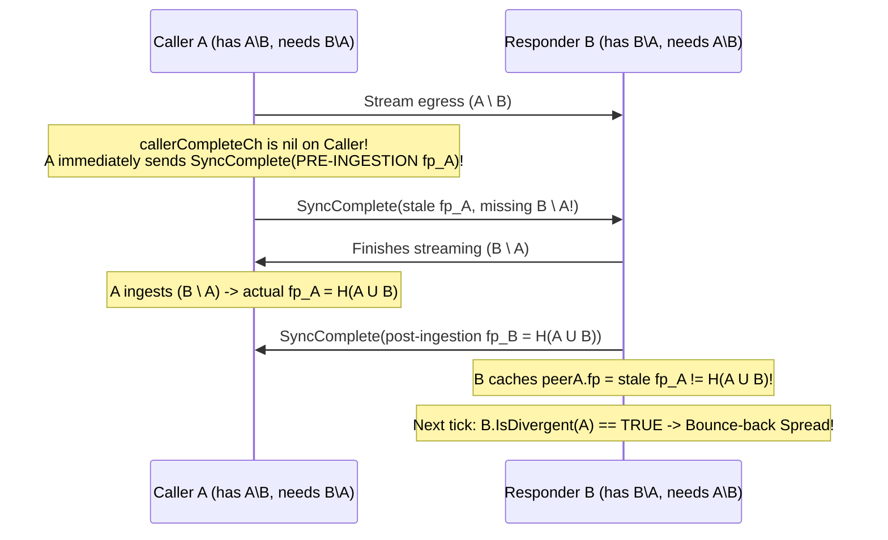

# Phase B Architectural & Security Audit Report

## 1. Executive Summary & Progress Feedback

Over the past 18 commits on `monster-refactor` (`3d502a1..4c09549`), including [`AdversarialPolicy`](file:///home/eikj/repos/ifrit/core/adversary.go) (`ba26e3f`) and wrapper cleanups (`1a7501c`, `4c09549`), the codebase has made **substantial structural progress** toward turning Ifrit into a modular, streaming-first Fireflies implementation:

| Plan Milestone ([plan-phaseB-bulk-streaming.md](file:///home/eikj/repos/ifrit/doc/agent-plans/plan-phaseB-bulk-streaming.md)) | Status | Assessment |
| :--- | :--- | :--- |
| **Step B.0 — Legacy Purge, B1 Tie-Breaker & B5 Telemetry** | **~90% Complete** | Monolithic `handlers.go` cleanly decomposed into [handlers.go](file:///home/eikj/repos/ifrit/core/handlers.go), [peer_admission.go](file:///home/eikj/repos/ifrit/core/peer_admission.go), [spread_digest_reconciliation_helpers.go](file:///home/eikj/repos/ifrit/core/spread_digest_reconciliation_helpers.go), [eval_control_helpers.go](file:///home/eikj/repos/ifrit/core/eval_control_helpers.go), and [control_validators.go](file:///home/eikj/repos/ifrit/core/control_validators.go). `seq`-gated [`PeerReconcileSession`](file:///home/eikj/repos/ifrit/core/reconciliation_session_manager.go#L336-L575) + `remoteID < selfID` tie-breaker (`B1`), [`promotePendingAccusationsForPeer`](file:///home/eikj/repos/ifrit/core/eval_control_helpers.go#L256-L293), and rebuttal telemetry fix (`B5`) are all solid and passing under `-race`. |
| **Step B.1 — `ItemCodec[T]`, `DefaultHasher` & `DataReconciler`** | **Complete (Exceeded Plan)** | [`DefaultHasher`](file:///home/eikj/repos/ifrit/reverseindexstore/digest_set.go#L30-L115) not only added zero-alloc truncated SHA-256 for `[]byte`, it eliminated silent `json.Marshal` fallbacks on arbitrary structs via `ErrUnhashableType`. [reconcilable_store_interface.go](file:///home/eikj/repos/ifrit/core/reconcilable_store_interface.go) cleanly verifies `actual == expected` digests prior to store insertion. |
| **Step B.2 — `rpc Sync` Wire Model & Stream Telemetry** | **Complete** | [gossip.proto](file:///home/eikj/repos/ifrit/protobuf/gossip.proto#L8) reserves removed fields safely and adds `SyncFrame`; stream telemetry interceptors are wired in [telemetry_interceptor_grpc.go](file:///home/eikj/repos/ifrit/comm/telemetry_interceptor_grpc.go#L252-L429). |
| **Step B.3 — Bidirectional `Sync` Engine & Bootstrap** | **Functional Baseline (Needs B3/B4 Hardening)** | [sync.go](file:///home/eikj/repos/ifrit/core/sync.go) and [sync_convergence_test.go](file:///home/eikj/repos/ifrit/core/sync_convergence_test.go) prove happy-path 2-node convergence and cold peer integration, and [examples/http_dissemination](file:///home/eikj/repos/ifrit/examples/http_dissemination/app.go) validates multi-node HTTP dissemination. **However, critical security, quiescence, and head-of-line blocking bugs remain in `B3` and `B4` (detailed in §2).** |
| **Strategic Goal — Pluggable Set Reconciliation** | **Blocked for Non-Naive (`riblt` / MTZ)** | Registry exists, **but `"riblt"` silently fails on live nodes** because Phase 1 `Spread` only exchanges raw `[]uint64` slices rather than coded symbols (§3.1). |
| **Strategic Goal — Byzantine Testability** | **In Progress (WIP)** | Replacing `protocol` with [`AdversarialPolicy`](file:///home/eikj/repos/ifrit/core/adversary.go#L15-L35) is the right design, but needs seeded determinism, wired aggressive-accuser & stream-corruption hooks, and fixes for two **severe Byzantine protocol vulnerabilities** (§2.1 & §3.2). |
| **Strategic Goal — Application Ergonomics** | **Good Core, Sharp Edges** | Generic store/codec API is clean, but [`Node.sendMsg`](file:///home/eikj/repos/ifrit/core/node.go#L530-L546) has a worker-deadlocking bug on error, and `NewClient` is tightly coupled to global `viper` disk files (§3.3). |

---

## 2. Deep-Dive Audit: Blockers B3 & B4 (Immediate Milestone)

Your instinct to pause and harden **B3 (Unsolicited Digest Injection)** and **B4 (Head-of-Line Blocking)** before running the Paragraph 5 test campaigns is spot-on. Below are the exact bugs uncovered in the current implementation that would either break Campaign C1–C5 assertions or expose honest nodes to trivial Byzantine attacks.

### 2.1 Blocker B3 — Ingress Validation, Framing & Byzantine Store Poisoning

> [!CAUTION]
> **Critical Vulnerability B3.1 — Empty `expectedData` Bypass in [`recvIngress`](file:///home/eikj/repos/ifrit/core/sync.go#L510-L520)**
> Look at lines 513–517 of [sync.go](file:///home/eikj/repos/ifrit/core/sync.go#L510-L520):
> ```go
> if len(expectedData) > 0 {
>     if _, ok := expectedData[curDataDigest]; !ok {
>         return nil, fmt.Errorf("%w: %016x", ErrUnexpectedDigest, curDataDigest)
>     }
> }
> ```
> Because of `if len(expectedData) > 0`, **whenever `expectedData` is empty, allowlist enforcement turns off completely!**
> 1. If Phase 1 negotiated `0` data items for this direction (e.g., control-only sync or one-way $A \to B$ data sync), the remote peer can push **unlimited unrequested data items** directly into the victim's `ReverseIndexStore`.
> 2. Even when Phase 1 negotiated $K > 0$ data items, line 541 executes `delete(expectedData, curDataDigest)` after each item. Once the $K$-th legitimate item is ingested, `len(expectedData)` reaches `0`, and items $K+1, K+2, \dots$ **bypass the allowlist check completely**!
>
> **Fix**: Remove the outer `if len(expectedData) > 0` wrapper unconditionally: if `_, ok := expectedData[curDataDigest]; !ok`, always reject with `ErrUnexpectedDigest` (which also automatically catches duplicate digests because `delete(expectedData, d)` removes each digest upon first receipt).

> [!CAUTION]
> **Critical Vulnerability B3.2 — Zero Allowlists on Control Batches & Lax Stream Framing ([sync.go](file:///home/eikj/repos/ifrit/core/sync.go#L498-L550))**
> 1. **Unchecked Control Batches**: [`recvIngress`](file:///home/eikj/repos/ifrit/core/sync.go#L498-L509) constructs `expectedData`, **but never checks `deltas.IngressCertificates(isCaller)`, `deltas.IngressNotes(isCaller)`, or `deltas.IngressAccusations(isCaller)`**. A peer can flood millions of unsolicited `CertificateBatch`, `NoteBatch`, or `AccusationBatch` items over an open `Sync` stream.
>    - **Fix**: Populate `expectedCerts`, `expectedNotes`, and `expectedAccs` maps from `deltas.Ingress*(isCaller)`. Before merging each incoming control item, compute its `DigestSymbol` (via `CertificateFromPb` / `NoteFromPb` / `AccusationFromPb` + store `Digest()`), reject with `ErrUnexpectedDigest` if absent, and `delete` from the allowlist map so duplicates are also rejected.
> 2. **Malformed Data Framing State Machine**:
>    - Sending `DataHeader(d2)` while `hasActiveData == true` (missing `DataEnd(d1)`) silently resets `curDataBuf` instead of aborting.
>    - Sending `DataChunk` or `DataEnd` when `!hasActiveData` is silently ignored instead of aborting with a framing error.
>    - Receiving `io.EOF` before `SyncComplete` or while `hasActiveData == true` returns `(nil, nil)` instead of `io.ErrUnexpectedEOF`, causing [`executeBidirectionalSync`](file:///home/eikj/repos/ifrit/core/sync.go#L242) to call `CompleteTransfer(seq)` on a truncated stream.
>    - Declare `DataItemHeader.TotalSize` check upfront: if `cfg.MaxItemBytes > 0 && p.DataHeader.GetTotalSize() > cfg.MaxItemBytes`, reject immediately on the header before buffering a single chunk.

> [!CAUTION]
> **Critical Vulnerability B3.3 — "Tier 1 Unconditional Raw Ingestion" Enables Digest-Squatting Blackholes & Epidemic DoS**
> Look at [`mergeNotes`](file:///home/eikj/repos/ifrit/core/eval_control_helpers.go#L16-L23), [`mergeAccusations`](file:///home/eikj/repos/ifrit/core/eval_control_helpers.go#L43-L50), [`mergeCertificates`](file:///home/eikj/repos/ifrit/core/eval_control_helpers.go#L90-L93), and [`admitCaller`](file:///home/eikj/repos/ifrit/core/peer_admission.go#L14-L19), paired with [`Note.CryptographicIdentity`](file:///home/eikj/repos/ifrit/core/discovery/note.go#L19-L21) and [`Accusation.CryptographicIdentity`](file:///home/eikj/repos/ifrit/core/discovery/accusation.go#L27-L29):
> - `Note.CryptographicIdentity()` hashes **only** `"id:epoch:mask"` (**excluding** the ECDSA signature), and [`digestSet.Insert`](file:///home/eikj/repos/ifrit/reverseindexstore/digest_set.go#L168-L170) is first-write-wins (`if _, exists := s.itemsByDigest[d]; exists { return d, false }`).
> - **Attack Trace (Deterministic Eviction of Any Honest Node)**:
>   1. Honest node $H$ is at `(epoch=1, mask=0b111)`. Byzantine node $M$ predicts that when $H$ is accused on Ring 1, $H$'s rebuttal will be `(id=H, epoch=2, mask=0b110)`.
>   2. $M$ sends an **unsigned / garbage-signed** `Note(id=H, epoch=2, mask=0b110, sig=BAD)` (e.g., via `Spread.OwnNote` in [`admitCaller`](file:///home/eikj/repos/ifrit/core/peer_admission.go#L15-L19), which doesn't even check `OwnNote.Id == remoteId` before `NoteStore().Insert`!).
>   3. Tier 1 inserts the forged note at digest $d = H(\text{"H:2:6"})$ into `NoteStore` and XORs $d$ into `ViewFingerprint`. Tier 2 rejects the signature, so `activeNotes[H]` stays at epoch `1`.
>   4. $M$ now accuses $H$ on Ring 1. Honest node $H$ signs its genuine rebuttal `Note(id=H, epoch=2, mask=0b110, sig=VALID)` — **which has the exact same digest $d$**!
>   5. Because every poisoned node already has digest $d$ in `NoteStore` (and refuses to overwrite `itemsByDigest[d]`), **set reconciliation never requests $H$'s rebuttal, direct neighbours never overwrite the garbage entry in `NoteStore`, $H$'s $2\Delta$ timer expires, and honest node $H$ is evicted across the overlay!**
>   6. Identically, pre-inserting a garbage-signed `Accusation(accused=X, accuser=HonestMonitor, ring=1, epoch=1, sig=BAD)` squats on the digest of `HonestMonitor`'s real accusation, **blinding failure detection when `X` crashes**; and flooding random bytes into Tier 1 forces honest nodes to store and epidemically replicate unbounded attacker garbage forever (directly violating [johansen2015fireflies.pdf](file:///home/eikj/repos/ifrit/.agents/resources/johansen2015fireflies.pdf) §6.2, p. 5:18: *"correct members should simply discard any unverifiable or invalid data they receive"*).
>
> **Engineering Fix (Preserving XOR Convergence Without Poisoning)**:
> 1. **Certificates**: Always run [`validateCertificate`](file:///home/eikj/repos/ifrit/core/control_validators.go#L18-L38) (CA signature check — zero causal dependencies!) **before** inserting into `CertStore`.
> 2. **`admitCaller`**: Validate `cert` first, verify `string(ownNote.GetId()) == remoteId`, and never insert `ownNote` into `NoteStore` before `evalNote` verifies its mask and ECDSA signature.
> 3. **Notes & Accusations**: Never insert an item into `NoteStore` or `AccusationStore` unless its mask/ring bounds AND **cryptographic ECDSA signature** pass against the admitted `Peer`'s public key! (Note: historical superseded epochs `epoch <= activeNote.epoch` still have valid ECDSA signatures from `Peer(id)` and valid masks, so verifying signature + mask before `NoteStore.Insert` / `AccusationStore.Insert` keeps historical grow-only XOR fingerprints 100% convergent across honest nodes while rejecting 100% of forged/unverifiable items! And because `Sync` streams `Certs -> Notes -> Accusations`, `Peer(signer)` is already admitted before `Notes` and `Accusations` are evaluated.)

> [!CAUTION]
> **Critical Vulnerability B3.4 — Fireflies Rule 6 Mask Upper-Bit Bypass in [`validMask`](file:///home/eikj/repos/ifrit/core/discovery/view.go#L1035-L1044)**
> Look at [`validMask`](file:///home/eikj/repos/ifrit/core/discovery/view.go#L1035-L1044):
> ```go
> func validMask(mask, numRings, maxByz uint32) error {
>     active := bits.OnesCount32(mask)
>     disabled := int(numRings) - active
>     if disabled > int(maxByz) {
>         return errTooManyDeactivatedRings
>     }
>     return nil
> }
> ```
> With `numRings = 3` (`maxByz = 1`), a Byzantine node crafting `mask = 0xFFFFFFF8` sets bits `0..2` to `0` (**all 3 rings disabled!**) and unused upper bits `3..31` to `1`. `OnesCount32` returns `29`, `disabled = 3 - 29 = -26 <= 1`, [`validMask`](file:///home/eikj/repos/ifrit/core/discovery/view.go#L1035) accepts the note, and [`IsRingDisabled`](file:///home/eikj/repos/ifrit/core/discovery/note.go#L23-L33) treats all 3 rings as disabled—rendering the Byzantine node **completely immune to accusations on every ring** (violating Rule 6 in [johansen2015fireflies.pdf](file:///home/eikj/repos/ifrit/.agents/resources/johansen2015fireflies.pdf) §3.4, p. 5:8).
>
> **Fix**:
> 1. Enforce `1 <= numRings && numRings <= 32` in [`NewView`](file:///home/eikj/repos/ifrit/core/discovery/view.go#L206-L208) (`Note.mask` is `uint32`, where `setBit(mask, i)` overflows to `0` for `i >= 32`).
> 2. Reject masks with any set bit at index $\ge \text{numRings}$ in [`validMask`](file:///home/eikj/repos/ifrit/core/discovery/view.go#L1035-L1044):
> ```go
> if numRings == 0 || numRings > 32 || (numRings < 32 && (mask>>numRings) != 0) {
>     return errInvalidMaskLength
> }
> ```
>
> **Adversarial Regression Test (`TestByzantine_MaskUpperBitImmunityBypass`)**:
> - Configure a `numRings = 3, maxByz = 1` cluster where a Byzantine peer $M$ drops UDP pongs (triggering a legitimate predecessor accusation) and uses [`AdversarialPolicy.OnRebuttal`](file:///home/eikj/repos/ifrit/core/adversary.go#L24) (and `OnGossipOut`) to broadcast a **cryptographically valid ECDSA-signed** `Note(id=M, epoch=2, mask=^uint32(0)<<numRings)` (`0xFFFFFFF8`).
> - Assert on all honest peers: (a) `evalNote` rejects the note with `errInvalidMask`, (b) `NoteStore` does **not** ingest the invalid note (`ViewFingerprint` unpolluted), (c) `ActiveNote(M)` remains at `epoch=1` with active rings intact, and (d) $M$ is evicted from `LiveMembers()` when the $2\Delta$ accusation timer expires.

---

### 2.2 Blocker B4 — Head-of-Line Blocking, Bounce-Back `Spread` & Teardown Leaks

#### Bug B4.1 — Responder `SyncComplete` Caches Stale Caller Fingerprints (Guaranteed Bounce-Back `Spread`!)
Look closely at the synchronization barrier in [`sendEgress`](file:///home/eikj/repos/ifrit/core/sync.go#L411-L445):



- Because Caller A sends `SyncComplete` at the end of `sendEgress` **before** `recvIngress` on Caller A has finished ingesting Responder B's items ($B \setminus A$), Responder B always records Caller A's *pre-sync* fingerprints whenever $B \setminus A \neq \emptyset$!
- In [`TestSync_BidirectionalMutualConvergence`](file:///home/eikj/repos/ifrit/core/sync_convergence_test.go#L260-L263), calling `nodeB.gossip()` on line 261 masked this bug by firing an extra bounce-back `Spread` RPC from B to A—which **will fail Campaign C2's Quiescence Gate** (`0` additional `Spread` RPCs over 5 ticks post-sync).
- **Clean Symmetric Fix**: Add an explicit `SyncItemsEnd` marker to `SyncFrame` (before `SyncComplete`):
  1. Both sides stream all egress batches/chunks, then send `SyncItemsEnd{}` (do **not** `CloseSend()` yet).
  2. Both sides' `recvIngress` loops ingest items until `SyncItemsEnd{}` arrives, then close a local `localIngressAppliedCh` barrier.
  3. Both sides wait on `<-localIngressAppliedCh`, compute their **true post-ingestion** `SyncComplete` fingerprints, send `SyncComplete`, and receive the peer's `SyncComplete` before closing. Neither side can deadlock, and both sides achieve 1-round quiescence across 2A, 2B, and 2C.

#### Bug B4.2 — Unbounded Sequential Unary RPCs Block `gossip()`, `rebuttal()`, and `Node.Stop()`
While Phase 2 (`Sync`) now spawns async goroutines via [`spawnSyncSession`](file:///home/eikj/repos/ifrit/core/sync.go#L64-L81), Phase 1 (`Spread`) and urgent rebuttals still suffer severe head-of-line blocking:
1. **No Per-RPC Timeout & No Shutdown Context on [`gRPCClient.Gossip`](file:///home/eikj/repos/ifrit/comm/client.go#L72-L85)**:
   `conn.Spread(context.Background(), args)` has **no deadline** and ignores `n.syncCtx`.
   - In [`Node.gossip()`](file:///home/eikj/repos/ifrit/core/protocol.go#L45-L69), if Neighbour 1 blackholes packets (e.g., Pumba pause/drop or Byzantine tarpit), `comm.Gossip` stalls `gossipLoop` for 90s+ (until TCP/HTTP2 keepalive), blocking Neighbour 2 and **starving all other rings**.
   - Worse, [`Node.rebuttal()`](file:///home/eikj/repos/ifrit/core/protocol.go#L11-L39) runs **synchronously inside `evalAccusation`** (`Sync` / `Spread` ingress) and loops sequentially over `neighbours` calling `comm.Gossip`. A single unresponsive or malicious tarpit neighbour stalls urgent rebuttals to honest neighbours past the $2\Delta$ crash-eviction window!
   - Worse still, in [`Node.Stop()`](file:///home/eikj/repos/ifrit/core/node.go#L604-L610), `n.wg.Wait()` executes **before** `n.comm.Stop()`. If `gossipLoop` is blocked inside `comm.Gossip(context.Background())`, `Node.Stop()` deadlocks forever!
2. **Sequential UDP Probes in [`Node.monitor()`](file:///home/eikj/repos/ifrit/core/protocol.go#L120-L126)**:
   Probing `ringsPingedPerInterval` targets sequentially multiplies worst-case `ping_timeout` (`3 * 5s = 15s`) instead of running bounded concurrent probes per tick.
3. **1-Ring-Per-Tick Idle Gossip Delay in [`View.GossipPartners()`](file:///home/eikj/repos/ifrit/core/discovery/view.go#L628-L634)**:
   If the single current ring's neighbours are `!IsDivergent(p)`, `gossip()` sleeps an entire `gossip_interval` (default `10s`) even when another ring has known divergent neighbours! Scanning up to `numRings` to pick the first ring with at least one `IsDivergent` partner (costing zero network I/O) eliminates wasted ticks.
4. **Fix**:
   - Pass `ctx context.Context` into `commService.Gossip(ctx, addr, state)` derived from `n.syncCtx` with a configurable `spread_timeout` (e.g., `5s` default).
   - Dispatch `rebuttal()` RPCs concurrently per neighbour with bounded timeout so a corrupt/dead neighbour can never delay honest rebuttals.

#### Bug B4.3 — `FingerprintData` `nil` vs `[8]byte{0..0}` Mismatch & Broken `entry_addrs` Bootstrap
1. **Empty Store Quiescence Loop**: [`Node.FingerprintData()`](file:///home/eikj/repos/ifrit/core/node.go#L301-L313) returns `nil` when no `DataReconciler` is registered, `[8]byte{0..0}` when an empty `DataReconciler` is registered, while a newly admitted `Peer` starts with `p.FingerprintData() == nil` and [`executeBidirectionalSync`](file:///home/eikj/repos/ifrit/core/sync.go#L231) guards `if len(fpData) > 0`. If one node registers an empty store (or none), `!bytes.Equal(nil, [8]byte{})` stays `true` forever! Canonicalizing `FingerprintData()` to always return an 8-byte big-endian `uint64` (`[8]byte{}` for `0`) makes empty and unregistered stores wire-identical.
2. **Missing `FingerprintCertificates` on [`Peer`](file:///home/eikj/repos/ifrit/core/discovery/peer.go#L51-L54)**: `ViewFingerprint` already XORs `noteStore.Fingerprint() ^ certStore.Fingerprint()` ([view.go:340](file:///home/eikj/repos/ifrit/core/discovery/view.go#L340)), which covers cert divergence, **except** in the rare XOR cancellation case where a cert change and note change cancel out. Either document that `ViewFingerprint` intentionally covers both or cache `fingerprintCerts` alongside `fingerprintView`.
3. **CA-less `entry_addrs` Bootstrap Broken in [`Node.Start()`](file:///home/eikj/repos/ifrit/core/node.go#L668-L698)**: Lines 669–672 send an empty `&pb.State{OwnNote: ...}` with **nil fingerprints**. Because `7d8826f` migrated [`handleNonNeighbourSpread`](file:///home/eikj/repos/ifrit/core/peer_admission.go#L73) to [`computeControlDeltas`](file:///home/eikj/repos/ifrit/core/spread_digest_reconciliation_helpers.go#L68-L79), which requires `hasFingerprints == true`, `reply` returns zero items and zero deltas—breaking CA-less bootstrap completely! Populate local fingerprints + cert/note digests on the bootstrap `pb.State` (just like `collectDigestDiffsForPeer`).

#### Bug B4.4 — Campaign C5 Readiness: `gRPCClient` Goroutine Leak & Default SQLite Contention
1. **Connection Leak on `Stop()`**: [`Comm.Stop()`](file:///home/eikj/repos/ifrit/comm/comm.go#L72-L79) stops the gRPC server (`c.s.stop()`), **but never closes cached client connections in [`gRPCClient.allConnections`](file:///home/eikj/repos/ifrit/comm/client.go#L27)**! Every dialled peer leaks HTTP/2 client goroutines after cluster teardown, which will fail Campaign C5's `runtime.NumGoroutine()` leak gate. Add `c.gRPCClient.CloseAll()` to `Comm.Stop()`.
2. **Default SQLite File Contention Across In-Process Nodes**: When `IFRIT_TELEMETRY_DB` is unset, [`getTelemetryDBPath()`](file:///home/eikj/repos/ifrit/comm/telemetry_interceptor_grpc.go#L431-L460) defaults to `/tmp/$USER/ifrit-experiments/telemetry_<host>.db` instead of disabled! Every node in a multi-node Go test opens and locks the **exact same SQLite file** on every 128 KB `SyncFrame` chunk (plus spawns a background `periodicCheckpoint` goroutine). Make SQLite telemetry **opt-in** (disabled unless `IFRIT_TELEMETRY_DB` is explicitly set to a path), and guard `s.remoteHost`/`s.remotePort` in [`telemetryClientStream.getRemote()`](file:///home/eikj/repos/ifrit/comm/telemetry_interceptor_grpc.go#L312-L320) with `sync.Once` to avoid a concurrent `SendMsg`/`RecvMsg` data race.
3. **Minor Leftover from Step B.0**: [`admitCaller`](file:///home/eikj/repos/ifrit/core/peer_admission.go#L27) still evaluates `if n.view.ShouldBeNeighbour(remoteId) || !wasObserved`, running ECDSA `CheckSignatureFrom(caCert)` on **every** inbound `Spread` RPC from an already-admitted neighbour; collapse to `if !wasObserved`.

---

## 3. Audit Against Your Three Strategic Architecture Goals

### 3.1 Pluggable Set Reconciliation (`naive`, `riblt`, MTZ / CPI)

> [!WARNING]
> **Enabling `reconciliation_strategy: "riblt"` Today Silently Produces Empty Diffs on Live Nodes**
> - [`RIBLTSession`](file:///home/eikj/repos/ifrit/core/reconciler_session_rateless_riblt.go#L176-L215) works in standalone unit tests when driven via `GenerateNextMessage()` / `ProcessIncomingMessage(codedSymbol)`.
> - However, [`Node.gossip()`](file:///home/eikj/repos/ifrit/core/spread_digest_reconciliation_helpers.go#L214-L242) and [`computeStoreDeltas`](file:///home/eikj/repos/ifrit/core/spread_digest_reconciliation_helpers.go#L108-L111) never call `GenerateNextMessage` or `ProcessIncomingMessage`! Instead, Caller sends raw `[]uint64` digests on `Spread`, and Responder calls `session.ProcessIncomingDigests(incomingSymbols)`.
> - In [`RIBLTSession.ProcessIncomingDigests`](file:///home/eikj/repos/ifrit/core/reconciler_session_rateless_riblt.go#L176-L180), it loops `s.decoder.AddSymbol(d)` (which tells `yangl1996/riblt` that *this local node already owns* `d`!) and never decodes—returning `nil` for both `LocalDigests()` and `RemoteDigests()`!
> - Additionally, [`NewTypedDataReconcilerWithCodec`](file:///home/eikj/repos/ifrit/core/reconcilable_store_interface.go#L293) snapshots `DefaultSessionConstructor[T]()` at store registration time, ignoring subsequent calls to [`Node.SetReconciliationProtocol`](file:///home/eikj/repos/ifrit/core/node.go#L479-L483).

**Architectural Recommendation to Make Reconciliation Truly Pluggable (RIBLT + MTZ + Naive)**:
Rateless IBLT (streaming coded symbols until peeling succeeds in $O(|A \triangle B|)$) and Minsky–Trachtenberg–Zippel partitioned polynomial reconciliation (used in [johansen2015fireflies.pdf](file:///home/eikj/repos/ifrit/.agents/resources/johansen2015fireflies.pdf) §6.3, p. 5:19, requiring $O(\log |S|)$ interactive rounds) **cannot fit inside a single unary `Spread` request/response**.
Because you already built the bidirectional `Sync` stream:
1. Keep unary `Spread` as a lightweight **4-fingerprint divergence & tie-break handshake** (or fast-path 1-round exchange for `"naive"`).
2. Add two protocol-agnostic reconciliation frames to `SyncFrame` (`ReconcileSketch{StoreType, Payload}` and `ReconcileSummary{StoreType, RequestedDigests, AvailableDigests}`) driven by a clean multi-round / rateless driver over `ReconcilerSession.GenerateNextMessage()` and `ProcessIncomingMessage()`.
3. Then `"naive"`, `"riblt"`, and future `"mtz"` plug into the exact same `Sync` engine without ever touching `gossip.proto` or `Node` transport code again!

---

### 3.2 Testability for Byzantine Behaviour ([core/adversary.go](file:///home/eikj/repos/ifrit/core/adversary.go) & Fireflies Paper Alignment)

Replacing the old `protocol` interface with [`AdversarialPolicy`](file:///home/eikj/repos/ifrit/core/adversary.go#L15-L35) is clean and idiomatic. To make Byzantine testing deterministic and expressive enough for both Fireflies paper attacks ([johansen2015fireflies.pdf](file:///home/eikj/repos/ifrit/.agents/resources/johansen2015fireflies.pdf) §5.4 & §7) and Campaign C1/C4:

1. **Deterministic Seeded PRNG**: [`adversary.go:45,58`](file:///home/eikj/repos/ifrit/core/adversary.go#L45-L60) uses global `math/rand.Uint32()`. Give `AdversarialPolicy` a mutex-guarded `*rand.Rand` initialized from an explicit `Seed int64` so any failing randomized Byzantine campaign is 100% replayable.
2. **Wire the Dead `OnMonitorProbe` Hook (Fireflies §7 "Aggressive Attack")**: [`OnMonitorProbe`](file:///home/eikj/repos/ifrit/core/adversary.go#L31) is defined on `AdversarialPolicy` but never invoked in [`Node.monitor()`](file:///home/eikj/repos/ifrit/core/protocol.go#L115-L166). Wiring it allows a corrupt predecessor to emit cryptographically valid false accusations against live successors on demand (forcing ring deactivation / mask updates per Rule 6–7).
3. **Add Stream-Level Byzantine Hook (`OnSyncEgress`)**: Adding `OnSyncFrameOut func(peer *discovery.Peer, frame *pb.SyncFrame) []*pb.SyncFrame` in [`sendEgress`](file:///home/eikj/repos/ifrit/core/sync.go#L248) unlocks **both**:
   - Fireflies §7 **"Passive / Withholding Attack"** (dropping `NoteBatch` or `AccusationBatch` frames so the attacker refuses to forward rebuttals or crash accusations), and
   - Campaign C1 **Byzantine Framing Faults** (injecting unrequested digests, flipping chunk bits, duplicating `DataItemHeader`, exceeding `MaxItemBytes`, or truncating before `DataItemEnd`) against real nodes over real mTLS!
4. **Mock / Malicious Crypto Hook (`backlog` L16–17)**: Because `Node` already depends on narrow [`cryptoService`](file:///home/eikj/repos/ifrit/core/node.go#L122-L125) and [`pingService`](file:///home/eikj/repos/ifrit/core/failure_detector.go#L24-L30) interfaces, exposing a small test wrapper around `cryptoService` (forging bad ECDSA `(r, s)` on Notes/Accusations/Pongs or signing with an untrusted CA) requires zero production-code bloat.
5. **Protocol Edge Case to Track — Fireflies Rule 8 Cascading Invalidation ([johansen2015fireflies.pdf](file:///home/eikj/repos/ifrit/.agents/resources/johansen2015fireflies.pdf) §3.5, p. 5:11)**: When a previously evicted peer $B$ recovers (or joins late) and enters `liveStore` via [`applyValidNote`](file:///home/eikj/repos/ifrit/core/eval_control_helpers.go#L223-L225), [`PromoteNote`](file:///home/eikj/repos/ifrit/core/discovery/view.go#L497) prunes accusations targeting $B$, **but does not re-check skipping accusations $A[G]_D$ against $B$'s ring successors $G$ that were made by lower-ranked predecessors $D$ while $B$ was absent**. Under churn + aggressive attackers, stale skipping accusations should be re-validated with `ValidAccuser` when ring membership grows.

---

### 3.3 Ergonomic Application Programmer Interface ([client.go](file:///home/eikj/repos/ifrit/client.go))

1. **Bug Fix — Worker-Starving Fallthrough in [`Node.sendMsg`](file:///home/eikj/repos/ifrit/core/node.go#L530-L546)**:
   In [`sendMsg`](file:///home/eikj/repos/ifrit/core/node.go#L532-L545), `return` on line 536 and `defer close(ch)` on line 531 are commented out! When `n.comm.Send` returns an error (`reply == nil`), `sendMsg` pushes `nil` into the 1-buffered channel `ch`, falls through, overwrites `err = nil` because `reply.GetError() == ""`, and **blocks forever** on the second channel send `ch <- &Message{...}`—permanently leaking a `dispatcher` worker! Uncomment `defer close(ch)` and `return` (or send `&Message{Error: err}`).
2. **Decouple [`ifrit.NewClient`](file:///home/eikj/repos/ifrit/client.go#L48-L59) from Mandatory `viper` Config Files & Disk Writes**:
   Currently, `readConfig()` errors out if no `ifrit_config.yaml` exists on disk and calls `viper.SafeWriteConfig()` (mutating the filesystem!). Notice how [examples/http_dissemination/app.go](file:///home/eikj/repos/ifrit/examples/http_dissemination/app.go#L87-L112) had to synthesize temp YAML files and mutate process-global `IFRIT_CONFIG` env vars just to boot a node. Adding optional fields (or functional options `WithCAAddr`, `WithGossipInterval`, `WithReconciliationStrategy`, `WithSyncConfig`) on [`ifrit.Config`](file:///home/eikj/repos/ifrit/client.go#L23-L39)—falling back to `viper` only when requested—will make embedding Ifrit in Go applications and running 64-node in-process test campaigns dramatically cleaner.
3. **Remove the X.509 `TCPPort < UDPPort` Operational Landmine ([client.go](file:///home/eikj/repos/ifrit/client.go#L82-L99))**:
   Because ASN.1 `SET OF` sorts `Subject.Locality` strings lexicographically, `NewClient` currently rejects valid fixed port pairs whenever `tcpAddr >= udpAddr` (note also `"127.0.0.1:10000" < "127.0.0.1:9000"` lexicographically!). Tagging `Locality` entries with explicit scheme prefixes (`"http:..."`, `"rpc:..."`, `"udp:..."`) makes decoding order-independent for all port numbers.
4. **Optional Reactive Store / Membership Callbacks**:
   Exposing an optional `OnItemIngested func(digest uint64, item T)` option on `RegisterDataStore` (and `OnMemberChange` on `Client`) lets applications react to disseminated updates immediately without polling `store.Elements()`.

---

## 4. Resolved Architectural Decisions & Reference Roadmap

The following design choices are recorded for reference prior to running the Paragraph 5 test campaigns:

- **Pre-Store Cryptographic & Mask Gate (`B3.3`, `B3.4`)**: Gate `CertStore`, `NoteStore`, and `AccusationStore` insertions on CA/ECDSA signature verification and upper-bit-safe mask validation so unverifiable items can never squat on digests or pollute grow-only XOR fingerprints (aligning with [johansen2015fireflies.pdf](file:///home/eikj/repos/ifrit/.agents/resources/johansen2015fireflies.pdf) §3.4 Rule 6 and §6.2).
- **Two-Barrier `SyncItemsEnd` → `SyncComplete` Framing (`B4.1`)**: Introduce an explicit `SyncItemsEnd` marker before `SyncComplete` on `SyncFrame` so both Caller and Responder compute and exchange **post-ingestion** fingerprints, guaranteeing single-round quiescence with zero bounce-back `Spread` RPCs.
- **Streaming `ReconcilerSession` (`"riblt"`) Over `Sync` (§3.1)**: Wire coded-symbol negotiation frames (`ReconcileSketch` / `ReconcileSummary`) over `SyncFrame` as Commit 4 **before** launching Campaigns C1–C5, so Campaign C3 validates both `"naive"` and `"riblt"` end-to-end.
- **Opt-In SQLite Telemetry (`B4.4`)**: Keep SQLite RPC telemetry disabled unless `IFRIT_TELEMETRY_DB` is explicitly set to a file path, avoiding shared `/tmp` SQLite lock contention and background checkpoint goroutines during multi-node in-process tests.

### Recommended Commit Sequence (When Ready to Implement)

1. **Commit 1 — Deterministic & Stream-Aware `AdversarialPolicy`**:
   - Replace global `rand.Uint32()` in [core/adversary.go](file:///home/eikj/repos/ifrit/core/adversary.go) with a seeded, mutex-guarded `*rand.Rand`, wire `OnMonitorProbe` in [core/protocol.go](file:///home/eikj/repos/ifrit/core/protocol.go), and add `OnSyncFrameOut` hook support.
2. **Commit 2 — Harden Blocker B3 (Ingress Allowlists, Framing & Pre-Store Signature Verification)**:
   - Remove the `if len(expectedData) > 0` bypass in [`recvIngress`](file:///home/eikj/repos/ifrit/core/sync.go#L513), enforce session allowlists across `Certificates`, `Notes`, `Accusations`, and `Data`, tighten `DataHeader`/`DataChunk`/`DataEnd`/`EOF` state checks, enforce `1 <= numRings <= 32` in [`NewView`](file:///home/eikj/repos/ifrit/core/discovery/view.go#L206-L208) + upper-bit validation in [`validMask`](file:///home/eikj/repos/ifrit/core/discovery/view.go#L1035), require CA/ECDSA signature + mask validation **before** `CertStore`/`NoteStore`/`AccusationStore` insertion (closing B3.1–B3.4), and add `TestByzantine_MaskUpperBitImmunityBypass`.
3. **Commit 3 — Harden Blocker B4 (Two-Barrier `SyncComplete`, Context Timeouts & Leak-Free Teardown)**:
   - Add `SyncItemsEnd` before `SyncComplete` in [gossip.proto](file:///home/eikj/repos/ifrit/protobuf/gossip.proto) / [sync.go](file:///home/eikj/repos/ifrit/core/sync.go) so both Caller and Responder exchange **post-ingestion** fingerprints (0 bounce-back `Spread`s).
   - Add `ctx`-bounded `comm.Gossip` (`spread_timeout`), concurrent `rebuttal()` / `monitor()` fan-out, canonical 8-byte `FingerprintData()`, `entry_addrs` bootstrap fingerprints, `gRPCClient.CloseAll()` in `Comm.Stop()`, opt-in `IFRIT_TELEMETRY_DB` SQLite telemetry, and fix [`Node.sendMsg`](file:///home/eikj/repos/ifrit/core/node.go#L530-L546).
4. **Commit 4 — Wire Streaming `ReconcilerSession` (`riblt`) Over `Sync`**:
   - Route `"riblt"` (and future `"mtz"`) coded-symbol negotiation over `SyncFrame` so `reconciliation_strategy: "riblt"` genuinely reconciles in $O(|A \triangle B|)$ symbols end-to-end before launching Campaigns C1–C5.
