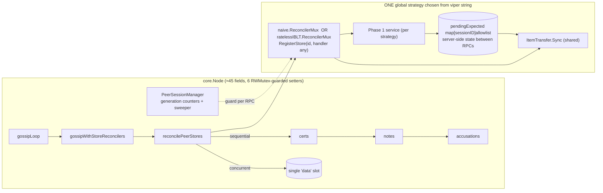
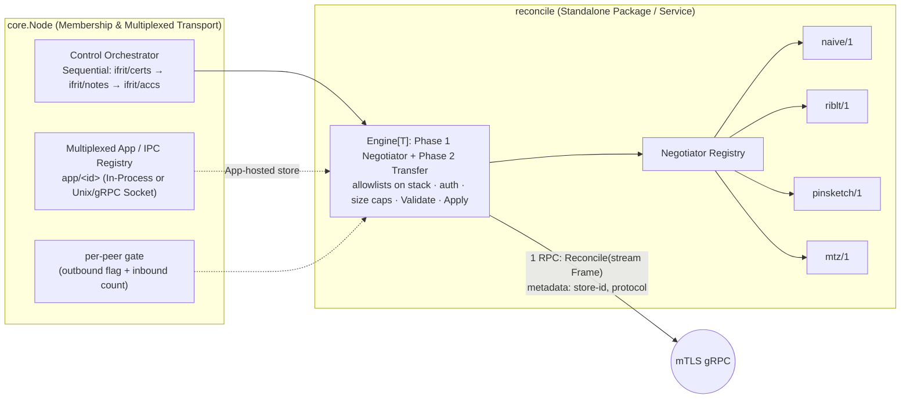

# Ifrit Simplification Audit (Finalized)

Scope: whole module at `05f5ba2`. Read in depth: `core/` (except `viz.go`), `reconcile/**`, `digestmaps/`, `comm/`, `client.go`, protos, `doc/`. Skimmed only: `core/discovery/ring.go` and the view timers/mask logic (paper-defined), `crypto/`, `experiments/`, `cmd/`.

Baseline: `go build ./...` and `go vet ./...` are clean. `go test ./...` passes everywhere except tests that need real DNS/sockets (`comm` `TestGetListener`/`TestListenUdp`, `examples/*` fail on `lookup sandbox` in the sandbox). Line counts and "≈ −N LOC" figures below are estimates.

---

## 1. Summary

The membership core (view, rings, notes, accusations, failure detector) is reasonably tight and its protocol logic should stay intact. The over-engineering is concentrated in the **reconciliation/transport layer** and in **configuration plumbing**—which are also the two places blocking your goals.

| Goal | Today | Verdict |
|---|---|---|
| Flexible reconciliation protocol | Each protocol re-implements reconciler + mux + session glue; strategy is a **global string** where anything ≠ `"naive"` silently means RIBLT; mixing strategies silently breaks | Not pluggable in practice |
| Several apps at once | Exactly **one** `"data"` slot in `core.Node`; one msg handler; one stream handler; second `RegisterDataStore` silently replaces the first | Not supported |
| Security | Phase 1 and Phase 2 are linked by a client-chosen session string and server-side map (cross-peer collisions, unbounded growth); no server-side bounds on inbound Phase 1; telemetry DB on by default | Several real issues; most disappear with the same refactor that gives pluggability |

**Core recommendation** (updated with your architectural decisions):

1. **Single bidirectional `Reconcile` RPC per `(peer, store)`**: Replace the three coupled gRPC services (`NaiveReconciler`/`Reconciler` + `ItemTransfer`) with one stream where Phase 1 is an opaque, multi-round protocol negotiation (`Negotiator`) and Phase 2 (validated item transfer) is written once.
2. **Protocol-agnostic `Negotiator` interface**: Supports 1-round (Naive, PinSketch), streaming rateless (RIBLT), and multi-round interactive tree-partitioning (Minsky–Trachtenberg–Zippel / CPI) without changing the wire service or Phase 2 engine (§3.1).
3. **Keep one built-in generic data store in `core.Node`, push arbitrary multi-app stores to external/IPC**: Keep Ifrit's built-in generic data store (`ifrit/data`) for node-level auxiliary state (e.g., certificate revocations/CRLs, node metrics) and as a built-in dissemination sanity check for experiments, while letting external applications host their own `reconcile` stores and multiplex over Ifrit's membership and messaging/IPC layer (§3.2).

Estimated net effect: **≈ −600 to −900 production LOC** across `reconcile/`, `core/`, `comm/`, with stronger security invariants and clean separation between membership and application state.

---

## 2. Current architecture and where it hurts



The pain points, in order of leverage:

- **Cross-RPC server state.** Phase 1 writes an allowlist into `pendingExpected`; Phase 2 reads it by a client-supplied string. This is both the source of the biggest security finding (S1) and the reason the whole `session-id` / `RecordExpected` / `PopExpected` machinery exists.
- **Per-RPC gating.** `inboundStreamGuard` acquires the peer gate separately for Phase 1 and for Phase 2. Between them the node can start its own outbound round, and the tie-breaker can then abort Phase 2 after Phase 1 succeeded (wasted work, leaked allowlist).
- **Duplication per protocol.** `naive` and `ratelessIBLT` each carry their own `Reconciler`, `ReconcilerMux`, `RegisterStore(any)`, `SyncHandler()` and `ReconcileWithPeer`.
- **Application state coupled into `core.Node`.** `core.Node` embeds a single `dataStoreReconciler` slot alongside Fireflies control stores.
- **Global singletons.** `viper` is read directly from `NewNode`, `NewView` and `comm`. The example app has to write a temp YAML file and `os.Setenv` to boot a node ([app.go L87–112](file:///home/uit-eindride/repos/master-thesis/fireflies/ifrit/examples/http_dissemination/app.go#L87-L112)).

---

## 3. Target design



```go
// reconcile: the ONLY thing a set reconciliation algorithm implements.
type Negotiator interface {
    Name() string // wire id, e.g. "riblt/1", "mtz/1", "pinsketch/1"
    Initiate(ctx context.Context, ch Channel, set Set) (Diff, error)
    Respond(ctx context.Context, ch Channel, set Set) (Diff, error)
}
type Channel interface {
    Send(payload []byte) error
    Recv() ([]byte, error)
}
type Set interface {
    Fingerprint() digestmaps.DigestSymbol
    DigestsCopy() []digestmaps.DigestSymbol
}
type Diff struct {
    Requested []digestmaps.DigestSymbol // A \ B: responder wants from initiator
    Available []digestmaps.DigestSymbol // B \ A: initiator wants from responder
    RemoteFP  []byte
}
```

### 3.1 How the single `Reconcile` RPC supports PinSketch, MTZ (CPI), Rateless IBLT, and newer protocols

A single bidirectional `Reconcile(stream Frame)` RPC where Phase 1 exchanges `Frame_Negotiate{ bytes payload }` via `Channel` and terminates as soon as `Initiate`/`Respond` returns `Diff` handles all major families of set reconciliation:

| Protocol Family | Phase 1 Interaction Pattern over `Channel` | Optional `Set` Fast-Path Interface |
|---|---|---|
| **Naive** (Full digest list) | **1-round streaming**: Initiator sends batched digests; Responder replies with $(A \setminus B, B \setminus A)$. | Base `Set` (`DigestsCopy()`) |
| **PinSketch / BCH Syndrome** (Dodis et al.) | **1-round fixed sketch**: Initiator sends $t$ power-sum syndrome symbols ($S_1, S_3, \dots, S_{2t-1}$) in $\mathbb{F}_{2^{64}}$; Responder subtracts local syndrome, finds roots of the error-locator polynomial (Berlekamp–Massey + Chien search). If $\lvert A \triangle B\rvert \le t$, Responder returns $(A \setminus B, B \setminus A)$ in 1 RTT; if capacity is exceeded, Responder sends a 1-byte `Fallback` token and switches to rateless/MTZ on the *same* open stream. | `SyndromeStore` (incrementally maintains $t$ syndrome words on `Insert`) |
| **Rateless IBLT** (Yang et al.) | **1.5-RTT prefix + rateless stream**: Initiator sends precomputed sketch prefix (or streams coded symbols); Responder peels difference and sends `Decoded` + diff pages as soon as peeling completes. | `SketchStore` (incrementally maintains fixed RIBLT sketch prefix) |
| **Minsky–Trachtenberg–Zippel (MTZ / CPI)** (used in Fireflies paper §6.3) | **Multi-round interactive bisection ($O(\log \lvert S\rvert)$ RTTs)**: Round 1 exchanges characteristic polynomial evaluations at $k$ points for the root key range $[0, 2^{64})$. When rational interpolation fails ($\lvert A \triangle B\rvert > m$), Responder replies with `Bisect` ranges; Initiator and Responder recursively exchange syndromes for active sub-intervals over `ch.Send`/`ch.Recv` until all leaf partitions decode cleanly. | `RangeEvalStore` (prefix-tree / B-tree caching polynomial evaluations per dyadic interval, or on-the-fly evaluation over sorted digests) |
| **KMW / LogLog / Hybrid Filter+Sketch** | **2-to-3 round adaptive**: Round 1 exchanges a compact cardinality estimator to size the exact sketch; Round 2 sends the sized sketch or Cuckoo/Bloom filter. | Base `Set` |

Because `Channel` is just an arbitrary sequence of message exchanges inside Phase 1 of the stream:
1. **Multi-round protocols (MTZ) never need new gRPC methods** or cross-RPC session maps—the recursive partition queue lives on the local call stack of `Initiate` and `Respond`.
2. **Phase 2 (item transfer, framing checks, size limits, digest verification, `Validate`, `Apply`) is 100% unchanged** regardless of which `Negotiator` produced the `Diff`.

### 3.2 Built-In Generic Data Store vs. External Application Multiplexing

Your point draws the exact right boundary between **what belongs inside `core.Node`** and **what applications should manage themselves**:

1. **Keep a built-in generic data store (`ifrit/data`) inside `core.Node`**:
   - Ifrit keeps its built-in generic data store (registered via `RegisterDataStore`) reconciled alongside the control stores (`ifrit/certs` → `ifrit/notes` → `ifrit/accs`, plus `ifrit/data`).
   - This serves two essential purposes without bloating `core.Node` into a multi-tenant database manager:
     1. **Protocol-adjacent / cluster-wide state**: Disseminating certificate revocations (CRLs), node health/telemetry summaries, or cluster configuration.
     2. **Dissemination sanity check & benchmarking**: Immediately verifying and benchmarking in tests and chaos experiments (like `examples/gossip` and `examples/http_dissemination`) that inserted items converge across all ring members.
   - Failure isolation fix (R5): If `ifrit/data` fails validation or isn't registered on a peer, `core.Node` still updates the peer's control fingerprints (`viewFP`, `accFP`) so Fireflies membership convergence is never blocked by data store errors.
2. **Do not make Ifrit responsible for managing every application's store**:
   - Instead of turning `core.Node` into a registry/scheduler for $N$ arbitrary application databases, **applications that want their own dedicated stores host them themselves** using the standalone `reconcile` package.
   - Ifrit provides the **membership view (`Members()`, ring neighbours) and multiplexed P2P messaging/streaming (`app_id`)** (in-process or over an IPC socket, tracked in `doc/backlog`), while each application owns its store lifecycle, validation rules, and reconciliation schedule.

---

## 4. Findings

Priority: **P0** do first / security-relevant, **P1** high leverage, **P2** worthwhile, **P3** cleanup.
Security column: ↑ improves, = neutral, ⚠ needs care when implementing.

### A. Reconciliation: pluggability and multiplexing

| ID | Pri | Finding and evidence | Proposal | Sec |
|---|---|---|---|---|
| **R1** | P1 | Phase 1 and Phase 2 are separate RPCs joined by a client-chosen `reconcile-session-id` and server map `pendingExpected` ([transfer.go L151, L216–239](file:///home/uit-eindride/repos/master-thesis/fireflies/ifrit/reconcile/transfer/transfer.go#L151)). The gate is taken per RPC ([control_reconcilers.go L172–198](file:///home/uit-eindride/repos/master-thesis/fireflies/ifrit/core/control_reconcilers.go#L172-L198)), so the tie-breaker can abort Phase 2 after Phase 1 succeeded. | One `Reconcile(stream Frame)` RPC per `(peer, store)`: `Negotiate{bytes}` → `Want` → `Header/Chunk/End` → `Complete`. Allowlists become local variables on the stack. Delete `session-id`, `RecordExpected/PopExpected`, `ItemTransferMux`. ≈ −250 LOC | ↑ (kills S1) |
| **R2** | P1 | `naive.Reconciler` and `ratelessIBLT.Reconciler` duplicate constructor, `SyncHandler`, mux, `RegisterStore`, `ReconcileWithPeer` ([naive L296–329](file:///home/uit-eindride/repos/master-thesis/fireflies/ifrit/reconcile/naive/reconcile_grpc.go#L296-L329) vs [riblt L272–305](file:///home/uit-eindride/repos/master-thesis/fireflies/ifrit/reconcile/ratelessIBLT/reconcile_grpc.go#L272-L305)). | `Negotiator` interface (§3.1) plus a registry. Naive becomes ~60 lines; RIBLT, PinSketch, or MTZ each become one self-contained file. Unknown protocol name fails at registration, not silently. | = |
| **R3** | P1 | `RegisterStore(storeID, handler any)` silently drops a handler that does not implement the mux's service ([naive L79–89](file:///home/uit-eindride/repos/master-thesis/fireflies/ifrit/reconcile/naive/reconcile_grpc.go#L79-L89), [riblt L99–110](file:///home/uit-eindride/repos/master-thesis/fireflies/ifrit/reconcile/ratelessIBLT/reconcile_grpc.go#L99-L110)); the node installs one mux from a global string ([L206–218](file:///home/uit-eindride/repos/master-thesis/fireflies/ifrit/core/control_reconcilers.go#L206-L218)). `ifrit.NewNaiveStore` / `NewReconcilableStoreWithStrategy` ([client.go L299–318](file:///home/uit-eindride/repos/master-thesis/fireflies/ifrit/client.go#L299-L318)) let an app pick a protocol ≠ node's; inbound Phase 1 for it then fails while outbound still dials. Also violates the repo's own "no `any`" rule. | Resolved by R1+R2: one service, handlers resolved by `(store-id, protocol name)`, typed. Strategy parse is strict (`"naive"`, `"riblt"`, etc.; else error). | ↑ |
| **R4** | P1 | **No application multiplexing.** `storeIDData = "data"` ([L31](file:///home/uit-eindride/repos/master-thesis/fireflies/ifrit/core/control_reconcilers.go#L31)), single `dataStoreReconciler` ([node.go L72](file:///home/uit-eindride/repos/master-thesis/fireflies/ifrit/core/node.go#L72)); `StoreMux.Register` overwrites silently ([transfer.go L52–56](file:///home/uit-eindride/repos/master-thesis/fireflies/ifrit/reconcile/transfer/transfer.go#L52-L56)). `msgHandler`/`streamHandler` are single slots too ([node.go L65–69](file:///home/uit-eindride/repos/master-thesis/fireflies/ifrit/core/node.go#L65-L69)), so two apps clobber each other's messaging as well. | Keep the built-in generic data store (`ifrit/data`) alongside control stores (`ifrit/certs`, `ifrit/notes`, `ifrit/accs`) for node-level state (CRLs, metrics, sanity checks). For multi-app support, multiplex messaging/streaming by `app_id` (validated `[a-z0-9._-]{1,64}`) and let apps attach their own `reconcile` stores (`app/<id>`) over the shared mTLS transport or via IPC sockets (§3.2). | ⚠ ids are attacker-influenced on the wire: map key only, length-capped |
| **R5** | P1 | `reconcilePeerStores` returns before updating **any** peer fingerprint if the data store fails ([L353–362](file:///home/uit-eindride/repos/master-thesis/fireflies/ifrit/core/control_reconcilers.go#L353-L362)). | Decouple control fingerprint updates (`viewFP`, `accFP`) from `dataFP` in `reconcilePeerStores`: always update `viewFP` and `accFP` as soon as `reconcileControlStores` succeeds, even if `ifrit/data` fails. External apps manage their own store fingerprints independently. | = |
| **R6** | P2 | Wrapper stores expose `Base()` ([riblt store.go L44](file:///home/uit-eindride/repos/master-thesis/fireflies/ifrit/reconcile/ratelessIBLT/store.go#L44), [naive store.go L29](file:///home/uit-eindride/repos/master-thesis/fireflies/ifrit/reconcile/naive/store.go#L29)); inserting via `Base()` desyncs the RIBLT sketch from the set (permanent mismatch). Embedded `Copy()` returns a plain set, silently dropping the sketch. | Remove `Base()`; override `Copy()`; make sketch capability an optional interface (`SketchStore` / `SyndromeStore`) checked by the negotiator. | ↑ |
| **R7** | P2 | `Detector.ValidateItem` + `Applier` + `OnMisbehavior`: every Applier error is reported as misbehaviour, so the control appliers swallow benign cases by returning `nil` ([L526, L565–572](file:///home/uit-eindride/repos/master-thesis/fireflies/ifrit/core/control_reconcilers.go#L526)), losing information. | Require an explicit `Validator` (providing `reconcile.AcceptAll[T]()` for stub validation when desired) and use a sentinel `reconcile.ErrIgnore` (benign/stale: skip item, keep session) vs fatal errors (abort + report). | = |

### B. Defects and hardening the refactor should absorb

None of these is a demonstrated integrity break: the digest recompute, validator and size checks in `recvSyncFrames` hold. They are resource-exhaustion, isolation and default-safety issues.

| ID | Pri | Finding and evidence | Fix | 
|---|---|---|---|
| **S1** | P0 | `pendingExpected` is keyed by session string only, not by authenticated peer; IDs are per-node counters (`rsess-%d`, `nsess-%d`), so **two peers both start at `…-1` and clobber each other's allowlist** (legit session then fails `ErrUnexpectedDigest` and is logged as misbehaviour). Entries are only removed when Phase 2 arrives; no TTL or cap, so an authenticated peer can add entries with fresh IDs indefinitely. | Structural fix is R1 (single stream keeps allowlist on the stack). |
| **S2** | P0 | **No server-side bounds on inbound Phase 1.** RIBLT `decodeRatelessFallback` loops `RecvCoded` into the decoder until it decodes ([reconcile_generics.go L270–285](file:///home/uit-eindride/repos/master-thesis/fireflies/ifrit/reconcile/ratelessIBLT/reconcile_generics.go#L270-L285)); naive grows `callerDigests` without limit ([naive L122–139](file:///home/uit-eindride/repos/master-thesis/fireflies/ifrit/reconcile/naive/reconcile_grpc.go#L122-L139)). `Timeout` is applied only on the initiator side (`ReconcileWithPeer`), so a malicious *initiator* gets no deadline. In Phase 2, each `WantDigests` frame spawns a goroutine ([transfer.go L338–349](file:///home/uit-eindride/repos/master-thesis/fireflies/ifrit/reconcile/transfer/transfer.go#L338-L349)) with no cap on frames or total digests. | Server-side deadline from `SyncConfig.Timeout`; caps on coded symbols (≈ $k \cdot (\lvert\text{local}\rvert+\text{MaxDelta})$) and digests per session; bound `Want` to the Phase-1 `available` set (trivial once R1 keeps it on the stack) and a per-session byte budget. Also check `buf.Len() == TotalSize` at `DataEnd`. |
| **S3** | P0 | **Telemetry is on by default.** With `IFRIT_TELEMETRY_DB` unset, `getTelemetryDBPath` falls back to `/tmp/$USER/ifrit-experiments/telemetry_<host>.db` ([L411–417](file:///home/uit-eindride/repos/master-thesis/fireflies/ifrit/comm/telemetry_interceptor_grpc.go#L411-L417)) and `NewComm` opens it ([comm.go L42](file:///home/uit-eindride/repos/master-thesis/fireflies/ifrit/comm/comm.go#L42)). Verified on this machine: `/tmp/uit-eindride/ifrit-experiments/` holds a **127 MB** DB created by test runs. | Make SQLite telemetry opt-in only (`IFRIT_TELEMETRY_DB` must be set explicitly) and move the SQLite logger implementation into `experiments/`, injecting `grpc.Unary/StreamInterceptor` into `comm`. |
| **S4** | P1 | Safe-by-accident defaults: `ConnFor` dials with `grpc.WithInsecure()` when no `ConnProvider`; `auth == nil` means unauthenticated handlers ([transfer.go L202–213, L325](file:///home/uit-eindride/repos/master-thesis/fireflies/ifrit/reconcile/transfer/transfer.go#L202-L213)). The node always injects both, but a standalone app composing `reconcile` directly gets plaintext + no auth silently. | Make both required (constructor error). Tests use an explicit `insecureConn` / `NoAuth` helper. |
| **S5** | P3 (Backlog) | Raw-store insertion happens **before** semantic validation for accusations ([L536 vs L564](file:///home/uit-eindride/repos/master-thesis/fireflies/ifrit/core/control_reconcilers.go#L536)), and stale notes are inserted before `HasNote` ([eval_control.go L214](file:///home/uit-eindride/repos/master-thesis/fireflies/ifrit/core/eval_control.go#L214), again at [L230](file:///home/uit-eindride/repos/master-thesis/fireflies/ifrit/core/eval_control.go#L230)). This is the documented "grow-only raw storage" invariant ([plan doc](file:///home/uit-eindride/repos/master-thesis/fireflies/ifrit/doc/agent-plans/version-vector-redir-layer-refactor.md)) that lets fingerprints converge. | **Resolved (Future Work)**: Keep the grow-only invariant for the thesis codebase; state snapshotting + deterministic garbage collection has been recorded in [doc/backlog](file:///home/uit-eindride/repos/master-thesis/fireflies/ifrit/doc/backlog#L56-L60). |
| **S6** | P2 | Notes and accusations are signature-verified **twice** on the reconcile path (detector, then `evalNote`/`evalAccusation`) ([L437–457](file:///home/uit-eindride/repos/master-thesis/fireflies/ifrit/core/control_reconcilers.go#L437-L457) + [eval_control.go L208, L452](file:///home/uit-eindride/repos/master-thesis/fireflies/ifrit/core/eval_control.go#L208)). ECDSA verify is the dominant per-item CPU cost, and two copies of the rules invite drift. | Unify into `admit*` (C2). |
| **S7** | P2 | Items are identified by a 64-bit digest; default hashers use FNV-1a for `string` and `ID()` ([digest_set.go L53–58, L104–111](file:///home/uit-eindride/repos/master-thesis/fireflies/ifrit/digestmaps/digest_set.go#L53-L58)). An authenticated peer can craft a different item with the same FNV-1a digest. Control items use SHA-256 (`CryptographicIdentity`), but **apps using `string` or `ID()` get FNV-1a**. | Default to truncated SHA-256 (or SipHash) for all default hashers in `digestmaps`. |
| **S8** | P2 | `marshalWithoutSignature` mutates the incoming protobuf (`m.Signature = nil`, deferred restore) ([eval_control.go L476–499](file:///home/uit-eindride/repos/master-thesis/fireflies/ifrit/core/eval_control.go#L476-L499)). Fragile if a message is ever shared across goroutines. | Marshal a shallow copy with `Signature: nil` instead of mutating in place. |
| **S9** | P2 | Dependency age: `google.golang.org/grpc v1.29.1` (2020) and `golang/protobuf v1.4.2`. | Bump as an isolated PR before the larger refactor. |
| **S10** | P2 | No-CA mode: server uses `RequestClientCert`, client uses `InsecureSkipVerify` ([comm.go L158](file:///home/uit-eindride/repos/master-thesis/fireflies/ifrit/comm/comm.go#L158)); `Stream` never calls `validateCtx` and `Messenger` only checks a cert exists. | Gate no-CA mode behind an explicit dev flag; call one `authenticatePeer(ctx)` helper from every handler. |

Carry-overs from [audit-phaseB](file:///home/uit-eindride/repos/master-thesis/fireflies/ifrit/doc/agent-plans/audit-phaseB-bulk-streaming.md) re-verified as **still open**: `Node.sendMsg` falls through after an error and sends twice ([node.go L424–440](file:///home/uit-eindride/repos/master-thesis/fireflies/ifrit/core/node.go#L424-L440)); `comm` RPCs use `context.Background()` with no deadline ([client.go L79, L93, L112](file:///home/uit-eindride/repos/master-thesis/fireflies/ifrit/comm/client.go#L79)); no `CloseAll()` for pooled connections on `Stop()`; `TCPPort < UDPPort` lexicographic landmine ([client.go L88–113](file:///home/uit-eindride/repos/master-thesis/fireflies/ifrit/client.go#L88-L113)).

### C. Core simplifications

| ID | Pri | Finding and evidence | Proposal |
|---|---|---|---|
| **C1** | P2 | `PeerSessionManager` is 247 lines: generation counters, `lastActivity`, a stale sweeper, refcounted inbound, never-pruned map ([file](file:///home/uit-eindride/repos/master-thesis/fireflies/ifrit/core/reconciliation_session_manager.go)). Every acquire already has a `defer` release and every session is bounded by a context timeout. The crossed-wires tie-breaker itself **is** worth keeping. | Per-peer gate: `outbound bool` + `inbound int` under one mutex, same tie-break rule (lower id wins), pruned on peer removal. ≈ 50 lines (−190). With R1 each store reconciliation is a single stream (`certs` → `notes` → `accs`). |
| **C2** | P1 | Three parallel validate-and-apply implementations for the same three item types: Spread path (`mergeNotes`/`mergeAccusations`/`mergeCertificates`, [eval_control.go L23–131](file:///home/uit-eindride/repos/master-thesis/fireflies/ifrit/core/eval_control.go#L23-L131)), control detectors ([L411–494](file:///home/uit-eindride/repos/master-thesis/fireflies/ifrit/core/control_reconcilers.go#L411-L494)), control appliers ([L496–576](file:///home/uit-eindride/repos/master-thesis/fireflies/ifrit/core/control_reconcilers.go#L496-L576)). `mergeNotes` and `mergeCertificates` have **no production callers** (tests only). | `core/admit.go`: `admitCert`, `admitNote`, `admitAccusation`. Control stores use `admit*` as the single handler; no separate detector/applier split. Fixes S6 and S8. ≈ −150 LOC. Existing `eval_control_test.go` (743 lines) is the safety net. |
| **C3** | P1 | Fingerprint plumbing: `FingerprintData()` has two sources of truth (`SetFingerprintData` override vs. store) ([node_store_helpers.go L14–37](file:///home/uit-eindride/repos/master-thesis/fireflies/ifrit/core/node_store_helpers.go#L14-L37)); `pingService` is wired through **optional anonymous interfaces** with a legacy fallback ([node.go L204–216](file:///home/uit-eindride/repos/master-thesis/fireflies/ifrit/core/node.go#L204-L216)); `UDPServer` has 3 providers × (setter + mutex) + 3 static setters + 2 legacy ([udp.go L154–220](file:///home/uit-eindride/repos/master-thesis/fireflies/ifrit/comm/udp.go#L154-L220)). `State.fingerprint_*` and `StateResponse.fingerprint_*` are populated by the server but **never read by any client code** ([handlers.go L62–98](file:///home/uit-eindride/repos/master-thesis/fireflies/ifrit/core/handlers.go#L62-L98)). | Put `SetFingerprints(func() Fingerprints)` in the `pingService` interface (compile-time checked); one provider, one RWMutex. Remove the override API and the unused `*DigestsUint64` helpers. Since greenfield wire changes are allowed, delete the dead fingerprint fields directly from `pb.State` and `pb.StateResponse`. |
| **C4** | P2 | `SyncConfig` has two deprecated no-op fields ([L102–104](file:///home/uit-eindride/repos/master-thesis/fireflies/ifrit/core/control_reconcilers.go#L102-L104)). `SetSyncConfig` after construction is a **silent no-op** for already-built reconcilers. `SetControlReconcilerHooks` is exported but used only by one test and re-registers over the mux. | Immutable options at construction; delete the deprecated fields and both setters. |
| **C5** | P2 | `Node` is a ~45-field god object with six independent RW-mutex setters (`msgHandler`, `streamHandler`, `adversary`, `syncConfig`, `gossipTimeout`, `dataReconciler`) and a six-field lifecycle (`exitFlag/exitMutex/exitChan/startedChan/startCalled/startMutex`). `setGossipTimeout` is unused. | Settings immutable after `NewNode`; lifecycle via one `context.Context` + `sync.Once`; split into membership / control-replicator / messaging structs. |
| **C6** | P1 | `viper` read directly in `NewNode` ([L133–185](file:///home/uit-eindride/repos/master-thesis/fireflies/ifrit/core/node.go#L133-L185)), `NewView` ([L141–146](file:///home/uit-eindride/repos/master-thesis/fireflies/ifrit/core/discovery/view.go#L141-L146)) and `comm/client.go` ([L61](file:///home/uit-eindride/repos/master-thesis/fireflies/ifrit/comm/client.go#L61)). `readConfig` fails without a file and then calls `viper.SafeWriteConfig()` ([client.go L425](file:///home/uit-eindride/repos/master-thesis/fireflies/ifrit/client.go#L425)). | Typed, validated `core.Options` with defaults, built once in `ifrit.NewClient`; `viper` only in an optional config loader; `ifrit.Config` gains direct fields/options. The example app then needs no temp YAML. |
| **C7** | P3 | `comm` offers two registration APIs: `RegisterService` and `RegisterGRPC(func(*grpc.Server))` ([comm.go L75–85](file:///home/uit-eindride/repos/master-thesis/fireflies/ifrit/comm/comm.go#L75-L85)); `commService` is wide ([node.go L102–115](file:///home/uit-eindride/repos/master-thesis/fireflies/ifrit/core/node.go#L102-L115)). | Keep `grpc.ServiceRegistrar` only (`RegisterService`). Under R1 the node registers `Gossip` and `Reconcile`. |

### D. Layering and packaging

| ID | Pri | Finding | Proposal |
|---|---|---|---|
| **L1** | P1 | `comm` (transport) imports `reconcile/transfer/proto` and `go-sqlite3` ([telemetry_interceptor_grpc.go L25–27](file:///home/uit-eindride/repos/master-thesis/fireflies/ifrit/comm/telemetry_interceptor_grpc.go#L25-L27)). Adding a protocol means touching transport telemetry. | Move SQLite telemetry logger into `experiments/` and pass gRPC interceptors into `comm` as options (per your comment). |
| **L2** | P2 | `worm/`, `bootstrap/`, `cmd/bootstrapper` (stale: unused `gossipHandler`, `mustGetEnvInt`), `experiments/observer` (cilium/ebpf + CGO sqlite) share the library's `go.mod`, so every consumer inherits `cilium/ebpf`, `go-sqlite3`, `gorilla/mux`, `rs/cors`, `configor`, `workerpool`. | Separate module (`go.work`) for `experiments/` (including telemetry and eBPF observer); archive `worm`/`bootstrap` if superseded. |
| **L3** | P3 | `AdversarialPolicy` hooks sit in production paths (`rebuttal`, `monitor`, `admitViaThinSpread`). Matches your backlog; cheap nil checks. | Keep. |

### E. Dead or redundant code (safe deletions, verified by grep)

- `core/eval_control.go`: `mergeNotes`, `mergeCertificates` (tests only), `promotePendingNotesForPeer` (empty stub, one call site).
- `core/node_store_helpers.go`: `SetFingerprint`, `Fingerprint` (no callers in the repo), `*DigestsUint64` ×3 (the `AccusationDigests` helper is only used by its `Uint64` wrapper); `Node.SendMessages`, `Node.SendStream` (no callers); `setGossipTimeout`.
- `comm/udp.go`: `getFingerprint`, `SetFingerprint`, `SetFingerprintProvider` (legacy).
- `digestmaps/version_vector_immutable.go` (164 lines + 408 test): **no production users**, only the interface file references it. Remove or move to an `exp` package.
- `core/discovery/view.go`: ~100 lines of `if v.noteStore == nil` / `certStore == nil` branches and `ErrNotesNotInitialized` plumbing ([L364–470](file:///home/uit-eindride/repos/master-thesis/fireflies/ifrit/core/discovery/view.go#L364-L470)); `NewView` always populates them. `ViewStores` "optional with default" fallbacks ([L167–195](file:///home/uit-eindride/repos/master-thesis/fireflies/ifrit/core/discovery/view.go#L167-L195)) should become required.
- `client.go`: `readConfig`'s `viper.SafeWriteConfig()`; `golang.org/x/net/context` imports (stdlib `context` suffices).
- Tests: `reconcile/transfer` (568 lines, the security-critical framing code) has **no tests of its own**; it is covered only indirectly through naive/riblt. Fix before refactoring into the unified engine (§6, PR1).

---

## 5. What I would deliberately not simplify

- **The Phase-2 validation chain** (allowlist → size cap → digest recompute → `Validate` → `Apply`) and its framing state machine. Port it verbatim into the unified `reconcile.Engine`, then extend (S2). It is the main defence against a Byzantine peer.
- **Auth at both the gate and the handler** (mTLS identity + view membership). Dedupe the code paths, keep both checks.
- **Signature verification on notes/accusations.** Dedupe (S6), never remove.
- **The two-tier store model** (grow-only raw store + active version vector). Keep as-is for convergence; state snapshotting + GC is tracked in `doc/backlog`.
- **Strict causal ordering (`certs → notes → accusations`)** with one stream per `(peer, store)`, and the crossed-wires tie-breaker (C1 keeps its semantics).
- **`discovery/ring.go` and view timers/masks**: they implement the paper; out of scope for simplification.

---

## 6. Suggested sequencing

Since this is a greenfield codebase (no backwards wire-compatibility shim needed) and each step should be a separate PR for tracking:

| PR | Content | Risk |
|---|---|---|
| **0 Hygiene & Telemetry Move** | Make telemetry opt-in and move SQLite telemetry into `experiments/` with interceptor injection into `comm` (S3, L1); `sendMsg` fix; deadlines on `comm` RPCs and `CloseAll()`; delete §E dead code; bump grpc/protobuf (S9) | Low |
| **1 Safety net** | Unit tests for Phase 2 framing (`reconcile/transfer`): adversarial frames (unsolicited header, oversize, chunk without header, digest mismatch, missing `Complete`, `TotalSize` mismatch). Add server-side deadline and caps (S2), required `ConnProvider`/`Auth` (S4) | Low |
| **2 Unified Admission** | Single `admit*` pipeline (`admitCert`, `admitNote`, `admitAccusation`) (C2), single signature verification (S6) and copy-on-verify (S8), SHA-256 default hasher (S7) | Medium: `core/sync_convergence_test.go` and `eval_control_test.go` must stay green |
| **3 Options & Fingerprints** | Typed `core.Options` replacing global `viper` calls in `core`/`comm` (C6); `SetFingerprints` in `pingService`; remove dead fingerprint fields from `gossip.proto` and deprecated `SyncConfig` fields (C3, C4) | Low–Medium |
| **4 Single-RPC Reconcile Engine** | `Negotiator` interface + registry, single `Reconcile(stream Frame)` RPC per `(peer, store)`, port `naive` and `ratelessIBLT` (ready for `pinsketch` / `mtz`), delete `ItemTransfer`/`pendingExpected`/`session-id`/duplicate muxes, simplify peer gate (R1–R3, R6, R7, C1, C7), preserve sequential `certs → notes → accusations` | Medium–High; core architectural win |
| **5 Application Multiplexing & Data Store Isolation** | Isolate control fingerprint updates from `ifrit/data` errors (R5); namespace built-in stores (`ifrit/certs`, `ifrit/notes`, `ifrit/accs`, `ifrit/data`); add `app_id` demuxing for messaging/streaming and allow external/in-process apps to attach their own `reconcile` stores (`app/<id>`) without `core.Node` owning their lifecycle (R4) | Medium |
| **6 Structure (Optional)** | Node struct split, lifecycle via context, `go.work` split for `experiments/` (C5, L2) | Low, optional |

---

## 7. Resolved Architectural Decisions (From Review Comments)

1. **Greenfield Wire Protocol**: Confirmed. We can modify `.proto` definitions directly without legacy wire-compatibility shims.
2. **One Stream per `(peer, store)` with Causal Control Ordering**: Confirmed. Each store reconciles over its own `Reconcile` stream, and `core.Node` enforces strict sequential ordering (`certs` → `notes` → `accusations`) before or alongside application stores.
3. **Single `Reconcile` RPC for PinSketch, MTZ, and Newer Protocols**: Confirmed (§3.1). Because Phase 1 exchanges arbitrary `Negotiate` frames over the bidirectional stream until `Initiate`/`Respond` returns a `Diff`, 1-round algebraic sketches (PinSketch), rateless streaming sketches (RIBLT), and multi-round interactive tree partitioning (MTZ/CPI) all plug in via `Negotiator` without touching transport or Phase 2 transfer code.
4. **Control Store Growth (S5) → `doc/backlog`**: Confirmed. Bounding grow-only control stores via a deterministic state snapshotter + garbage collector is future work and has been added to [doc/backlog](file:///home/uit-eindride/repos/master-thesis/fireflies/ifrit/doc/backlog#L56-L60).
5. **SQLite Telemetry → `experiments/`**: Confirmed. Keep the SQLite telemetry logger in the repository under `experiments/`, make it opt-in, and decouple `comm/` via injected gRPC interceptors.
6. **Built-In Generic Data Store + External App Stores**: Confirmed. Keep the single built-in generic data store (`ifrit/data`) in `core.Node` for cluster-level auxiliary state (CRLs/revocations, node metrics) and dissemination sanity checks/benchmarks (with control fingerprints isolated from data store errors), while external applications host their own `reconcile` stores and multiplex over Ifrit's membership and messaging/IPC layer (tracked in [doc/backlog](file:///home/uit-eindride/repos/master-thesis/fireflies/ifrit/doc/backlog#L62-L65)).
