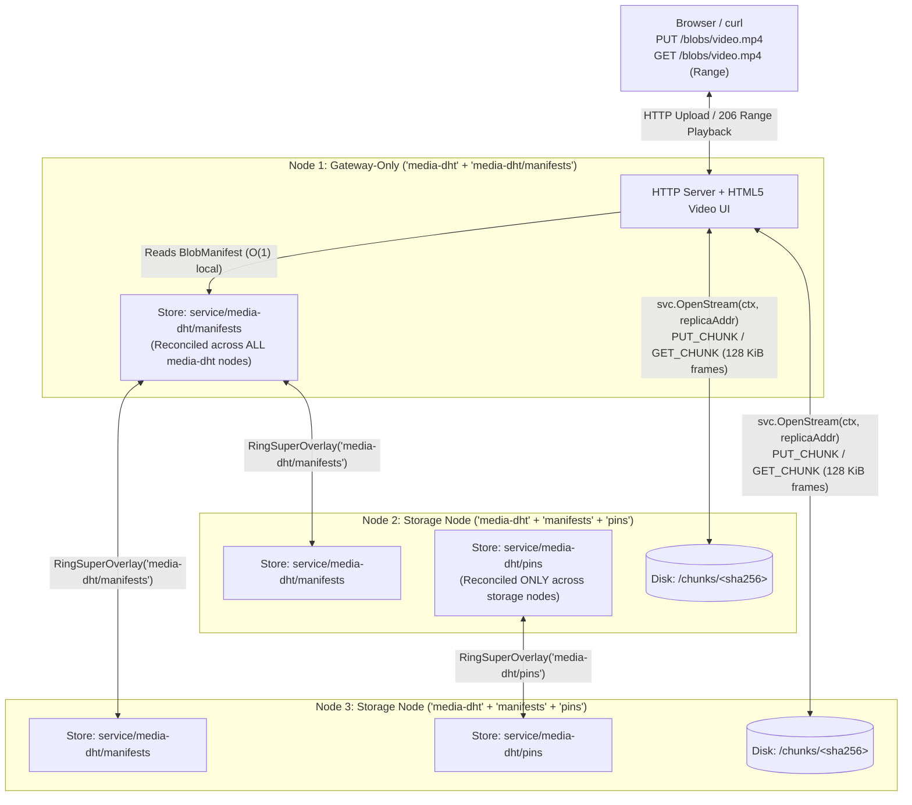

# Plan: Multi-Store Support Per Service (Selective Placement) & Chunked Media DHT

## Goal Description

Extend Phase 1's service multiplexing so that a single third-party service can own **multiple named reconcilable stores** and **place each store on an independent subset of nodes** (e.g., all nodes of `"media-dht"` host `manifests`, while only storage nodes host `pins`/`shards`), and then showcase the full Ifrit stack by building a **Chunked Media DHT** (`examples/dht_media`) that streams large video/audio blobs across nodes via bidirectional mTLS streams (`OpenStream`) with HTTP `Range` seeking for browser playback.

---

## User Review Required

> [!IMPORTANT]
> **How independent per-store node placement works via qualified IDs (`serviceID/storeName`)**:
> Rather than inventing a second discovery protocol for per-store placement, each named store attached to a service is announced in `ServiceNote`'s `VersionVectorImmutable` under the qualified key `<serviceID>/<storeName>` (e.g., `"media-dht/manifests"`, `"media-dht/pins"`), while the service itself remains `"media-dht"`.
> - Because `ServiceDirectory` already creates a deterministic `RingSuperOverlay` per key in `ServiceNote`, a store placed on only 3 out of 20 `"media-dht"` nodes automatically gets its own connected 3-node `RingSuperOverlay` without ever dialing the 17 nodes that don't host that store.
> - `reconcile.Mux` routes streams under `"service/<serviceID>/<storeName>"`.

> [!IMPORTANT]
> **Breaking (greenfield) API updates on `ServiceEndpoint`**:
> 1. `RegisterServiceStore[T](svc, storeName, store, codec...)` and `svc.RegisterStoreReconciler(storeName, rec, fpFn)` now take an explicit `storeName` (validated against `[a-z0-9._-]{1,64}`).
> 2. `svc.OpenStream(ctx context.Context, dest string) (inputStream chan<- []byte, replyStream <-chan []byte)` gains a `ctx` parameter (for clean HTTP/video-seek cancellation) and directional channel return types (preventing accidental sends on `replyStream` or reads on `inputStream`).

---

## Open Questions

> [!NOTE]
> Please confirm if you'd like any adjustments to these defaults before implementation:
> 1. **Streaming protocol for Media DHT**: Use **requester-initiated bidirectional streams** (`OpenStream(ctx, replicaAddr)` with Frame 0 = JSON `PUT_CHUNK`/`GET_CHUNK` header and Frames 1..N = 128 KiB binary chunks) so HTTP `<video>` seeking and backpressure map 1:1 with zero correlation tables and no self-reported address spoofing.
> 2. **Chunk placement strategy**: Use **Rendezvous (HRW) Hashing** (`SHA256(chunkHash + ":" + peer.ID)`) over `svc.StoreMembers("pins")` (+ `Self()` if storage node) to pick the top $R$ replica nodes per 1 MiB chunk.
> 3. **Gateway vs. Storage role showcase**: In `examples/dht_media`, run both **storage nodes** (hosting `manifests` + `pins` + disk chunks) and **gateway-only nodes** (hosting only `manifests`, proxying uploads/downloads over `OpenStream` to storage nodes) to demonstrate selective per-store placement live.

---

## Architecture Overview



---

## Proposed Changes

### Part 1: Multi-Store Support Per Service & Context-Aware Streams

---

#### [MODIFY] [service_note.go](file:///home/uit-eindride/repos/master-thesis/fireflies/ifrit/core/discovery/service_note.go) & [service_accusation.go](file:///home/uit-eindride/repos/master-thesis/fireflies/ifrit/core/discovery/service_accusation.go) & [service_directory.go](file:///home/uit-eindride/repos/master-thesis/fireflies/ifrit/core/discovery/service_directory.go)
- Keep `ValidateServiceID(segment string) error` strict (`[a-z0-9._-]{1,64}`, no `/`) for individual `serviceID` and `storeName` segments.
- Add `ValidateQualifiedServiceID(id string) error` accepting either `<serviceID>` or `<serviceID>/<storeName>` (where each segment passes `ValidateServiceID`), and `QualifiedStoreID(serviceID, storeName string) (string, error)` returning `serviceID + "/" + storeName`.
- Use `ValidateQualifiedServiceID` in `UnmarshalServiceNote`, `UnmarshalServiceAccusation`, `NewSignedServiceAccusation`, `ServiceDirectory.RegisterLocalService`, and `ServiceDirectory.UnregisterLocalService`.
- Result: `"media-dht"` (the service) and `"media-dht/manifests"` / `"media-dht/pins"` (its named stores) each get independent membership indexing (`membersByService[qualifiedID]`) and independent deterministic `RingSuperOverlay` instances over the exact subset of nodes hosting them.

---

#### [MODIFY] [comm/client.go](file:///home/uit-eindride/repos/master-thesis/fireflies/ifrit/comm/client.go), [core/node.go](file:///home/uit-eindride/repos/master-thesis/fireflies/ifrit/core/node.go), & [core/handlers.go](file:///home/uit-eindride/repos/master-thesis/fireflies/ifrit/core/handlers.go)
- **Fix stream dial leak & add context cancellation** in `gRPCClient.StreamMessenger`:
  ```go
  func (c *gRPCClient) StreamMessenger(ctx context.Context, serviceID, addr string, input, reply chan []byte) error {
      defer close(reply)
      if ctx == nil {
          ctx = context.Background()
      }
      ...
      callCtx, cancel := context.WithCancel(ctx)
      defer cancel()
      if serviceID != "" {
          callCtx = metadata.NewOutgoingContext(callCtx, metadata.Pairs(ServiceIDMetadataKey, serviceID))
      }
      ...
  }
  ```
  - Always `defer close(reply)` *before* `c.connection(addr)` and `conn.Stream(callCtx)` so callers ranging over `reply` never block forever on dial/auth errors.
  - Select on `<-streamCtx.Done()` when sending to `reply` (`select { case reply <- req.GetContent(): case <-streamCtx.Done(): return }`) so cancelling `ctx` (e.g. when a browser seeks or closes `<video>`) tears down both client and server goroutines immediately with zero leaks.
- In [`core/handlers.go`](file:///home/uit-eindride/repos/master-thesis/fireflies/ifrit/core/handlers.go#L200-L210): break out of `replyStream` if `srv.Send` fails (so a dead/cancelled client stream stops sending immediately instead of logging errors for every remaining video chunk) and drain/unblock cleanly.

---

#### [MODIFY] [core/service_multiplexer.go](file:///home/uit-eindride/repos/master-thesis/fireflies/ifrit/core/service_multiplexer.go) & [client.go](file:///home/uit-eindride/repos/master-thesis/fireflies/ifrit/client.go)
- Upgrade `localService` from one `store *serviceStoreEntry` to multiple named stores:
  ```go
  type localService struct {
      msgHandler    processMsg
      streamHandler streamMsg
      stores        map[string]*serviceStoreEntry // keyed by validated storeName
  }
  ```
- Each `serviceStoreEntry` records:
  - `serviceID` (`"media-dht"`),
  - `storeName` (`"pins"`),
  - `qualifiedID` (`"media-dht/pins"` — the key in `ServiceDirectory` whose `RingSuperOverlay` drives gossip partners!),
  - `muxStoreID` (`"service/media-dht/pins"` — the key on `reconcile.Mux`).
- `RegisterServiceStoreReconciler(serviceID, storeName, rec, fpFn)`:
  1. Validates `serviceID` and `storeName`.
  2. Registers `qualifiedID` (`serviceID + "/" + storeName`) in `ServiceDirectory` (`RegisterLocalService`) so this node announces hosting that store and builds a `RingSuperOverlay` over $S_{\text{serviceID/storeName}}$.
  3. Mounts `rec` on `reconcile.Mux` under `"service/" + qualifiedID`.
  4. Adds `entry` to `localService.stores[storeName]`.
- `UnregisterServiceStore(serviceID, storeName)`: removes one store from `localService.stores`, unregisters `"service/" + qualifiedID` from `reconcile.Mux`, and calls `ServiceDirectory.UnregisterLocalService(n.cs, qualifiedID)`.
- `UnregisterService(serviceID)` (`svc.Close()`): unregisters every store in `localService.stores` from `reconcile.Mux` and `ServiceDirectory`, then unregisters `serviceID` itself.
- `reconcileServiceStores()` queries `n.view.ServiceDirectory().Overlay(entry.qualifiedID).GossipPartners()` so each store reconciles **strictly over the nodes that host that specific store**.
- Update `client.go`:
  - `svc.OpenStream(ctx context.Context, dest string) (inputStream chan<- []byte, replyStream <-chan []byte)`
  - `svc.RegisterStoreReconciler(storeName string, rec reconcile.StoreReconciler, fpFn func() []byte) error`
  - `svc.UnregisterStore(storeName string) error`
  - `svc.StoreMembers(storeName string) []PeerInfo`
  - `svc.StoreNeighbours(storeName string) []PeerInfo`
  - `ifrit.RegisterServiceStore[T any](svc *ServiceEndpoint, storeName string, store ReverseIndexStore[T], codec ...ItemCodec[T]) error`
- Update [`examples/streaming/streamingExample.go`](file:///home/uit-eindride/repos/master-thesis/fireflies/ifrit/examples/streaming/streamingExample.go) and [`core/service_multiplexer_test.go`](file:///home/uit-eindride/repos/master-thesis/fireflies/ifrit/core/service_multiplexer_test.go) for the updated signatures.

---

### Part 2: Chunked Media DHT Showcase (`examples/dht_media`)

---

#### [NEW] `examples/dht_media/protocol.go`
- **Reconciled Store Types**:
  - `BlobManifest` (stored in `service/media-dht/manifests` across all `"media-dht"` nodes):
    ```go
    type BlobManifest struct {
        Key         string   `json:"key"`
        ContentType string   `json:"content_type"`
        TotalSize   int64    `json:"total_size"`
        ChunkSize   int64    `json:"chunk_size"`   // default 1 MiB
        ChunkHashes []string `json:"chunk_hashes"` // hex SHA-256 per chunk
        Replicas    int      `json:"replicas"`     // replication factor (default 2)
        UploadedBy  string   `json:"uploaded_by"`
    }
    ```
    Implements `CryptographicIdentity() []byte` over `Key` + chunk hashes so `digestmaps.MustDefaultHasher[BlobManifest]()` uses SHA-256.
  - `PinRecord` (stored in `service/media-dht/pins` **only on storage nodes**):
    ```go
    type PinRecord struct {
        BlobKey   string `json:"blob_key"`
        ChunkHash string `json:"chunk_hash"`
        NodeID    string `json:"node_id"`
    }
    ```
    Demonstrates a second service store placed on a **different subset of nodes** (storage nodes only, while gateway-only nodes only host `manifests`).
- **Stream Control Frame Protocol** (Frame 0 JSON header over `svc.OpenStream`, followed by raw `128 KiB` binary frames):
  - `StreamRequest{Op: "PUT_CHUNK" | "GET_CHUNK", Hash, Offset, Length, Size}`
  - `StreamResponse{OK bool, Error string, Size int64}`
- **Rendezvous (HRW) Placement Helper**:
  - `SelectReplicas(chunkHash string, candidates []ifrit.PeerInfo, r int) []ifrit.PeerInfo`: ranks candidates deterministically by `SHA256(chunkHash + ":" + peer.ID)` and returns the top `min(r, len(candidates))` storage nodes.

---

#### [NEW] `examples/dht_media/chunkstore.go`
- Disk-backed content-addressed chunk storage (`<dataDir>/chunks/<sha256>`):
  - `WriteChunkFromStream(hash string, expectedSize int64, in <-chan []byte) error`: writes to a temp file while hashing with `sha256.New()`, verifies exact size and digest, then atomically renames into place (rejecting corrupt uploads without keeping partial files).
  - `StreamChunkRange(hash string, offset, length int64, reply chan<- []byte) error`: opens the chunk file, seeks to `offset`, and streams `128 KiB` slices onto `reply`.

---

#### [NEW] `examples/dht_media/app.go` & `examples/dht_media/main.go`
- `MediaDHTApp`:
  - Config: `HTTPPort`, `TCPPort`, `UDPPort`, `Hostname`, `CaAddr`, `CertPath`, `DataDir`, `GossipInterval`, `StorageEnabled bool`, `ReplicationFactor int`, `ChunkSize int64`.
  - Attaches to Ifrit via `svc, err := client.Service("media-dht")`.
  - Always attaches `manifests` store (`ifrit.RegisterServiceStore(svc, "manifests", manifestStore)`).
  - When `StorageEnabled == true`, initializes disk `ChunkStore`, attaches the `pins` store (`ifrit.RegisterServiceStore(svc, "pins", pinStore)`), and registers `svc.RegisterStreamHandler(app.handleChunkStream)`.
  - **Upload (`PUT /blobs/{key}` or `POST /blobs/{key}`)**:
    - Reads request body incrementally in `ChunkSize` (1 MiB) slices (constant RAM!).
    - Computes each chunk's SHA-256, selects $R$ storage nodes via `SelectReplicas(chunkHash, storageCandidates, R)` where `storageCandidates = svc.StoreMembers("pins")` (+ `Self()` if storage node).
    - Streams each chunk to the selected replicas via `svc.OpenStream(r.Context(), peer.Addr)` (or writes locally if self is a replica), then inserts `BlobManifest` into `manifestStore` (and `PinRecord`s on replicas).
  - **Download & Video/Audio Seeking (`GET /blobs/{key}`)**:
    - Looks up `BlobManifest` in local `manifestStore` (reconciled transparently via Ifrit!).
    - Parses optional HTTP `Range: bytes=start-end` header (returning `206 Partial Content`, `Content-Range`, `Accept-Ranges: bytes`, `Content-Type`, `Content-Length` so HTML5 `<video>` / `<audio>` players can stream and scrub smoothly).
    - Maps `[start, end]` to the overlapping chunk indices `[firstChunk..lastChunk]`, fetches each chunk from local disk or via `svc.OpenStream(r.Context(), replicaAddr)` (failing over across HRW replicas if a replica is unreachable or fails SHA-256 verification on full-chunk reads!), and writes bytes directly to `http.ResponseWriter` (flushing as chunks arrive).
  - **Built-in Web UI (`GET /`)**:
    - Lightweight single-page HTML UI listing available blobs, node roles/members/storage peers, an upload picker, and an inline `<video controls>` / `<audio controls>` player.

---

#### [NEW] `examples/dht_media/dht_media_test.go` & `scripts/run_local_dht.sh` + [MODIFY] [justfile](file:///home/uit-eindride/repos/master-thesis/fireflies/ifrit/justfile)
- Add `scripts/run_local_dht.sh` (and `just local-dht`) to spin up a local multi-process cluster (e.g., 3 storage nodes + 1 gateway node) so you can upload and play a real video/audio file in your browser.

---

## Verification Plan

### Automated Tests
1. **Multi-Store & Selective Node Placement (`core/discovery/service_directory_test.go`, `core/service_multiplexer_test.go`)**:
   - Verify `ValidateQualifiedServiceID` accepts `"media-dht"` and `"media-dht/pins"`, and rejects malformed/multi-slash IDs (`"a/b/c"`, `"media-dht/"`).
   - Run a 3-node mTLS cluster where all 3 nodes attach `"media-dht"` + `"manifests"`, while ONLY 2 nodes attach `"pins"`.
   - Assert `StoreMembers("manifests")` has 2 remote peers on each node, `StoreMembers("pins")` has only 1 remote peer on the two storage nodes, `manifests` converges across all 3 nodes, and `pins` converges strictly between the 2 storage nodes without cross-talk.
   - Verify `UnregisterStore("pins")` removes `"media-dht/pins"` from `ServiceNote` and `reconcile.Mux` while keeping `"media-dht/manifests"` and `"media-dht"` active.
   - Verify `OpenStream(ctx, ...)` cancels cleanly with zero goroutine leaks or deadlocks when `ctx` is cancelled mid-stream or when dialing an unreachable address.
2. **End-to-End Chunked Media DHT (`examples/dht_media/dht_media_test.go`)**:
   - Launch an ephemeral CA + 3 nodes (2 storage nodes + 1 gateway-only node, using 256 KiB test chunks).
   - Upload a 1.5 MiB pseudo-media payload (`Content-Type: video/mp4`) to the **gateway-only node** via `PUT /blobs/demo.mp4`.
   - Verify `manifests` reconciles to all 3 nodes, `pins` reconciles strictly between the 2 storage nodes, and zero chunks are stored on the gateway node's disk.
   - Download the full file from another node (`GET /blobs/demo.mp4`) and assert byte-for-byte equality.
   - Issue multiple HTTP `Range: bytes=start-end` requests spanning chunk boundaries and assert `206 Partial Content`, exact `Content-Range`, and exact byte slices.
   - **Byzantine / Corruption Failover Test**: Corrupt a chunk file on one storage replica on disk, request `GET /blobs/demo.mp4` from the gateway, and assert the gateway detects the SHA-256 mismatch and seamlessly streams the valid chunk from the healthy second replica!
3. **Full Workspace Verification**:
   - `go fmt ./... && go vet ./... && go build ./...`
   - `go test -race -count=1 ./digestmaps/... ./reconcile/... ./comm/... ./core/... ./examples/dht_media ./examples/http_dissemination ./examples/streaming .`

### Manual Verification
- Run `just local-dht` (launches CA + 3 storage nodes + 1 gateway node), open the gateway URL (e.g. `http://127.0.0.1:8091/`) in a browser, upload a local `.mp4` or `.mp3` file, and play/scrub the video directly from any node in the cluster.
