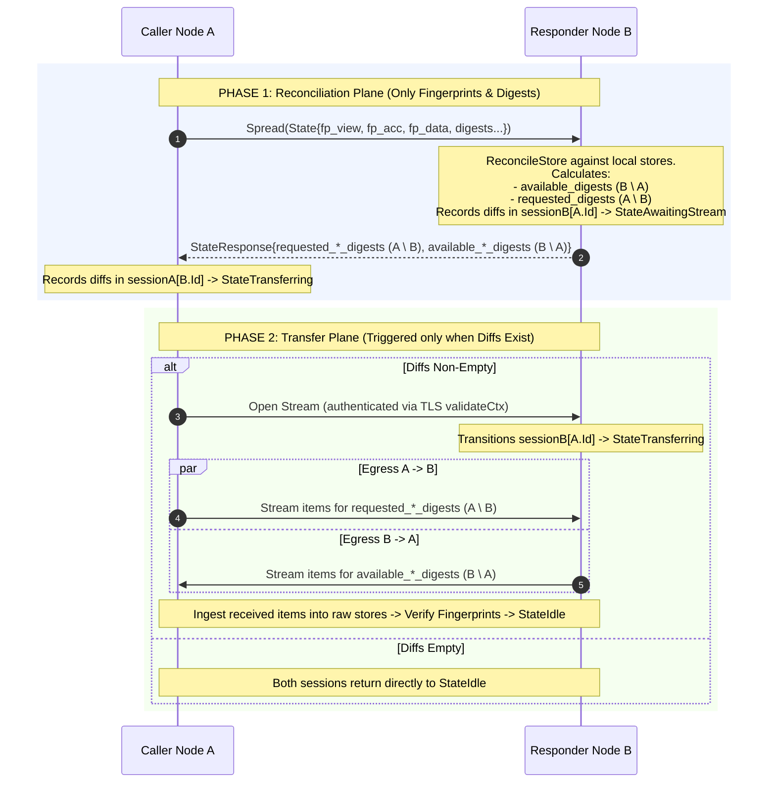

# Phase A Step 4: Strict Two-Phase Reconciliation & Stream Transfer Architecture

## 1. Executive Summary & Core Principle

Set reconciliation in Ifrit is strictly **two-phase**:
1. **Phase 1: Reconciliation Plane (Unary `Spread` RPC)**:
   - Exchanges **only fingerprints and digest symbols** (set differences).
   - Computes:
     - $A \setminus B$ (digests Caller A has that Responder B needs).
     - $B \setminus A$ (digests Responder B has that Caller A needs).
   - **Zero payload bytes or raw items (certificates, notes, accusations, or data) are sent on `Spread`.**
   - Both nodes store these computed digest diffs in their active `PeerReconcileSession`.
2. **Phase 2: Transfer Plane (Bidirectional Stream)**:
   - If diffs are non-empty, an authenticated stream (`Stream` / `SyncData`) is opened between Caller A and Responder B.
   - Nodes exchange the actual bulk payloads (control items and application data) across the stream using chunking and bounded memory.

---

## 2. Architecture & State Flow



---

## 3. Why Payload Piggybacking on `Spread` Was Removed

In legacy code, Responder B packed `reply.Certificates`, `reply.Notes`, and `reply.Accusations` directly into `StateResponse`:
- **Message Size Blow-Up:** Violates gRPC unary message bounds (e.g. 4MB limit exceeded during node rejoins, large cluster boots, or network partition heals).
- **Asymmetry:** Responder B could push items to Caller A, but Caller A had no way to push $A \setminus B$ without hacky fields like `pushed_certificates`, `pushed_notes`, and `pushed_accusations`.
- **Bypasses Stream Flow Control:** Defeats backpressure, stream chunking, and memory bounds.

---

## 4. Step-by-Step Implementation Roadmap for Phase A Step 4

### Step 4.1: Pre-Implementation Cleanup
1. **Remove Dead Commented Code**:
   - Delete lines 131–403 in `core/protocol.go` (`spamAccusations`, `experiment`).
2. **Strip Out Piggyback Fields in `handlers.go`**:
   - Remove `ingestPushedControlItems` from `Node.Spread`.
   - Remove `pushed_certificates`, `pushed_notes`, and `pushed_accusations` from `protobuf/gossip.proto` (or deprecate them).

### Step 4.2: Pure Digest Exchange in `Spread` Handlers (`core/handlers.go`)
1. In `reconcileCertificates`:
   - Stop populating `reply.Certificates`.
   - Populate only `reply.AvailableCertificateDigests` ($B \setminus A$) and `reply.RequestedCertificateDigests` ($A \setminus B$).
2. In `reconcileNotes`:
   - Stop populating `reply.Notes` and attached certificates.
   - Populate only `reply.AvailableNoteDigests` ($B \setminus A$) and `reply.RequestedNoteDigests` ($A \setminus B$).
3. In `reconcileAccusations`:
   - Stop populating `reply.Accusations`.
   - Populate only `reply.AvailableAccusationDigests` ($B \setminus A$) and `reply.RequestedAccusationDigests` ($A \setminus B$).
4. Return boolean indicating if any requested or available digests were generated.

### Step 4.3: Wire Caller-Side `PeerReconcileSession` (`core/protocol.go`)
1. In `correct.Gossip(n *Node)`:
   - Acquire per-peer session concurrency lock:
     ```go
     sess := n.sessionManager.GetOrCreate(p.Id)
     if !sess.TryStartReconciling() {
         continue // skip this tick if a session with p is already active
     }
     ```
   - Invoke `n.comm.Gossip(p.Addr, msg)`.
   - Check returned `reply`:
     - Inspect all `Requested*Digests` ($A \setminus B$) and `Available*Digests` ($B \setminus A$).
     - If non-empty:
       - Set `sess.SetHasDeltas(true)`.
       - Transition: `sess.TransitionAfterReconcile(true)` $\to$ `SessionTransferring`.
       - Dispatch stream transfer to exchange missing items.
     - If empty:
       - Transition: `sess.TransitionAfterReconcile(true)` $\to$ `SessionIdle`.
       - Update cached peer fingerprints for peer `p`.

### Step 4.4: Verification & Testing
1. **Unit Tests**:
   - Verify `Spread` returns pure digest vectors without bulk payloads.
   - Verify `PeerReconcileSession` state transitions on both Caller and Responder.
2. **Race Detection**:
   - Run `go test -race -count=1 ./core/... ./versionvector/... ./reverseindexstore/... ./examples/...`.

