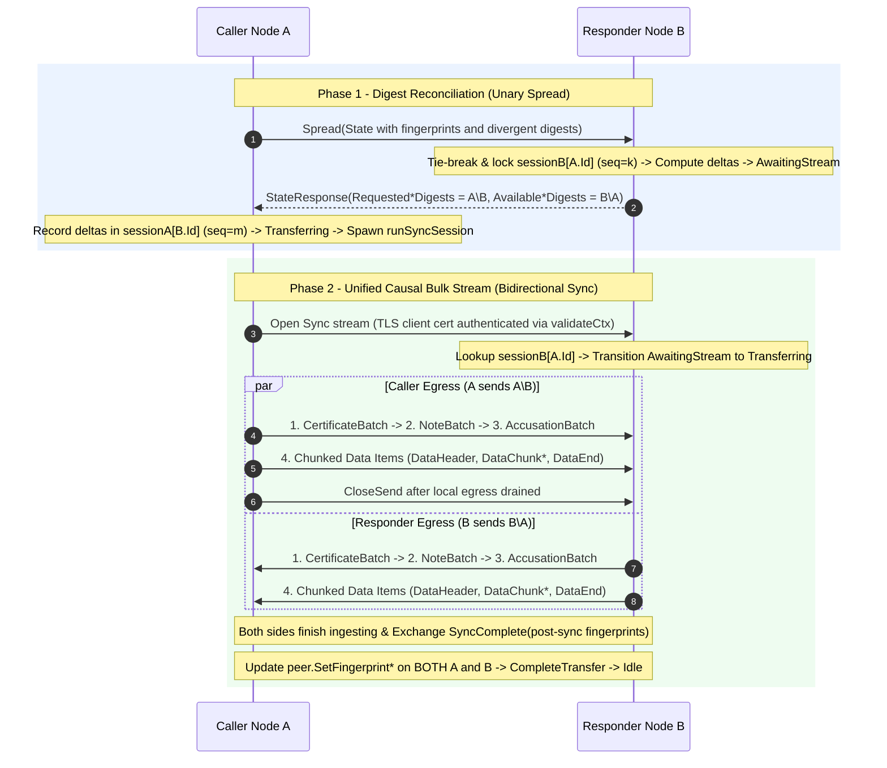
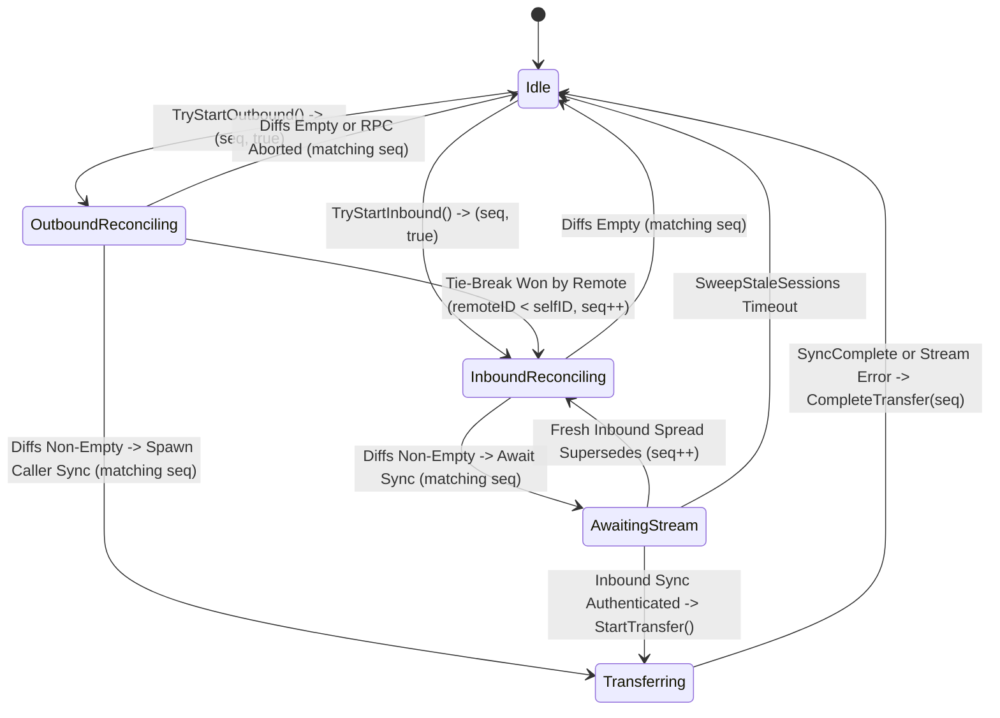

# Phase B Engineering Plan: Unified Control & Bulk Data Streaming (`Sync`)

## 1. Executive Summary & Architectural Unification

Following Phase A Step 4 ([plan-phaseA-step4-two-phase-reconciliation.md](file:///home/eikj/repos/ifrit/.plans/plan-phaseA-step4-two-phase-reconciliation.md)), Ifrit enforces a strict **two-phase reconciliation invariant** between ring neighbours:

1. **Phase 1 — Reconciliation Plane (Unary [`Spread`](file:///home/eikj/repos/ifrit/core/handlers.go#L61-L82))**: Exchanges **only** 64-bit XOR fingerprints and digest symbols, populating [`ReconcileDeltas`](file:///home/eikj/repos/ifrit/core/reconciliation_session_manager.go#L222-L234) on both Caller A ([`correct.Gossip`](file:///home/eikj/repos/ifrit/core/protocol.go#L42-L106)) and Responder B ([`computeControlAndDataDeltas`](file:///home/eikj/repos/ifrit/core/handlers.go#L157-L180)). Zero control items or application payloads ride on neighbour `Spread` RPCs.
2. **Phase 2 — Transfer Plane (Bidirectional Stream)**: Exchanges all missing items identified in Phase 1 under bounded memory and backpressure.

> [!IMPORTANT]
> **Critical Post-Phase-A Reality Check**: The original roadmap in [plan-stream-bulk-data.md](file:///home/eikj/repos/ifrit/.plans/plan-stream-bulk-data.md#L317-L325) assumed `Spread` still carried `Certificates`, `Notes`, and `Accusations` while `SyncData` only carried application data. Because Phase A Step 4 stripped all neighbour piggybacking from `Spread`, **neither control state nor application data transfers between neighbours today**—sessions transition to [`SessionTransferring`](file:///home/eikj/repos/ifrit/core/reconciliation_session_manager.go#L196) (Caller) and [`SessionAwaitingStream`](file:///home/eikj/repos/ifrit/core/reconciliation_session_manager.go#L194) (Responder) and halt.
>
> **Architectural Simplification**: Instead of inventing separate transfer paths for control items vs. application data, Phase B introduces **one unified, TLS-authenticated gRPC stream**—`rpc Sync (stream SyncFrame) returns (stream SyncFrame)` in [gossip.proto](file:///home/eikj/repos/ifrit/protobuf/gossip.proto)—kept strictly isolated from the public user-facing [`Stream`](file:///home/eikj/repos/ifrit/core/handlers.go#L265-L322) / [`Client.OpenStream`](file:///home/eikj/repos/ifrit/client.go#L188-L195) API.

### Causal Egress Ordering Across One Stream

On each side of an active `Sync` stream, the egress writer drains [`ReconcileDeltas`](file:///home/eikj/repos/ifrit/core/reconciliation_session_manager.go#L222-L234) in **strict causal dependency order**:

1. **Certificates** ([`EgressCertificates`](file:///home/eikj/repos/ifrit/core/reconciliation_session_manager.go#L267-L272)) → Admits unknown peers into `fullView` via [`mergeCertificates`](file:///home/eikj/repos/ifrit/core/handlers.go#L538-L573) so their public keys exist before notes or accusations are evaluated.
2. **Notes** ([`EgressNotes`](file:///home/eikj/repos/ifrit/core/reconciliation_session_manager.go#L283-L288)) → Evaluates [`mergeNotes`](file:///home/eikj/repos/ifrit/core/handlers.go#L468-L493) against already-admitted peer certificates, establishing current `ActiveNote` epochs and ring masks.
3. **Accusations** ([`EgressAccusations`](file:///home/eikj/repos/ifrit/core/reconciliation_session_manager.go#L299-L304)) → Evaluates [`mergeAccusations`](file:///home/eikj/repos/ifrit/core/handlers.go#L495-L536) now that both accuser/accused certificates and accused `ActiveNote` epochs are present.
4. **Application Data** ([`EgressData`](file:///home/eikj/repos/ifrit/core/reconciliation_session_manager.go#L315-L320)) → Streams serialized items from [`DataReconciler`](file:///home/eikj/repos/ifrit/core/reconilable_store_interface.go#L8-L12) in configurable chunks (default `128 KB`, pooled via `sync.Pool`) using `DataHeader` → `DataChunk*` → `DataEnd` framing.
5. **Post-Sync Convergence Trailer** (`SyncComplete`) → Exchanges post-ingestion local fingerprints so **both** Caller and Responder update cached [`Peer`](file:///home/eikj/repos/ifrit/core/discovery/peer.go#L140-L180) fingerprints before returning to [`SessionIdle`](file:///home/eikj/repos/ifrit/core/reconciliation_session_manager.go#L190).



---

## 2. Critical Blockers to Clear

### Blocker B1 — Simultaneous 2-Node Outbound Initiation Deadlock ("Crossed Wires" Race)

- **Root Cause in Current Code**:
  Suppose Neighbour A and Neighbour B tick [`correct.Gossip`](file:///home/eikj/repos/ifrit/core/protocol.go#L42-L106) at the same instant:
  1. Both call [`TryStartReconciling`](file:///home/eikj/repos/ifrit/core/reconciliation_session_manager.go#L380-L392) (`Idle` → `Reconciling`) and dial `Spread` to each other.
  2. B's `Spread` arrives at A: [`TryStartInboundReconciling`](file:///home/eikj/repos/ifrit/core/reconciliation_session_manager.go#L398-L410) only checks `if s.state == SessionTransferring { return false }`. It **overwrites** A's outbound `SessionReconciling` state and transitions `sessA[B]` to `SessionAwaitingStream` at line 175 of [handlers.go](file:///home/eikj/repos/ifrit/core/handlers.go#L164-L176)!
  3. Symmetrically, A's `Spread` overwrites `sessB[A]` into `SessionAwaitingStream`!
  4. Both outbound `Spread` RPCs return to [`correct.Gossip`](file:///home/eikj/repos/ifrit/core/protocol.go#L81-L85). [`TransitionAfterReconcile(true)`](file:///home/eikj/repos/ifrit/core/reconciliation_session_manager.go#L438-L456) sees `s.state == SessionAwaitingStream` (not `SessionReconciling`) and silently returns `SessionAwaitingStream` without opening a stream!
  5. **Result**: Both nodes sit deadlocked in `SessionAwaitingStream`, waiting for the other to open a stream, until the 30-second [`SweepStaleSessions`](file:///home/eikj/repos/ifrit/core/node.go#L144-L146) timeout expires—and can immediately repeat the collision on the next tick.
- **Engineering Fix**:
  1. Split [`SessionReconciling`](file:///home/eikj/repos/ifrit/core/reconciliation_session_manager.go#L192) into `SessionOutboundReconciling` and `SessionInboundReconciling`, and add a monotonic generation counter `seq uint64` to [`PeerReconcileSession`](file:///home/eikj/repos/ifrit/core/reconciliation_session_manager.go#L332-L339). Every state acquisition returns `(seq uint64, ok bool)`, and every completion/abort method (`TransitionAfterReconcile`, `ResetIfSeq`, `CompleteTransfer`) requires matching `seq` so a superseded goroutine can **never** clobber a newer session's state.
  2. Enforce a **deterministic tie-breaker** inside `TryStartInboundReconciling(selfID, remoteID string)` when `s.state == SessionOutboundReconciling`:
     - **Higher Peer ID yields to Lower Peer ID (`remoteID < selfID`)**: Inbound `Spread` wins, increments `s.seq`, and transitions to `SessionInboundReconciling`. When our losing outbound `Spread` goroutine returns (either with `codes.Aborted` or a response), its stale `seq` mismatches and exits cleanly as a no-op.
     - **Lower Peer ID holds priority (`selfID < remoteID`)**: `TryStartInboundReconciling` returns `false`, and [`Spread`](file:///home/eikj/repos/ifrit/core/handlers.go#L61-L82) returns `status.Error(codes.Aborted, ErrSessionBusy.Error())` so the remote peer aborts its losing outbound attempt while serving our winning `Spread`.



---

### Blocker B2 — Missing Streaming Codec on `DataReconciler` & `[]byte` Hasher Bottleneck

- **Root Cause 1 (Type-Erased Serialization)**:
  [`DataReconciler`](file:///home/eikj/repos/ifrit/core/reconilable_store_interface.go#L8-L12) exposes only `Digests()`, `Fingerprint()`, and `Reconcile(...)`. Once [`RegisterDataStore`](file:///home/eikj/repos/ifrit/core/node.go#L470-L475) erases type `T`, [`Node`](file:///home/eikj/repos/ifrit/core/node.go#L51-L110) has no way to read bytes for an egress `DigestSymbol` or decode/insert an inbound byte stream back into [`ReverseIndexStore`](file:///home/eikj/repos/ifrit/reverseindexstore/interface.go).
- **Root Cause 2 (`[]byte` Base64-JSON Allocation Trap)**:
  In [`DefaultHasher`](file:///home/eikj/repos/ifrit/reverseindexstore/digest_set.go#L19-L64), `string`, `ID()`, and `CryptographicIdentity()` have dedicated fast paths, **but `[]byte` falls through to `json.Marshal` (line 56)**! Hashing a `16 MB` `[]byte` item currently allocates a `22 MB` base64-encoded JSON string on the heap before running FNV-1a.
- **Engineering Fix**:
  1. Add a native `case []byte` fast path in [`DefaultHasher`](file:///home/eikj/repos/ifrit/reverseindexstore/digest_set.go#L49-L55) using **SHA-256 truncated to 64-bit BigEndian `DigestSymbol`** (`sum := sha256.Sum256(b)`), matching [`CryptographicIdentity`](file:///home/eikj/repos/ifrit/reverseindexstore/digest_set.go#L34-L37) with zero heap allocations and cryptographic collision resistance.
  2. Introduce a generic `ItemCodec[T any]` interface in `core/reconcilable_store_interface.go`:
     ```go
     type ItemCodec[T any] interface {
         Encode(item T, w io.Writer) error
         Decode(r io.Reader) (T, error)
     }
     ```
     with `DefaultItemCodec[T any]()`:
     - `[]byte`: zero-copy `bytes.NewReader` / `io.ReadAll` (no extra marshaling).
     - `string`: raw UTF-8 bytes.
     - `proto.Message`: deterministic protobuf wire marshaling.
     - Structs / arbitrary `T`: `json.NewEncoder` / `json.NewDecoder`, plus `RegisterDataStoreWithCodec[T](c, store, codec)` on [`Client`](file:///home/eikj/repos/ifrit/client.go#L256-L261) and [`Node`](file:///home/eikj/repos/ifrit/core/node.go#L470-L475) for custom binary or disk-backed `os.File` blob codecs.
  3. Extend [`DataReconciler`](file:///home/eikj/repos/ifrit/core/reconilable_store_interface.go#L8-L12) with streaming I/O methods:
     - `OpenItemReader(d revIdxStore.DigestSymbol) (rc io.ReadCloser, sizeHint int64, ok bool, err error)`
     - `IngestItem(expected revIdxStore.DigestSymbol, r io.Reader) error` (decodes `item`, verifies `store.Digest(item) == expected`, and inserts into `store` only on exact digest match).

---

### Blocker B3 — Unsolicited Digest Injection & the Multi-Peer Orphaned-Accusation Wedge

- **Root Cause 1 (Unverified Stream Ingress)**:
  Without strict session-bound ingress validation, a buggy or Byzantine peer on `Sync` could flood arbitrary certificates, notes, accusations, or oversize data blobs that were never requested in Phase 1, or claim digest $d_1$ while sending bytes that hash to $d_2$.
- **Root Cause 2 (Orphaned-Accusation Wedge in Multi-Peer Rings)**:
  In [`mergeAccusations`](file:///home/eikj/repos/ifrit/core/handlers.go#L500-L535):
  - **Tier 1** (lines 503–507) unconditionally inserts `rawAcc` into `AccusationStore()`, immediately converging `AccusationFingerprint()`.
  - **Tier 2** (lines 510–530) silently executes `continue` if `accuser == nil`, `accused == nil`, or `ActiveNote(accId)` is not yet present!
  - Within a single peer's `Sync` stream, causal ordering (`Certs` → `Notes` → `Accusations`) prevents this when the sender has all three. **However, in an $N$-node ring**, Peer B can legitimately possess and stream `Accusation(X -> Y, epoch=2)` before Peer A has received `Cert(X)` or `Note(Y, epoch=2)` from Peer C! Unlike [`promotePendingNotesForPeer`](file:///home/eikj/repos/ifrit/core/handlers.go#L809-L826), **nothing ever re-evaluates unpromoted accusations in `AccusationStore()` when the missing certificate or note arrives later**—permanently wedging valid failure detections!
- **Engineering Fix**:
  1. **Session Ingress Allowlist & Digest Verification**: Build an `expected map[uint64]struct{}` from [`IngressCertificates`](file:///home/eikj/repos/ifrit/core/reconciliation_session_manager.go#L275-L280), [`IngressNotes`](file:///home/eikj/repos/ifrit/core/reconciliation_session_manager.go#L290-L295), [`IngressAccusations`](file:///home/eikj/repos/ifrit/core/reconciliation_session_manager.go#L305-L310), and [`IngressData`](file:///home/eikj/repos/ifrit/core/reconciliation_session_manager.go#L322-L327) when starting `Sync`. Reject and abort the stream (`codes.InvalidArgument` / `ErrUnexpectedDigest` / `ErrDigestMismatch`) if:
     - A peer sends a digest not in `expected` or sends the same digest twice;
     - Recomputed item digest $\neq$ header digest; or
     - Streamed item bytes exceed configurable `max_sync_item_bytes` (default `64 MB`, configurable via `viper` / `Node.SetSyncConfig` for larger hosts or disk-backed stores).
  2. **Close the Orphaned-Accusation Gap**: Add `promotePendingAccusationsForPeer(id string)` in [handlers.go](file:///home/eikj/repos/ifrit/core/handlers.go#L808-L826) (scanning `AccusationStore()` for accusations where `accuser == id` or `accused == id` and invoking [`evalAccusation`](file:///home/eikj/repos/ifrit/core/handlers.go#L682-L708) once both peers and `ActiveNote(accused)` exist), called automatically from [`addValidCertificate`](file:///home/eikj/repos/ifrit/core/handlers.go#L797-L806) and at the end of [`evalNote`](file:///home/eikj/repos/ifrit/core/handlers.go#L751-L768).

---

### Blocker B4 — Head-of-Line Blocking, `dispatcher` Starvation & Bounce-Back `Spread`

- **Root Cause 1 (Sequential Loop + Workerpool Trap)**:
  [`correct.Gossip`](file:///home/eikj/repos/ifrit/core/protocol.go#L45-L105) iterates sequentially over `neighbours`. Running a multi-MB `Sync` transfer synchronously inside that `for` loop stalls gossip with every other ring neighbour. Conversely, submitting `Sync` onto [`Node.dispatcher`](file:///home/eikj/repos/ifrit/core/node.go#L199-L200) has two subtle traps:
  - In unit/integration tests where `viper` `max_concurrent_messages` is unset (`0`), `workerpool.NewDispatcher(0)` spawns **zero** workers and deadlocks submitted jobs!
  - Even in production (`max_concurrent_messages = 5`), 5 long-lived user [`Client.OpenStream`](file:///home/eikj/repos/ifrit/client.go#L188-L195) calls completely starve `n.dispatcher`!
- **Root Cause 2 (Redundant Bounce-Back `Spread`)**:
  If Caller A updates [`Peer.SetFingerprintData`](file:///home/eikj/repos/ifrit/core/discovery/peer.go#L147-L152) after `Sync`, Responder B's cached view of A's fingerprints (`view.Peer(A.Id)`) still holds A's *pre-sync* values until the next UDP `Pong`, causing B to fire an unnecessary `Spread` back to A on its next gossip tick.
- **Engineering Fix**:
  1. **Dedicated Session-Bounded Goroutines + Node Shutdown Context**:
     - Add `syncCtx context.Context` and `syncCancel context.CancelFunc` on [`Node`](file:///home/eikj/repos/ifrit/core/node.go#L51-L110), cancelled immediately inside [`isStopping`](file:///home/eikj/repos/ifrit/core/node.go#L556-L568) **before** `n.wg.Wait()` in [`Node.Stop`](file:///home/eikj/repos/ifrit/core/node.go#L570-L607).
     - Spawn `n.spawnSyncSession(peer, sess, seq)` as a tracked goroutine (`n.wg.Add(1)` under `exitMutex` guard so it never races with `Stop()`). Concurrency is already strictly bounded to at most $|N_{\text{neighbours}}| \le 2 \times \text{numRings}$ by [`PeerReconcileSession`](file:///home/eikj/repos/ifrit/core/reconciliation_session_manager.go#L332-L339)'s `SessionTransferring` lock—zero risk of goroutine explosion and zero coupling to user `dispatcher` workers!
  2. **Bidirectional Post-Sync `SyncComplete` Frame**:
     - After each side finishes sending its egress items and ingesting all expected ingress items, it sends `SyncComplete{fp_view, fp_accs, fp_data, fp_certs}`. Both Caller A and Responder B update their cached [`Peer`](file:///home/eikj/repos/ifrit/core/discovery/peer.go#L147-L180) fingerprints before releasing the session to `SessionIdle`—achieving immediate single-round quiescence.

---

### Blocker B5 — Protobuf Toolchain & Telemetry Interceptor Regression

1. **Protobuf Codegen Toolchain (Verified Working)**:
   - Host `protoc` (`libprotoc 3.21.12` at `/usr/bin/protoc`) paired with the module-pinned `protoc-gen-go v1.23.0` built directly from `github.com/golang/protobuf/protoc-gen-go` (`v1.4.2` in [go.mod](file:///home/eikj/repos/ifrit/go.mod#L6)) compiles [gossip.proto](file:///home/eikj/repos/ifrit/protobuf/gossip.proto) cleanly via:
     ```bash
     go build -o /tmp/protoc-gen-go github.com/golang/protobuf/protoc-gen-go
     protoc --plugin=protoc-gen-go=/tmp/protoc-gen-go --go_out=plugins=grpc:protobuf -I protobuf gossip.proto
     ```
2. **Telemetry Misclassification Bug**:
   - In [`logSpreadExchange`](file:///home/eikj/repos/ifrit/comm/telemetry_interceptor_grpc.go#L129-L131):
     ```go
     isRebuttal := len(stateReq.GetExistingHosts()) == 0 && stateReq.GetOwnNote() != nil
     ```
     Because `ExistingHosts` is no longer populated in [`collectGossipContentForPeer`](file:///home/eikj/repos/ifrit/core/mutators.go#L16-L44), **100% of normal gossip `Spread` RPCs are currently mislogged as Rebuttals**!
   - **Fix**: Define `hasFingerprints := stateReq.GetFingerprintView() != nil || stateReq.GetFingerprintAccusations() != nil || stateReq.GetFingerprintData() != nil || stateReq.GetFingerprintCertificates() != nil` and set `isRebuttal := !hasFingerprints && stateReq.GetOwnNote() != nil` (matching [`correct.Rebuttal`](file:///home/eikj/repos/ifrit/core/protocol.go#L20-L40), which sends *only* `OwnNote`). Add `grpc.WithStreamInterceptor` / `grpc.StreamServerInterceptor` hooks for `Sync` frame byte & item accounting.

---

## 3. Code & Architectural Simplifications (~220+ Lines Removable)

Clearing out legacy anti-entropy scaffolding **before** building the streaming engine shrinks the surface area of `core/` and eliminates dead branches:

| File & Symbols | Problem / Legacy Debt | Simplification Action |
| :--- | :--- | :--- |
| [handlers.go](file:///home/eikj/repos/ifrit/core/handlers.go#L103-L117) ([`admitCaller`](file:///home/eikj/repos/ifrit/core/handlers.go#L84-L126)) | Calls [`evalCertificate`](file:///home/eikj/repos/ifrit/core/handlers.go#L829-L835) on **every** inbound `Spread` from an existing neighbour (`ShouldBeNeighbour == true`), running X.509 signature verification and logging `EROR Tried to add peer twice to full view` on every tick. | Collapse lines 103–117 into a single `if !wasObserved { ... evalCertificate(cert) ... }`. |
| [handlers.go](file:///home/eikj/repos/ifrit/core/handlers.go#L158-L180), [`mergeViewsHostNotes`](file:///home/eikj/repos/ifrit/core/handlers.go#L403-L434), [`mergeViews`](file:///home/eikj/repos/ifrit/core/handlers.go#L460-L466), [`computeAccusationDeltas`](file:///home/eikj/repos/ifrit/core/handlers.go#L364-L368), [`computeNoteDeltas`](file:///home/eikj/repos/ifrit/core/handlers.go#L395-L400) | ~90 lines of dead `ExistingHosts` map diffing and `callerFp == nil` raw-slice fallbacks that violate the Phase A Step 4 zero-piggybacking rule. | Delete `mergeViews`, `mergeViewsHostNotes`, and the `callerFp == nil` / `hosts != nil` legacy branches completely. |
| [view.go](file:///home/eikj/repos/ifrit/core/discovery/view.go#L946-L984) ([`View.State`](file:///home/eikj/repos/ifrit/core/discovery/view.go#L955-L960), [`View.ExistingHostsMap`](file:///home/eikj/repos/ifrit/core/discovery/view.go#L963-L984)) & [mutators.go](file:///home/eikj/repos/ifrit/core/mutators.go#L46-L58) ([`collectGossipContent`](file:///home/eikj/repos/ifrit/core/mutators.go#L46-L58)) | Builds a hex-encoded `map[string]uint64` of all peers solely for the single CA-less bootstrap call in [`Node.Start`](file:///home/eikj/repos/ifrit/core/node.go#L662-L685) (which hits [`handleNonNeighbourSpread`](file:///home/eikj/repos/ifrit/core/handlers.go#L128-L155) anyway and ignores `ExistingHosts`!). | Replace line 662 in [`Node.Start`](file:///home/eikj/repos/ifrit/core/node.go#L662) with a minimal bootstrap `pb.State{OwnNote: ...}`, then delete `collectGossipContent`, `View.State`, and `View.ExistingHostsMap`. |
| [protocol.go](file:///home/eikj/repos/ifrit/core/protocol.go#L12-L18) ([`spamAccusations`](file:///home/eikj/repos/ifrit/core/protocol.go#L12-L13), [`experiment`](file:///home/eikj/repos/ifrit/core/protocol.go#L15-L18)) | Unused leftover struct definitions after dead-code removal. | Delete unused struct types. |
| [gossip.proto](file:///home/eikj/repos/ifrit/protobuf/gossip.proto#L11-L113) | Dead fields `existingHosts = 1`, `pushed_certificates = 12`, `pushed_notes = 13`, `pushed_accusations = 14`, and unused messages `Data` and `Test`. | Remove dead fields/messages and mark field numbers `reserved 1, 12, 13, 14;` on `State` for wire safety. *(Keep `StateResponse` fields `1..3` strictly for [`handleNonNeighbourSpread`](file:///home/eikj/repos/ifrit/core/handlers.go#L128-L155) cold-bootstrap integration & non-neighbour accusation replies.)* |
| [reconilable_store_interface.go](file:///home/eikj/repos/ifrit/core/reconilable_store_interface.go) | Misspelled filename (`reconilable` missing `c`). | Rename cleanly to `core/reconcilable_store_interface.go` during Step B.1. |

---

## 4. Wire Specification, Runtime Configurability & Implementation Roadmap

### `Sync` Protobuf Framing ([gossip.proto](file:///home/eikj/repos/ifrit/protobuf/gossip.proto))

```protobuf
service gossip {
    rpc Spread (State) returns (StateResponse) {}
    rpc Sync (stream SyncFrame) returns (stream SyncFrame) {}
    rpc Messenger (Msg) returns (MsgResponse) {}
    rpc Stream (stream Msg) returns (stream MsgResponse) {}
}

message SyncFrame {
    oneof payload {
        CertificateBatch certificates = 1;
        NoteBatch notes               = 2;
        AccusationBatch accusations   = 3;
        DataItemHeader data_header    = 4;
        DataItemChunk data_chunk      = 5;
        DataItemEnd data_end          = 6;
        SyncComplete complete         = 7;
    }
}

message CertificateBatch { repeated Certificate items = 1; }
message NoteBatch        { repeated Note items = 1; }
message AccusationBatch  { repeated Accusation items = 1; }

message DataItemHeader {
    uint64 digest     = 1;
    int64  total_size = 2; // -1 if unknown stream length, >= 0 when known
}

message DataItemChunk {
    bytes data = 1;        // Pooled slice sized by sync_chunk_bytes (default 128 KB)
}

message DataItemEnd {
    uint64 digest = 1;     // Confirms clean end-of-item before store Commit/Ingest
}

message SyncComplete {
    bytes fingerprint_view         = 1;
    bytes fingerprint_accusations  = 2;
    bytes fingerprint_data         = 3;
    bytes fingerprint_certificates = 4;
}
```

### Configurable Streaming Parameters (`SyncConfig`)

Exposed via both `viper` keys in [`readConfig`](file:///home/eikj/repos/ifrit/client.go#L271-L305) and programmatic `Node.SetSyncConfig(SyncConfig)` / `Client.SetSyncConfig(SyncConfig)`:
- `sync_chunk_bytes` (default `131072` = `128 KB`): Size of pooled `DataItemChunk` slices.
- `max_sync_item_bytes` (default `67108864` = `64 MB`): Maximum size of a single streamed item before ingress rejection (`<= 0` disables the cap for trusted disk-backed multi-GB blob codecs).
- `sync_control_batch_size` (default `128` certificates / `512` notes or accusations per batch frame).

---

### Execution Milestones (Independently Testable Commits)

#### Step B.0 — Pre-Implementation Cleanup & Blocker Hardening
1. Purge `ExistingHosts`, [`mergeViews`](file:///home/eikj/repos/ifrit/core/handlers.go#L460-L466), [`mergeViewsHostNotes`](file:///home/eikj/repos/ifrit/core/handlers.go#L403-L434), [`ExistingHostsMap`](file:///home/eikj/repos/ifrit/core/discovery/view.go#L963-L984), [`View.State`](file:///home/eikj/repos/ifrit/core/discovery/view.go#L955-L960), [`collectGossipContent`](file:///home/eikj/repos/ifrit/core/mutators.go#L46-L58), [`spamAccusations`](file:///home/eikj/repos/ifrit/core/protocol.go#L12-L13), and [`experiment`](file:///home/eikj/repos/ifrit/core/protocol.go#L15-L18).
2. Simplify [`admitCaller`](file:///home/eikj/repos/ifrit/core/handlers.go#L84-L126) so [`evalCertificate`](file:///home/eikj/repos/ifrit/core/handlers.go#L829-L835) only runs when `!wasObserved`.
3. Add `promotePendingAccusationsForPeer` in [handlers.go](file:///home/eikj/repos/ifrit/core/handlers.go#L808-L826) and hook into [`addValidCertificate`](file:///home/eikj/repos/ifrit/core/handlers.go#L797-L806) and [`evalNote`](file:///home/eikj/repos/ifrit/core/handlers.go#L710-L769).
4. Upgrade [`PeerReconcileSession`](file:///home/eikj/repos/ifrit/core/reconciliation_session_manager.go#L332-L339) with `SessionOutboundReconciling`, `SessionInboundReconciling`, generation counter `seq uint64`, and the deterministic `remoteID < selfID` tie-breaker (Blocker B1).
5. Fix [`logSpreadExchange`](file:///home/eikj/repos/ifrit/comm/telemetry_interceptor_grpc.go#L129-L131) rebuttal detection (Blocker B5).
6. Run unit tests + new tie-breaker & orphaned-accusation promotion tests under `go test -race ./...`.

#### Step B.1 — `ItemCodec[T]`, `DefaultHasher` `[]byte` Fast-Path & Streaming `DataReconciler`
1. Add native `case []byte` truncated SHA-256 hashing in [`DefaultHasher`](file:///home/eikj/repos/ifrit/reverseindexstore/digest_set.go#L49-L55).
2. Rename [reconilable_store_interface.go](file:///home/eikj/repos/ifrit/core/reconilable_store_interface.go) → `core/reconcilable_store_interface.go` and implement `ItemCodec[T]`, `DefaultItemCodec[T]()`, `OpenItemReader`, and `IngestItem` (with strict digest-equality verification before store insertion).
3. Expose optional `RegisterDataStoreWithCodec[T]` alongside zero-config [`RegisterDataStore`](file:///home/eikj/repos/ifrit/client.go#L256-L261).
4. Verify with codec & corruption-rejection unit tests (`[]byte`, `string`, `proto.Message`, structs, digest mismatch, truncated readers).

#### Step B.2 — Protobuf `rpc Sync` & Authenticated `comm` Transport Plumbing
1. Update [gossip.proto](file:///home/eikj/repos/ifrit/protobuf/gossip.proto) with `rpc Sync (stream SyncFrame) returns (stream SyncFrame)` and reserve removed legacy `State` fields; regenerate [gossip.pb.go](file:///home/eikj/repos/ifrit/protobuf/gossip.pb.go) with `protoc` + `protoc-gen-go v1.23.0`.
2. Extend [`commService`](file:///home/eikj/repos/ifrit/core/node.go#L112-L116) and [`gRPCClient`](file:///home/eikj/repos/ifrit/comm/client.go#L26-L31) with `OpenSyncStream(ctx context.Context, addr string) (pb.Gossip_SyncClient, error)`.
3. Add stream telemetry accounting in [telemetry_interceptor_grpc.go](file:///home/eikj/repos/ifrit/comm/telemetry_interceptor_grpc.go) so `Sync` byte & control/data transfer metrics are captured cleanly.

#### Step B.3 — Bidirectional `Sync` Engine & Non-Blocking Session Lifecycle (`core/sync.go`)
1. Implement `Node.Sync(srv pb.Gossip_SyncServer) error` (Responder) and `Node.runSyncSession(ctx context.Context, peer *discovery.Peer, sess *PeerReconcileSession, seq uint64)` (Caller) sharing a single symmetric `executeBidirectionalSync(ctx, stream, peer, sess, seq, isCaller)` engine:
   - Responder authenticates caller via [`validateCtx`](file:///home/eikj/repos/ifrit/core/handlers.go#L837-L855), looks up `sess := n.sessionManager.GetOrCreate(remoteId)`, and transitions [`StartTransfer()`](file:///home/eikj/repos/ifrit/core/reconciliation_session_manager.go#L460-L470) (`SessionAwaitingStream` → `SessionTransferring`).
   - Concurrent egress writer (using pooled `SyncConfig.ChunkBytes` buffers) streams `Certs` → `Notes` → `Accusations` → `Data` for `sess.Deltas().Egress*(isCaller)`.
   - Ingress reader validates every incoming digest against `sess.Deltas().Ingress*(isCaller)`, enforces `SyncConfig.MaxItemBytes`, merges control batches (`mergeCertificates`, `mergeNotes`, `mergeAccusations`), and pipes data chunks into `reconciler.IngestItem`.
   - Both sides exchange `SyncComplete`, update `peer.SetFingerprint*`, and release `sess.CompleteTransfer(seq)` (`SessionIdle`), or `sess.ResetIfSeq(seq)` on any stream error.
2. Wire `n.spawnSyncSession(p, sess, seq)` into [`correct.Gossip`](file:///home/eikj/repos/ifrit/core/protocol.go#L81-L86) and tie `syncCancel()` into [`Node.isStopping`](file:///home/eikj/repos/ifrit/core/node.go#L556-L568).

---

## 5. Network Dissemination Test Campaign Plan (Hardware-Scalable)

To prove that **control state and bulk application data disseminate reliably to every live node in the network** while keeping default `go test ./...` fast and lightweight on modest local laptops, the campaign harness exposes **configurable scale profiles**.

### 5.1 Configurable Scale Profiles (`CampaignScaleConfig`)

Controlled via environment variables (`IFRIT_CAMPAIGN_PROFILE=modest|standard|beefy`, plus granular overrides `IFRIT_TEST_NODES`, `IFRIT_TEST_ITEMS`, `IFRIT_TEST_BLOB_BYTES`, `IFRIT_TEST_RINGS`):

| Parameter | `modest` *(Default for local `go test`)* | `standard` *(CI / Workstation)* | `beefy` *(Stress / Multi-Core Server)* |
| :--- | :--- | :--- | :--- |
| **Ring Cluster Sizes ($N$)** | `5, 8` nodes | `5, 12, 20` nodes | `10, 32, 64` nodes |
| **Fireflies Rings ($k$)** | `3` | `3` | `5` |
| **Broadcast Item Count ($M$)** | `64` items | `250` items | `2,000` items |
| **Large Oversize Blob Test (C2D)** | `2 × 5 MB = 10 MB` *(still `> 4 MB` gRPC unary limit)* | `3 × 8 MB = 24 MB` | `4 × 64 MB = 256 MB` |
| **Concurrent Storm Items / Node** | `20` items/node | `50` items/node | `200` items/node |
| **Expected Suite Wall-Clock (`-race`)** | `~3–6 s`, `< 150 MB` RAM | `~10–15 s` | `~30–60 s` |

### 5.2 Shared Cluster Test Harness Architecture

Modeled on [streamingExample_test.go](file:///home/eikj/repos/ifrit/examples/streaming/streamingExample_test.go) with ephemeral OS ports (`127.0.0.1:0`) and condition-polled assertions (zero fragile `time.Sleep` waits):
- **Real Crypto & Real Network Stack**: In-memory [`cauth.NewCa`](file:///home/eikj/repos/ifrit/cauth/cauth.go) signing real ECDSA X.509 node certificates, real mutual-TLS [`comm.NewComm`](file:///home/eikj/repos/ifrit/comm/comm.go#L25-L62) gRPC servers/clients, and real [`comm.NewUdpServer`](file:///home/eikj/repos/ifrit/comm/udp.go) signed UDP Ping/Pong monitors with 3-fingerprint piggybacking.
- **Observability Probes**: Atomic RPC counters wrapping `Spread` and `Sync` frames to assert wire invariants (zero control/data items on neighbour `Spread`, bounded `Spread` count, post-convergence quiescence).
- **Convergence Oracle**:
  $$
  \forall i \in \text{LiveNodes}: \quad \text{Store}_i.\text{Fingerprint}() = \bigoplus_{x \in \bigcup_j S_j} H(x) \;\land\; \text{Store}_i.\text{Size}() = \left|\bigcup_j S_j\right|
  $$
  plus byte-for-byte payload equality across every node's [`ReverseIndexStore`](file:///home/eikj/repos/ifrit/reverseindexstore/interface.go), identical full-view membership $|V_i| = N$, and consistent `ActiveNote` epochs.

---

### 5.3 Five Progressive Test Campaigns

| Campaign | Topology & Scale | Workload & Faults Injected | Pass Criteria & Invariants Verified |
| :--- | :--- | :--- | :--- |
| **C1: Deterministic Engine, Chunk Boundaries & Byzantine Framing** | 2-node mocked & loopback `Sync` streams | • Payloads of `0 B`, `1 B`, `chunkSize - 1`, `chunkSize`, `chunkSize + 1`, and multi-chunk blobs<br/>• Simultaneous `A <-> B` outbound `Spread` collision<br/>• Adversarial stream frames: unrequested digest, corrupted chunk byte, duplicate digest, truncated mid-chunk EOF, oversize header (`> MaxItemBytes`)<br/>• Out-of-order multi-peer accusation before cert/note | • 100% round-trip fidelity across all chunk boundaries<br/>• Tie-breaker resolves simultaneous `Spread` in `< 1` tick (zero 30s stalls)<br/>• Corrupted/unsolicited items rejected with **zero** store pollution; session resets cleanly to `Idle`<br/>• Orphaned accusation promoted immediately upon cert + note arrival |
| **C2: Pairwise Asymmetric, Symmetric & Oversize Blob Sync** | 2-node real TLS + UDP cluster | • **2A (Caller → Responder)**: $\|A \setminus B\| = M,\; \|B \setminus A\| = 0$<br/>• **2B (Responder → Caller)**: $\|A \setminus B\| = 0,\; \|B \setminus A\| = M$<br/>• **2C (Symmetric Disjoint)**: $\|A \setminus B\| = M/2,\; \|B \setminus A\| = M/2$<br/>• **2D (Oversize Blobs)**: Blobs exceeding gRPC's `4 MB` unary max message limit (`2 × 5 MB` on `modest`, `4 × 64 MB` on `beefy`) | • Both nodes converge to identical sets & XOR fingerprints<br/>• Oversize blob sync succeeds without `ResourceExhausted` errors<br/>• **Quiescence Gate**: Over 5 gossip ticks after `SyncComplete`, **0** additional `Spread` or `Sync` RPCs are sent |
| **C3: Multi-Hop $N$-Node Ring Dissemination** | $N$ nodes (`5, 8` on `modest`; up to `64` on `beefy`), $k$ Fireflies rings (multi-hop diameter $> 1$), run under both `"naive"` & `"riblt"` | • **3A (Single-Source Broadcast)**: Inject $M$ items (mix of small structs and multi-chunk byte blobs) on `Node 0` only<br/>• **3B (All-to-All Concurrent Write Storm)**: All $N$ nodes concurrently insert unique + overlapping items across waves while gossiping<br/>• **3C (Cold-Start Late Joiner)**: Disseminate $M$ items across $N - 1$ nodes, then boot `Node N-1` knowing **only 1 bootstrap contact** | • **100% Network Dissemination**: Every node $0 \dots N-1$ holds the exact union $\bigcup_j S_j$ (verified item-by-item and by XOR fingerprint)<br/>• In **3C**, `Node N-1` learns all $N$ peer certificates, all $N$ active notes, and all $M$ bulk items; nodes `0..N-2` learn `Node N-1`'s cert, note, and newly written items |
| **C4: Churn, Crash Failure Detection & Rebuttal Under Bulk Load** | $N$ nodes (`6` on `modest`, `16+` on `beefy`), $k = 3$ rings, active multi-chunk streaming | • **4A (Mid-Stream Node Kill)**: `Stop()` `Node 3` mid-stream while disseminating bulk blobs<br/>• **4B (False Suspicion & Rebuttal)**: Drop UDP pongs on `Node 4` until predecessor creates an accusation, then restore UDP while bulk sync is active | • **4A**: In-flight `Sync` with `Node 3` aborts cleanly; Fireflies accusation disseminates over `Sync` to all $N-1$ survivors; `Node 3` is evicted from `LiveMembers()` on all survivors; all survivors converge on 100% of live items<br/>• **4B**: `Node 4` issues epoch-incremented rebuttal; new `Note` propagates to all $N$ nodes; all $N$ nodes retain `Node 4` as live and converge on 100% of data |
| **C5: Concurrency (`-race`), Wire-Purity & Resource Leak Gate** | All C1–C4 suites | • Execute under `go test -race -count=1`<br/>• Snapshot `runtime.NumGoroutine()` before cluster boot vs. after `Stop()`<br/>• Inspect RPC interceptor capture across entire C3 run | • `0` data races<br/>• `0` leaked goroutines after cluster teardown<br/>• **Strict Two-Phase Wire Proof**: `0` certificates, notes, accusations, or data bytes ever traverse neighbour `Spread` RPCs |

