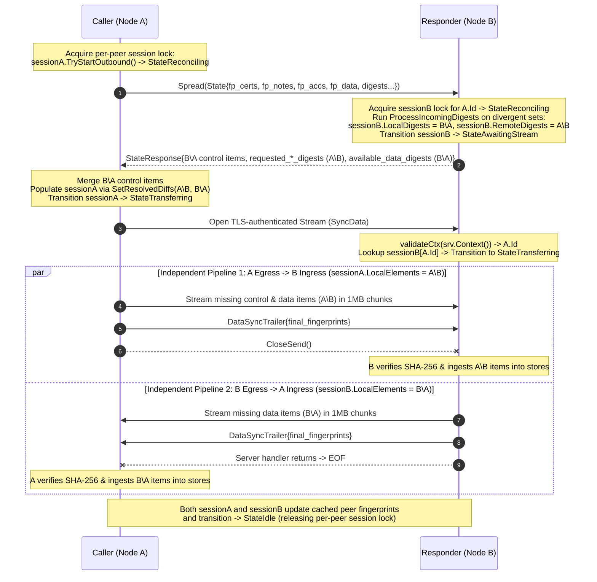

# Set Reconciliation, Bulk Data Streaming & Architectural Roadmap

This document captures the current state of Ifrit's set reconciliation architecture following the Version-Vector Redirection Layer and Certificate Store (`certStore`) refactorings, details the per-peer **Session Reconciliation State Machine** (`PeerReconcileSession`), identifies the concrete blockers and code simplifications required to get end-to-end data transfer working, and lays out the architectural path from unary `Spread` to rateless `StreamingSpread` (RIBLT) and decoupled two-way `SyncData` streaming.

---

## 1. Current Architectural State (Post-Redirection-Layer & `certStore` Refactor)

### 1.1 Completed Foundations
1. **UDP Pong Divergence Tracking**:
   - UDP `Pong` piggybacks three signed 64-bit commutative XOR fingerprints (`fingerprint_data`, `fingerprint_accusations`, `fingerprint_view`).
   - `discovery.Peer` caches peer fingerprints with zero redundant flags; `Node.IsDivergent` and `Node.DivergentSets` skip in-sync gossip partners.
2. **Core Data Primitives (`reverseindexstore` & `versionvector`)**:
   - **`ReverseIndexStore[T, S]`**: Thread-safe grow-only / mutable digest set in $GF(2)$ with incremental $O(1)$ XOR `Fingerprint()`, $O(1)$ `GetByDigest` / `GetByDigests`, and `Insert(elem) (S, bool)`.
   - **`CryptographicIdentity() []byte` & `DefaultHasher`**: `Accusation` (`accused:accuser:ringNum:epoch`), `Note` (`id:epoch:mask`), and `Certificate` (raw DER bytes) expose deterministic `CryptographicIdentity() []byte` payloads hashed via **SHA-256 truncated to 64-bit BigEndian `DigestSymbol`** (replacing legacy `ID() string` / FNV-1a to resist trivial collision attacks on Byzantine statements).
   - **Split Version Vector Primitives**:
     - `VersionVectorImmutable[T, S]`: Persistent/immutable versioned set with $O(1)$ digest lookup and XOR fingerprinting.
     - `VersionVectorMutable[K comparable, T any, S Symbol[S]]`: Decouples identity key `K` (e.g. `string` peer ID or `"accused:ringNum"`) from digest symbol `S`, enforcing monotonic version advancement ("largest epoch wins") with encapsulated `sync.RWMutex` concurrency.
3. **Two-Tier Unconditional Ingestion, Consolidated View State & `certStore`**:
   - **Tier 1 — Grow-Only Raw Storage (`ReverseIndexStore`)**:
     - `View.certStore`: Grow-only `ReverseIndexStore[*Certificate, DigestSymbol]` storing raw X.509 certificate DER bytes (`discovery.Certificate`), seeded with `self`'s certificate in `NewView` and updated in `AddFull` / `AddTestPeer` / `RemoveTestFull`.
     - `View.noteStore` & `View.accusationStore`: Every incoming `pb.Note` and `pb.Accusation` (`NoteFromPb`, `AccusationFromPb`) is **unconditionally inserted** into raw storage prior to semantic validation. Even out-of-order, corrupt, or adversarial statements are recorded in raw storage so set reconciliation XOR fingerprints converge deterministically across peers without permanent divergence loops.
     - **Composite View Fingerprint**: `View.Fingerprint()` returns `noteStore.Fingerprint().XOR(certStore.Fingerprint())`, allowing UDP `Pong` to detect both certificate and note divergences without altering the compact 3-fingerprint UDP wire framing (`data`, `accusations`, `view`).
     - **Canonical Store Accessors**: Eliminated redundant error-returning dual getters (`View.Notes()`, `View.Certificates()`, `Node.Notes()`, `Node.Certificates()`), standardizing on canonical non-nil accessors (`NoteStore()`, `CertStore()`, `AccusationStore()`) and pluggable session factories (`SetCertSessionFactory`, `SetNoteSessionFactory`, `SetAccusationSessionFactory`, `SetDataSessionFactory`).
   - **Tier 2 — Semantic Indirection (`VersionVectorMutable`)**:
     - `Peer.note`, `Peer.noteMutex`, `View.noteEpochs`, and nested `activeAccusations` maps have been **eliminated**, making `Peer` an immutable identity plus atomic counters/fingerprints.
     - `View.activeNotes` (`VersionVectorMutable[string, *Note, DigestSymbol]`) and `View.activeAccusations` (`VersionVectorMutable[string, *Accusation, DigestSymbol]`) serve as the sole semantic state layer via `PromoteNote` and `PromoteAccusation` (removing redundant wrappers like `recordActiveAccusation` and duplicate epoch checks in `applyValidAccusation`).
     - `View.ShouldRebuttal` implements **reboot epoch catch-up** (`epoch >= currNote.epoch` $\to$ `epoch + 1`), allowing restarted nodes without persisted epochs to refute stale/higher network accusations immediately.

### 1.2 Target System Architecture

```mermaid
flowchart TB
    subgraph L0["Tier 1: Grow-Only Raw Stores (GF(2) XOR Fingerprints)"]
        CertStore["View.certStore\nReverseIndexStore[*Certificate, DigestSymbol]"]
        NoteStore["View.noteStore\nReverseIndexStore[*Note, DigestSymbol]"]
        AccStore["View.accusationStore\nReverseIndexStore[*Accusation, DigestSymbol]"]
        DataStore["App DataStore\nReverseIndexStore[T, DigestSymbol]"]
    end

    subgraph L0_Indir["Tier 2: Semantic Redirection Layer (discovery.View)"]
        FullView["Full View & Rings\n(Validated Peers & Ring Topology)"]
        ActiveNotes["View.activeNotes\nVersionVectorMutable[peerID, *Note, DigestSymbol]"]
        ActiveAccs["View.activeAccusations\nVersionVectorMutable[accused:ring, *Accusation, DigestSymbol]"]
    end

    subgraph L1A["Control & Digest Reconciliation Plane (Session State Machine)"]
        FD["UDP Ping/Pong\n(3 Signed 64-bit XOR Fingerprints:\nView = FP_certs ^ FP_notes, Accs, Data)"]
        PeerSession["PeerReconcileSession (Bounded by O(numRings))\nPer-Peer Mutex + State: Idle -> Reconciling -> AwaitingStream/Transferring -> Idle\nHolds certSession, noteSession, accSession, dataSession"]
        UnarySpread["Unary Spread RPC (Baseline)\nPopulates LocalDigests (Send) & RemoteDigests (Recv) in Session"]
        StreamSpread["StreamingSpread RPC (Scale)\nRateless RIBLT Coded Symbol Stream -> O(d) Peeling"]
    end

    subgraph L1B["Bulk & Control Data Transfer Plane (Triggered by Session State)"]
        SyncStream["Two-Way Stream Transfer\nCaller Egress: sessionA.LocalElements() (A\\B)\nResponder Egress: sessionB.LocalElements() (B\\A)\nBounded O(chunk_size) Memory"]
    end

    CertStore --> FullView
    NoteStore --> ActiveNotes
    AccStore --> ActiveAccs
    CertStore & NoteStore & AccStore & DataStore --> FD
    FD -->|Divergent Peer| PeerSession
    PeerSession -->|StateReconciling| UnarySpread
    PeerSession -->|StateReconciling (Large Sets)| StreamSpread
    UnarySpread -->|SetResolvedDiffs: LocalDigests & RemoteDigests| PeerSession
    StreamSpread -->|Decoded LocalDigests & RemoteDigests| PeerSession
    PeerSession -->|StateTransferring| SyncStream
    SyncStream <--> CertStore & NoteStore & AccStore & DataStore
```

---

## 2. Session Reconciliation State Machine (`PeerReconcileSession`)

### 2.1 Why Stateful Per-Peer Sessions Replace Ad-Hoc Follow-Up `Spread` Calls
Previously, `ReconcileStore` created a `ReconcilerSession`, computed the diff on Responder B, and immediately discarded the session struct. Attempting to resolve $A \setminus B$ via a second "lightweight follow-up `Spread`" was an architectural smell that treated `Spread` as both a digest diff calculator and a one-way item transport.

Because the number of active gossip sessions on each node is strictly bounded by the ring topology ($O(\text{numRings})$, at most $2 \times \text{numRings}$ ring neighbours), **both Caller A and Responder B maintain a `PeerReconcileSession` per neighbour**. Look at how symmetric the state becomes right after `Spread`:

1. **On Responder B (inside `Spread`):**
   - B's session runs `sessionB.ProcessIncomingDigests(callerDigests)` for each divergent set (`cert`, `note`, `acc`, `data`) and stores:
     - `sessionB.LocalDigests()` = $B \setminus A$ (items B has that A lacks — ready to **send** to A)
     - `sessionB.RemoteDigests()` = $A \setminus B$ (items A has that B lacks — ready to **receive** from A)
   - B returns `Available*Digests` ($B \setminus A$) and `Requested*Digests` ($A \setminus B$) in `StateResponse`.
2. **On Caller A (receiving `StateResponse`):**
   - Using `SetResolvedDiffs(localDiff, remoteDiff []S)` on `ReconcilerSession`, A's session stores the exact duals from `StateResponse`:
     - `sessionA.LocalDigests()` = $A \setminus B$ (`Requested*Digests`: items A has that B lacks — ready to **send** to B)
     - `sessionA.RemoteDigests()` = $B \setminus A$ (`Available*Digests`: items B has that A lacks — ready to **receive** from B)
3. **Triggering the Data Plane:**
   - Because `sessionB` on Responder B *already* holds `LocalDigests()` ($B \setminus A$) and `RemoteDigests()` ($A \setminus B$) keyed by Caller A's TLS-authenticated `peer.Id`, when Caller A opens the stream to B, Responder B looks up `sessionB` by `peer.Id` from `validateCtx(srv.Context())` and **immediately streams `sessionB.LocalElements()` ($B \setminus A$) on its egress** while Caller A **streams `sessionA.LocalElements()` ($A \setminus B$) on its egress**!

### 2.2 Transition-Triggered State Machine vs. Polling Thread

| Approach | Pros | Cons |
| :--- | :--- | :--- |
| **Event-Driven State Machine** *(Each step triggers the next)* | • **Zero polling latency:** As soon as `Spread` populates `LocalDigests` & `RemoteDigests`, transitioning to `StateTransferring` immediately dispatches the stream transfer on `n.dispatcher`.<br/>• **Built-in in-flight guard:** If a peer's session is already active, `correct.Gossip` naturally skips it. | • If Responder B transitions to `StateAwaitingStream` and Caller A crashes before opening the stream, B's session needs a timeout reset. |
| **Dedicated Polling Thread** *(Checks session conditions)* | • Simple central loop scanning $\le 2 \times \text{numRings}$ sessions.<br/>• Easy to check timeouts on stuck sessions. | • Adds ticker latency between diff calculation and stream startup.<br/>• Still must spawn goroutines for blocking RPC/stream I/O and still needs state flags so the next tick doesn't re-trigger an active transfer. |

**Selected Design — Transition-Triggered State Machine + Existing `gossipLoop` Sweep + Per-Peer Mutex**:
1. **State Machine Lifecycle**:
   ```mermaid
   stateDiagram-v2
       [*] --> Idle
       Idle --> Reconciling : Outbound Gossip (Spread) or Inbound Spread
       Reconciling --> Idle : Diffs Empty (LocalDigests == ∅ && RemoteDigests == ∅)
       Reconciling --> Transferring : Caller A (Diffs Non-Empty -> Dispatch Stream)
       Reconciling --> AwaitingStream : Responder B (Diffs Non-Empty -> Wait for A's Stream)
       AwaitingStream --> Transferring : Responder B (Caller A Opens TLS Stream)
       AwaitingStream --> Idle : Stale Session Timeout (Swept by gossipLoop)
       Transferring --> Idle : Stream Verified & Fingerprints Updated
   ```
2. **Per-Peer Mutex (Solving the Simultaneous 2-Node Ring Initiation Race)**:
   - In a 2-member ring (where A and B are each other's neighbours), Node A can initiate `Spread` to Node B at the exact same instant Node B initiates `Spread` to Node A.
   - To ensure **only one session per peer pair can be active at a time**, `PeerReconcileSession` is guarded by a per-peer mutex / atomic state lock (`TryAcquireReconcile`):
     - When `correct.Gossip` selects peer `p`, it attempts to acquire `session.TryStartOutbound()`. If an inbound or outbound session with `p` is already non-`Idle` (`Reconciling`, `AwaitingStream`, or `Transferring`), `Gossip` skips `p` for that tick.
     - If a simultaneous `Spread` race occurs on the wire (`A -> B` and `B -> A` in flight simultaneously), a deterministic tie-breaker (`self.Id < peer.Id` or mutex acquisition order) ensures one session proceeds while the redundant concurrent initiation cleanly yields.
3. **Existing `gossipLoop` Sweeps Stale Sessions**:
   - No extra background polling thread is needed: on each `gossipLoop` tick, if a peer's session has been stuck in `StateAwaitingStream` past a configurable timeout (`staleSessionTimeout`), it is reset to `Idle`.

---

## 3. Concrete Blockers & Code Simplifications

### 3.1 Blockers to Clean Up First (Phase 4 / Phase A Blockers)

1. **Blocker 1 — Caller-Side Session Population (`SetResolvedDiffs` on `ReconcilerSession`)**:
   - Currently, `ReconcilerSession` (`core/reconcileable_store_interface.go:20-30`) only populates `localDiff` and `remoteDiff` on Responder B via `ProcessIncomingDigests`.
   - **Fix**: Add `SetResolvedDiffs(localDiff, remoteDiff []S)` to `ReconcilerSession` (implemented on both `NaiveExchangeSession` and `RIBLTSession`) so Caller A can populate its session from `StateResponse` (`Requested*Digests` as `localDiff` $A \setminus B$, `Available*Digests` as `remoteDiff` $B \setminus A$) using the exact same session interface (`LocalDigests()`, `LocalElements()`, `RemoteDigests()`, `Done() == true`).
2. **Blocker 2 — Data Delta Loss (`B \ A` Discarded in `typedDataReconciler.Reconcile`)**:
   - `typedDataReconciler[T].Reconcile` (`core/reconcileable_store_interface.go:125-128`) executes `_, remoteDigests, err := ReconcileStore(...)` — throwing away `localElements` ($B \setminus A$) and only returning `remoteDigests` ($A \setminus B$)!
   - **Fix**: Return **both** `localDigests` ($B \setminus A$) and `remoteDigests` ($A \setminus B$) from `DataReconciler.Reconcile`, store them in `PeerReconcileSession.dataSession`, and include both `requested_data_digests` ($A \setminus B$) and `available_data_digests` ($B \setminus A$) in `pb.StateResponse`.
3. **Blocker 3 — Control-Plane Asymmetry (`A \ B` Ignored in `correct.Gossip`)**:
   - `correct.Gossip` (`core/protocol.go:61-75`) ignores `reply.Requested*Digests` and overwrites `p.SetFingerprint*` with B's unchanged pre-push fingerprint, causing infinite `Spread` loops whenever $A \setminus B \neq \emptyset$ and $B \setminus A = \emptyset$.
   - **Fix**: Populate `PeerReconcileSession` with both `Requested*Digests` ($A \setminus B$) and `Available*Digests` ($B \setminus A$) and transfer missing items in both directions before updating cached peer fingerprints.
4. **Blocker 4 — `Node.Stream` Authentication & Routing**:
   - `Node.Stream` (`core/handlers.go:174-235`) currently omits `n.validateCtx(srv.Context())` and routes all bytes to the user-registered `streamHandler`.
   - **Fix**: Always validate the TLS peer certificate via `validateCtx(srv.Context())` to extract `peer.Id`. Dedicate `rpc SyncData` (or authenticated stream routing keyed by `peer.Id`) to look up `PeerReconcileSession[peer.Id]` and stream `session.LocalElements()` while ingesting `session.RemoteDigests()`.
5. **Blocker 5 — `DataReconciler` Lacks an Item Serialization / Streaming Codec**:
   - `RegisterDataStore[T](n, store)` erases type `T`, leaving `Node` with no way to serialize an element `T` by digest for outbound streaming or deserialize inbound bytes back into `store`.
   - **Fix**: Equip `DataReconciler` with `OpenItemReader` / `IngestItemReader` (with a zero-boilerplate default codec for `[]byte`, `string`, and JSON-serializable structs in `RegisterDataStore[T]`, plus a disk-backed `BlobDescriptor` codec for multi-GB files).

---

### 3.2 Taming the `Spread` Monster & Code Simplifications

`Node.Spread` (`core/handlers.go:46-154`) and its surrounding helpers carry heavy structural debt:

1. **Four-Branch Tangled Maze & Spurious `EROR` Log Spam on Every RPC**:
   - In `Spread`, `evalNote(args.GetOwnNote())` is duplicated in **3 separate branches** and `evalCertificate(cert)` in **2 branches**.
   - On **every single `Spread` call between already-known neighbors**, line 75 calls `n.evalCertificate(cert)` $\to$ `n.view.AddFull(id, cert)`, which acquires a write lock and logs `EROR Tried to add peer twice to full view` (`view.go:300`)!
2. **80+ Lines of Duplicated Legacy `ExistingHosts` Code & Wasted Wire Payload**:
   - `collectGossipContentForPeer` (`core/mutators.go:34`) still serializes and sends the entire `ExistingHosts` map (`map<string, uint64>` of all $N$ peers) on every `viewDiff`, even though `reconcileNotes` (`handlers.go:286`) immediately takes the `callerFp != nil` path and ignores `ExistingHosts` completely.
   - `reconcileNotes` (lines 320–355) contains a verbatim copy-paste of `mergeViews` (lines 378–414).
   - `core/protocol.go` (lines 131–403) retains 270+ lines of commented-out dead code (`spamAccusations`, `experiment`).

**Clean Refactored `Spread` Pipeline (~25 Lines)**:
```go
func (n *Node) Spread(ctx context.Context, args *pb.State) (*pb.StateResponse, error) {
    peer, wasObserved, err := n.admitCaller(ctx, args.GetOwnNote())
    if err != nil {
        return nil, err
    }

    reply := n.newStateResponse()

    if !n.view.ShouldBeNeighbour(peer.Id) {
        return n.handleNonNeighbourSpread(peer, wasObserved, reply)
    }

    n.reconcileControlAndData(peer, args, reply)
    n.handleExternalGossip(args, reply)
    return reply, nil
}
```
- **`admitCaller(ctx, ownNote)`**:
  1. Calls `validateCtx(ctx)` $\to$ extracts `cert` and `remoteId`.
  2. Checks `peer := n.view.Peer(remoteId)`. Only if `peer == nil` (`!wasObserved`) does it validate and insert `cert` via `evalCertificate(cert)` (eliminating redundant X.509 signature checks and `Tried to add peer twice` error logs!).
  3. Unconditionally inserts `ownNote` into `NoteStore()` (Tier 1) and evaluates `evalNote(ownNote)` once (Tier 2).

---

### 3.3 Certificate Gossiping at Scale (and Fixing the Orphaned-Note Wedge)

With `discovery.Certificate` and `View.certStore` now implemented and tested, wiring certificate reconciliation into `Spread` solves two critical scalability and correctness issues:

1. **Eliminating Redundant ~1KB X.509 Resends on Every Note Update**:
   - Previously, `reconcileNotes` unconditionally attached a peer's ~1KB X.509 certificate whenever sending a `Note` in `localDelta` — even when Caller A already had that peer's certificate.
   - By reconciling `certStore` via `ReconcileStore(n.getCertSessionFactory(), n.view.CertStore(), ...)`, each peer's X.509 certificate is transferred **at most once per peer pair** over the lifetime of the cluster. Once all $N$ certs are known, `CertFingerprint()` matches everywhere and **zero certificate bytes or digests** are sent during ongoing note/epoch churn.
2. **Eliminating the Orphaned-Note Wedge Bug**:
   - Under Tier 1 unconditional ingestion, if Node A receives `Note(C, epoch=1)` *before* learning `Cert(C)`, `Note(C, epoch=1)` enters `A.NoteStore()` while `evalNote` returns `errNoPeer` because `C` is not yet in `fullView`.
   - Because `View.Fingerprint()` is now `noteStore.Fingerprint().XOR(certStore.Fingerprint())`, Node A's view fingerprint still diverges from Node B's (which has `Cert(C)`).
   - Reconciling certificates **before** notes in `Spread` / `mergeCertificates` — and immediately checking `NoteStore()` to promote any waiting note for newly admitted peer `C` — guarantees that out-of-order notes promote as soon as their certificate arrives!

---

### 3.4 Set Reconciliation Strategy: Unary MTZ vs. `StreamingSpread` + RIBLT

| Dimension | Unary MTZ (Characteristic Polynomials) | `StreamingSpread` + Rateless RIBLT |
| :--- | :--- | :--- |
| **Is it truly 1-RTT Unary?** | **No, only when $d \le \bar{m}$!** Caller must guess an upper bound $\bar{m}$ on $d = \|A \triangle B\|$. Whenever $d > \bar{m}$ (bootstrap, node rejoin, partition heal), interpolation fails and requires **multi-round capacity doubling** ($\bar{m}, 2\bar{m}, 4\bar{m}\dots$) or full $O(N)$ fallback anyway. | **Yes — 1 stream, zero $d$ guessing!** Rateless encoder streams 24-byte coded symbols continuously; receiver peels in real time and sends `DECODED` the instant $1.35 d$ symbols arrive, seamlessly handling $d = 1$ to $d = 10^6$. |
| **CPU Complexity** | **$O(d^3)$ Gaussian / $O(d^2)$ Berlekamp-Massey + Chien/Berlekamp root-finding** over a finite field $\mathbb{F}_q$ ($q > 2^{64}$, requiring custom `uint128` / $GF(2^{64})$ arithmetic). Severe CPU cliff when $d > 500$. | **$O(d)$ simple XOR + SipHash peeling**. Scales linearly to hundreds of thousands of differences in milliseconds. |
| **Implementation Effort & Risk** | **High**: Zero finite-field / polynomial root-finding library exists in `go.mod`; requires building and debugging subtle algebra + multi-round fallback state machines from scratch. | **Low**: `github.com/yangl1996/riblt` and `RIBLTSession[T, S]` (`GenerateNextMessage`, `ProcessIncomingMessage`, `Done`) are **already implemented and tested** in `core/rateless_practical_set_reconciler_wrapper.go`! |
| **Session State Machine Fit** | Poor fit: requires multi-RPC retry loops on degree overflow. | **Native fit**: `PeerReconcileSession` holds `RIBLTSession` instances directly; `StreamingSpread` feeds incoming symbol batches into `ProcessIncomingMessage` until `Done() == true`, populating `LocalDigests()` and `RemoteDigests()` identically to `NaiveExchangeSession`! |

---

## 4. Detailed Design for Protobuf & Streaming Protocol

### 4.1 Protobuf Extensions (`protobuf/gossip.proto`)

```protobuf
service gossip {
    rpc Spread (State) returns (StateResponse) {}
    rpc StreamingSpread (stream SpreadFrame) returns (stream SpreadFrame) {}
    rpc SyncData (stream DataSyncFrame) returns (stream DataSyncFrame) {}
    rpc Messenger (Msg) returns (MsgResponse) {}
    rpc Stream (stream Msg) returns (stream MsgResponse) {}
}

message State {
    map<string, uint64> existingHosts = 1; // Deprecated legacy fallback
    Note ownNote = 2;
    bytes externalGossip = 3;

    bytes fingerprint_data = 4;
    bytes fingerprint_accusations = 5;
    bytes fingerprint_view = 6;          // XOR(fingerprint_certificates, fingerprint_notes)
    bytes fingerprint_certificates = 10;

    repeated uint64 accusation_digests = 7;
    repeated uint64 note_digests = 8;
    repeated uint64 data_digests = 9;
    repeated uint64 certificate_digests = 11;

    // Optional control items pushed from Caller -> Responder to complete A \ B
    repeated Certificate pushed_certificates = 12;
    repeated Note pushed_notes = 13;
    repeated Accusation pushed_accusations = 14;
}

message StateResponse {
    repeated Certificate certificates = 1;
    repeated Note notes = 2;
    repeated Accusation accusations = 3;
    bytes externalGossip = 4;

    bytes fingerprint_data = 5;
    bytes fingerprint_accusations = 6;
    bytes fingerprint_view = 7;
    bytes fingerprint_certificates = 11;

    repeated uint64 requested_accusation_digests = 8;   // A \ B
    repeated uint64 requested_note_digests = 9;         // A \ B
    repeated uint64 requested_data_digests = 10;        // A \ B: digests Caller A has that Responder B needs
    repeated uint64 available_data_digests = 12;        // B \ A: digests Responder B has that Caller A needs
    repeated uint64 requested_certificate_digests = 13; // A \ B
}
```

### 4.2 Session-Driven Two-Way `SyncData` Streaming Flow



---

## 5. Pragmatic Step-by-Step Execution Roadmap

### Phase A: `certStore`, Session Reconciliation State Machine, `Spread` Simplification & Bidirectional Control Sync
- [x] **Step 1 — `certStore` & Composite Fingerprinting (`core/discovery/`, `core/node.go`) [COMPLETED]**:
  - Created `discovery.Certificate` (`CryptographicIdentity() []byte` with SHA-256 `DefaultHasher`, `ToPbMsg()`, `CertificateFromPb()`, `CertificateFromX509()`, `Parse()`).
  - Integrated `View.certStore` seeded with `self` in `NewView` and remote peers in `AddFull` / `AddTestPeer` / `RemoveTestFull`.
  - Updated `View.Fingerprint()` to `noteStore.Fingerprint().XOR(certStore.Fingerprint())`.
  - Removed redundant dual getters (`Notes()`, `Certificates()`), standardizing on `NoteStore()` and `CertStore()`, and exposed `SetCertSessionFactory` on `Node`.
  - Verified with unit tests (`certificate_test.go`, `view_test.go`, `protocol_test.go`) and `go test -race -count=1`.
- [ ] **Step 2 — Clean Up Blockers & Build `PeerReconcileSession` State Machine (`core/reconcileable_store_interface.go`, `core/session_manager.go`)**:
  - Add `SetResolvedDiffs(localDiff, remoteDiff []S)` to `ReconcilerSession` (`NaiveExchangeSession` and `RIBLTSession`).
  - Fix `DataReconciler.Reconcile` (`typedDataReconciler[T]`) to return both `localDigests` ($B \setminus A$) and `remoteDigests` ($A \setminus B$).
  - Implement `PeerReconcileSession` and `PeerSessionManager` (bounded by ring neighbours) with a **per-peer mutex** preventing simultaneous 2-node ring initiation races, tracking states (`Idle`, `Reconciling`, `AwaitingStream`, `Transferring`) and per-set sessions (`certSession`, `noteSession`, `accSession`, `dataSession`), with unit tests verifying state transitions and concurrency guards.
- [ ] **Step 3 — Refactor `Spread` & Wire Certificate Reconciliation (`protobuf/gossip.proto`, `core/handlers.go`, `core/mutators.go`)**:
  - Add certificate fields (`fingerprint_certificates`, `certificate_digests`, `requested_certificate_digests`, `pushed_certificates`, `pushed_notes`, `pushed_accusations`) and `available_data_digests` ($B \setminus A$) to `protobuf/gossip.proto` and recompile.
  - Decompose `Node.Spread` into linear stages: `admitCaller` (calling `evalCertificate` only when `!wasObserved`), `handleNonNeighbourSpread`, and `reconcileControlAndData` (populating `PeerReconcileSession`).
  - Reconcile certificates via `ReconcileStore(n.getCertSessionFactory(), n.view.CertStore(), ...)` *before* notes, and promote any waiting unpromoted notes in `NoteStore()` when a new peer certificate is admitted (fixing the orphaned-note wedge).
  - Stop serializing `ExistingHosts` in `collectGossipContentForPeer` and remove duplicated `mergeViews` fallback code.
- [ ] **Step 4 — Bidirectional Control Sync (`A \ B` & `B \ A`) & Legacy Cleanup (`core/protocol.go`)**:
  - When `PeerReconcileSession` resolves non-empty `LocalDigests()` ($A \setminus B$) on Caller A for certificates, notes, or accusations, transition the session to push those missing items to Responder B and update cached peer fingerprints only after bidirectional completion.
  - Delete the 270+ lines of commented-out legacy code in `core/protocol.go`.
  - Verify all Phase A tests under `go test -race -count=1 ./core/... ./versionvector/...`.

### Phase B: `DataReconciler` Streaming Codec & Two-Way `SyncData` Transfer Plane
- [ ] **Step 1 — Extend `DataReconciler` with Streaming IO Codec (`core/reconcileable_store_interface.go`)**:
  - Add `OpenItemReader` / `IngestItemReader` to `DataReconciler` with a zero-config default in-memory codec for `RegisterDataStore[T]` and a disk-backed `BlobDescriptor` codec for multi-GB files.
- [ ] **Step 2 — Add `SyncData` RPC & Session-Driven Streaming Engine (`protobuf/gossip.proto`, `comm/client.go`, `core/handlers.go`)**:
  - Add `rpc SyncData (stream DataSyncFrame) returns (stream DataSyncFrame)` with TLS context validation (`validateCtx` $\to$ `peer.Id` session lookup).
  - When `PeerReconcileSession` transitions to `StateTransferring`, Caller A opens `SyncData` to B: A's egress streams `sessionA.LocalElements()` ($A \setminus B$) while B's egress streams `sessionB.LocalElements()` ($B \setminus A$) in 1MB chunks (`sync.Pool`), verifying SHA-256 digests and transitioning both sessions back to `StateIdle`.
- [ ] **Step 3 — End-to-End Integration Verification**:
  - Test asymmetric sets ($|A \setminus B| = 0, |B \setminus A| = 5,000$ and vice versa), simultaneous 2-node ring gossip ticks (verifying per-peer mutex), and multi-megabyte chunked streaming under `go test -race -count=1`.

### Phase C: Rateless `StreamingSpread` with `RIBLTSession`
- [ ] **Step 1 — Add `rpc StreamingSpread` (`protobuf/gossip.proto`, `comm/client.go`, `core/handlers.go`)**:
  - Stream batched 24-byte `RIBLTSession` coded symbols (`core/rateless_practical_set_reconciler_wrapper.go`) inside `PeerReconcileSession` for any set (`certs`, `notes`, `accs`, `data`) whose fingerprint diverges in `SpreadInit`.
  - Halt symbol generation per set immediately upon receiving `SetDecoded`, populate `session.LocalDigests()` and `session.RemoteDigests()`, and transition directly into `StateTransferring`.
- [ ] **Step 2 — Scale Verification**:
  - Benchmark and test 10,000+ item sets with small deltas ($d = 5$) and large partition-heal deltas ($d = 5,000$), verifying $O(d)$ wire transfer ($\approx 1.35 d$ symbols) and full convergence under `-race`.
