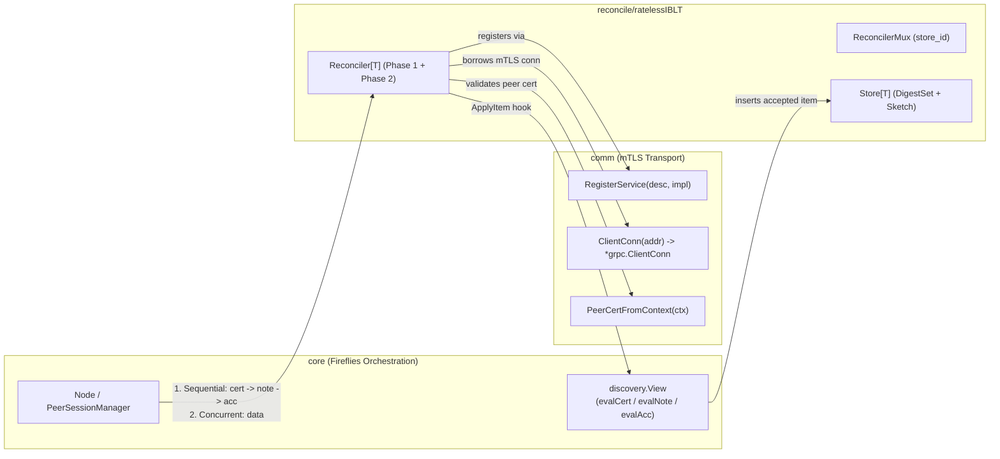

# Phased Integration Plan: `reconcile/ratelessIBLT` into `ifrit`

## Goal Description

Move set reconciliation and item transfer concerns out of `core/` and `protobuf/gossip.proto` into self-contained reconcilable store packages (starting with `reconcile/ratelessIBLT`), leaving `core/` responsible only for Fireflies membership, causal orchestration (`cert → note → accusation` sequentially, `data` concurrently), and per-peer concurrency gating.

We will execute this incrementally, beginning with **Phase 1 (Low-Fidelity Preparation)**:
1. Generalize `comm` so arbitrary gRPC services (including `reconcile/ratelessIBLT`) can register on the node's mTLS `grpc.Server` and borrow pooled mTLS `grpc.ClientConn` instances.
2. Expose `comm` mTLS peer-certificate extraction so `reconcile/ratelessIBLT` (and any future protocol module) can enforce authentication without dialing raw TCP connections.
3. Prepare `reconcile/ratelessIBLT` for dependency injection (connection provider, item applier hook, tamper/auth validation, and Phase 2 framing limits), without breaking existing `ifrit` tests.

---

## User Review Required

> [!IMPORTANT]
> **Multiplexing 4 stores over one gRPC `Reconciler` service (`store_id`):**
> A single `grpc.Server` cannot register four separate `reconpb_riblt.ReconcilerServer` instances under the same service name (`/recon.Reconciler`). We recommend adding a lightweight `ReconcilerMux` (dispatching by a `"store-id"` gRPC metadata header or an explicit `store_id` proto field) so `"certs"`, `"notes"`, `"accusations"`, and `"data"` share one gRPC service registration.

> [!WARNING]
> **Control-store admission vs. raw `store.Insert(item)`:**
> In `ifrit`, receiving a certificate, note, or accusation cannot bypass `View` rules (`evalValidCertificate`, `evalNote`, `evalAccusation`). `reconcile/ratelessIBLT` should accept an optional `ApplyItem(ctx, item) error` hook (defaulting to `store.Insert(item)` for standalone apps) so `ifrit` can route incoming control items through `View` validation while updating the store's sketch when `View` accepts them.

---

## Open Questions & Decisions

- **Store demultiplexing (`"store-id"` metadata):** Confirmed—`ReconcilerMux` will route streams using the gRPC `"store-id"` metadata header (with a `"default"` fallback when a standalone single-store server has only one handler registered).
- **Control-store admission (`ItemApplier` hook):** Confirmed—`Config[T].Applier` defaults to `store.Insert(item)` and allows `ifrit` to route incoming control items through `View` (`evalValidCertificate`, `evalNote`, `evalAccusation`).
- **Scope:** Confirmed—implement **Phase 1 only** (`comm` generalization + `ratelessIBLT` DI/hardening + unit tests), keeping existing `Spread`/`Sync` paths intact for Phase 2.

---

## Architecture Overview



---

## Proposed Changes

### Phase 1: Low-Fidelity Transport & Auth Preparation (`comm` & `core`)

#### [MODIFY] [comm.go](file:///home/uit-eindride/repos/master-thesis/fireflies/ifrit/comm/comm.go)
- Implement `grpc.ServiceRegistrar` directly on `*Comm` so any gRPC service can register onto `c.s.rpcServer` alongside `Gossip`:
  ```go
  // RegisterService registers a gRPC service implementation on the node's mTLS server.
  // Satisfies grpc.ServiceRegistrar.
  func (c *Comm) RegisterService(desc *grpc.ServiceDesc, impl interface{}) {
      c.s.rpcServer.RegisterService(desc, impl)
  }
  ```
- Keep `Register(p pb.GossipServer)` as a thin wrapper (`pb.RegisterGossipServer(c, p)`) during transition so existing callers compile unchanged.
- Add `PeerCertFromContext(ctx context.Context) (*x509.Certificate, error)` extracting `tlsInfo.State.PeerCertificates[0]` from `google.golang.org/grpc/peer` + `credentials.TLSInfo` (matching [`Node.validateCtx`](file:///home/uit-eindride/repos/master-thesis/fireflies/ifrit/core/eval_control.go#L416-L434), making mTLS identity reusable outside `core`).

#### [MODIFY] [client.go](file:///home/uit-eindride/repos/master-thesis/fireflies/ifrit/comm/client.go)
- Expose pooled mTLS connections from `*gRPCClient`:
  ```go
  // ClientConn returns a pooled, mTLS-authenticated gRPC ClientConn for addr.
  // Callers must NOT close the returned connection; lifecycle is managed by Comm.
  func (c *gRPCClient) ClientConn(addr string) (grpc.ClientConnInterface, error) {
      conn, err := c.connection(addr)
      if err != nil {
          return nil, err
      }
      return conn.cc, nil
  }
  ```

#### [MODIFY] [node.go](file:///home/uit-eindride/repos/master-thesis/fireflies/ifrit/core/node.go) & [node_test.go](file:///home/uit-eindride/repos/master-thesis/fireflies/ifrit/core/node_test.go)
- Extend `commService` in `core/node.go` with `RegisterService(*grpc.ServiceDesc, interface{})` and `ClientConn(string) (grpc.ClientConnInterface, error)` (and update `commStub` in `core/node_test.go`).
- Reuse `comm.PeerCertFromContext(ctx)` inside `Node.validateCtx(ctx)` to eliminate duplication once `comm` owns mTLS peer extraction.

---

### Phase 1B: Dependency Injection & Hardening in `reconcile/ratelessIBLT`

#### [MODIFY] [store.go](file:///home/uit-eindride/repos/master-thesis/fireflies/ifrit/reconcile/ratelessIBLT/store.go)
- Export `Store[T any, S Symbol[S]]` (or `RatelessIBLTStore` interface + exported constructor `NewRatelessIBLTStore` returning an exported type) so `core` and `discovery` can reference it.
- Ensure `Insert` / `InsertBatch` remain concurrency-safe and expose `SketchStore[S]` + `digestmaps.ReverseIndexStore[T, S]`.

#### [MODIFY] [reconcile_grpc.go](file:///home/uit-eindride/repos/master-thesis/fireflies/ifrit/reconcile/ratelessIBLT/reconcile_grpc.go)
- Export `Reconciler[T any]` and `Config[T any]` with injected dependencies:
  ```go
  type ConnProvider func(ctx context.Context, addr string) (grpc.ClientConnInterface, error)
  type PeerAuthenticator func(ctx context.Context) error
  type ItemApplier[T any] func(ctx context.Context, item T) error

  type Config[T any] struct {
      Codec           ItemCodec[T]
      ConnProvider    ConnProvider      // nil falls back to insecure dial for standalone use
      Auth            PeerAuthenticator // optional inbound mTLS/view peer check
      Detector        TamperDetector[T]
      Applier         ItemApplier[T]    // nil defaults to store.Insert(item)
      SymbolBatchSize int
      MaxItemBytes    int64             // bounds Phase 2 buffer growth
      Timeout         time.Duration
  }
  ```
- Fix Phase 2 security & framing gaps in `recvSyncFrames`:
  - Enforce `Config.Auth(stream.Context())` at the start of `ReconcileDigests` and `Sync` handlers.
  - Enforce an `expectedData` allowlist (built from `available` digests on caller and `requested` digests on responder) and active-item framing (`hasActiveData` state machine), reporting violations to `TamperDetector.OnMisbehavior`.
  - Enforce `MaxItemBytes` on both `DataHeader.TotalSize` and cumulative `DataChunk` bytes.
  - Pass `ReconcileWithPeer(ctx context.Context, addr string)` so `core` can pass `peer.Addr` directly without constructing `ratelessIBLT.Peer{Host, Port}`.
- Add a lightweight `ReconcilerMux` implementing `reconpb_riblt.ReconcilerServer` that routes incoming streams by `"store-id"` metadata (or proto field) to registered store reconcilers.

---

### Phase 2 (Follow-up): Wiring Control & Data Stores in `core`

1. **Decouple `Spread` admission from reconciliation:** Keep a lightweight admission/ping check in `core` (`admitCaller` + non-neighbour accusation fast-path), while `Node.gossip()` triggers `Reconciler.ReconcileWithPeer` under `PeerSessionManager` (serializing `(self, peer)` sessions via the existing tie-breaker):
   - Sequentially: `certReconciler` → `noteReconciler` → `accReconciler` (injecting `evalValidCertificate`, `evalNote`, `evalAccusation` as `ItemApplier`).
   - Concurrently (when neighbour is integrated): `dataReconciler`.
2. **Simplify `PeerSessionManager`:** Remove `ReconcileDeltas` and `SessionAwaitingTransfer` since each store reconciler runs Phase 1 → Phase 2 within one `ReconcileWithPeer` call.
3. **Update `peer.SetFingerprints(...)`** after all store reconciliations complete.

---

### Phase 3 (Follow-up): Protocol & Legacy Cleanup

- Strip obsolete reconciliation fields (`*_digests`, `SyncFrame`, `CertificateBatch`, etc.) from `protobuf/gossip.proto` and regenerate `gossip.pb.go`.
- Retire `core/sync.go`, `core/spread_digest_reconciliation_helpers.go`, `core/reconciler_session_naive.go`, and `core/reconciler_session_rateless_riblt.go`.

---

## Verification Plan (TDD-First Execution Order)

We will **write the tests first** against the target API signatures, confirm they fail as expected before implementation, and then implement `comm` and `reconcile/ratelessIBLT` until the full suite passes.

### Step 1: New Tests Written First

1. **`comm` (`comm/comm_test.go`):**
   - **Generic service registration & pooled mTLS `ClientConn`:** Create two `Comm` instances on `127.0.0.1:0` sharing a test CA (using ephemeral self-signed/CA certs via `crypto/cauth` or test helpers, avoiding DNS `"sandbox"` lookup), register a secondary gRPC service (e.g., a test `Reconciler` or `Gossip` handler) via `comm.RegisterService(...)`, obtain a pooled connection via `comm.ClientConn(addr)`, invoke an RPC, and assert that subsequent `ClientConn(addr)` calls reuse the same underlying `*grpc.ClientConn`.
   - **mTLS peer authentication (`PeerCertFromContext`):** Inside the secondary service handler on `Comm`, verify `comm.PeerCertFromContext(ctx)` returns the caller's exact `*x509.Certificate` (matching `SubjectKeyId`), and returns typed errors when called with a `context.Background()` (no peer) or non-TLS peer.
   - **Telemetry compatibility:** Verify calls made over `comm.ClientConn(addr)` pass through `comm`'s existing TLS + stream/unary telemetry interceptors cleanly.

2. **`reconcile/ratelessIBLT` (`reconcile/ratelessIBLT/reconcile_test.go`):**
   - **End-to-end mTLS reconciliation over `comm.Comm`:** Wire two `ifrit` `comm.Comm` nodes with `ReconcilerMux` registered via `Comm.RegisterService` and `Config.ConnProvider` backed by `Comm.ClientConn` + `Config.Auth` backed by `comm.PeerCertFromContext`; reconcile disjoint and overlapping sets (both within `Sketch` capacity and exceeding `Sketch` capacity to trigger `UsedFallback = true`) and assert both stores converge to identical sets and fingerprints.
   - **Multi-store multiplexing (`ReconcilerMux` via `"store-id"` metadata):** Register two independent stores (`"certs"` and `"data"`) on one `ReconcilerMux`; reconcile `"certs"` and verify `"data"` is untouched, and verify missing/unknown `"store-id"` metadata returns `codes.InvalidArgument` / `codes.NotFound`.
   - **Auth rejection:** Configure `Config.Auth` to reject unauthorized peers and verify both `ReconcileDigests` and `Sync` streams abort before touching store state and trigger `TamperDetector.OnMisbehavior`.
   - **Phase 2 security & framing guards (`TamperDetector`):**
     - `MaxItemBytes` exceeded on `DataHeader.TotalSize` and on accumulated `DataChunk` bytes.
     - Unsolicited `DataHeader` (digest not in negotiated `expectedData` allowlist) rejected with `OnMisbehavior` triggered.
     - Framing violations (`DataChunk` or `DataEnd` without `DataHeader`, digest mismatch on `DataEnd`, missing `SyncComplete` before `io.EOF`) rejected with `OnMisbehavior` triggered.
   - **Custom `ItemApplier` hook:** Inject an `Applier` that rejects invalid items (simulating `evalNote`/`evalAccusation` rejection) and accepts valid ones, verifying rejected items never enter `Store` and trigger `OnMisbehavior`.

### Step 2: Automated Verification Commands
- `go fmt ./... && go vet ./... && go build ./...`
- `go test -count=1 ./comm/... ./reconcile/... ./digestmaps/... ./core/...`
- `go test -race -count=1 ./comm/... ./reconcile/... ./core/...`
