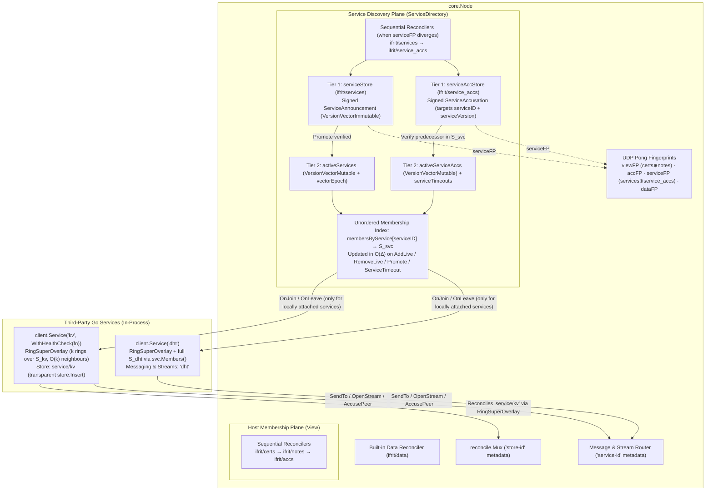

# Phase 1 Plan: In-Process Service Multiplexing, Service Discovery & Deterministic Ring Super-Overlays (Greenfield)

## 1. Goal & Scope

Transform Ifrit into a **multiplexed membership, service discovery, and transport substrate** for third-party distributed services (DHTs, worker orchestrators, file-sharing services, pub/sub systems, message queues, etc.). Because this is a greenfield project with no downstream users, we will update `pb.Pong`, internal APIs, `ifrit.Client`, and `examples/` directly without backwards-compatibility shims, while keeping the core Fireflies host membership protocol (`Note`, `Accusation`, base rings) completely pure and keeping the built-in `ifrit/data` store isolated for node/cluster-level state (e.g., future certificate revocations/CRLs and dissemination sanity checks).

### Key Deliverables in Phase 1
1. **Store Namespacing, Dedicated `fingerprint_services`, & R5 Isolation**:
   - Namespace built-in stores under:
     - **Host Membership Plane**: `ifrit/certs`, `ifrit/notes`, `ifrit/accs`
     - **Service Discovery Plane**: `ifrit/services` (`ServiceAnnouncement`), `ifrit/service_accs` (`ServiceAccusation`)
     - **Node Data Plane**: `ifrit/data`
   - Reserve `service/<service-id>` for third-party service stores (`serviceID` validated against `^[a-z0-9._-]{1,64}$`).
   - Add `bytes fingerprint_services = 6;` (`serviceStore.Fingerprint() ^ serviceAccStore.Fingerprint()`) directly to `pb.Pong` (signed in `comm.PongContent`) so service-discovery changes trigger **only** `ifrit/services` $\rightarrow$ `ifrit/service_accs` reconciliation without touching host `ifrit/certs`, `ifrit/notes`, or `ifrit/accs`.
   - Decouple control fingerprint updates (`viewFP`, `accFP`, `serviceFP`) from `ifrit/data` errors (**Audit R5**).
2. **Service Discovery Module (`ServiceAnnouncement` wrapping `VersionVectorImmutable` + `ServiceDirectory`)**:
   - Restore `digestmaps.VersionVectorImmutable` and add a monotonic `Epoch() uint64` (`vectorEpoch`) to both `VersionVectorImmutable` and `VersionVectorMutable`, along with deterministic canonical serialization (`OrderedElements`) for signing immutable version-vector snapshots.
   - Model each node's `ServiceAnnouncement` as a signed wrapper around a `VersionVectorImmutable[string, string, DigestSymbol]` (holding the node's hosted `serviceID -> serviceVersion` entries, its own announcement `Epoch()`, and an incremental `Fingerprint()`).
   - Spread `ServiceAnnouncement` records through a Tier 1 grow-only reconcilable store (`ifrit/services`, wrapping `ReverseIndexStore`) driven by `reconcile.Engine`, with Tier 2 `activeServices` (`VersionVectorMutable`, including `self`) as the single source of truth.
3. **Separated `ServiceAccusation` + `ServiceAccusationStore` (`ifrit/service_accs`) & Per-Service Rebuttal Isolation (Option B)**:
   - Keep host `discovery.Accusation` (`ifrit/accs`) 100% dedicated to host liveness.
   - Add `discovery.ServiceAccusation` (`ifrit/service_accs`) targeting a specific `(accused, serviceID, serviceVersion, ringNum)` tuple—where `serviceVersion` is that service's version inside `accused`'s `VersionVectorImmutable` (so unrelated services joining/leaving on `accused` can advance `ServiceAnnouncement.Epoch()` without falsely cancelling an accusation against `serviceID`).
   - **Super-Overlay Predecessor Verification**: Unlike host accusations (which check predecessor on the global base ring), a `ServiceAccusation` is valid only if `accuser` is `accused`'s predecessor on `ringNum` within **`serviceID`'s deterministic $k$-ring `RingSuperOverlay` over $S_{\text{svc}}$**.
   - **Health-Gated Rebuttal**: When `accused == self`, the node checks the service's local `HealthCheck` callback (`true` by default if still attached in-process; in Phase 2, probing the external process's Unix socket). If healthy, it rebuts by incrementing **`serviceID`'s `serviceVersion` ($v \to v+1$)** in its `VersionVectorImmutable` and publishing the new `ServiceAnnouncement`. If unhealthy or un-rebutted within `removalTimeout`, `(accused, serviceID)` is evicted from `ServiceDirectory` across the global catalog while host `accused` remains alive in `View.Live()`.
4. **Deterministic $k$-Ring `RingSuperOverlay` Over $S_{\text{svc}}$ (Built for Large $N$ & Global Predecessor Verification)**:
   - Standardize the service super-overlay on a deterministic $k$-ring **`RingSuperOverlay`** over $S_{\text{svc}} \subseteq V_{\text{live}}$ (reusing `core/discovery/ring.go`'s `SHA256(peer.ID || ringNum)` ring logic).
   - Why avoid arbitrary/random super-overlays for Ifrit's service layer: Every node in the cluster must be able to deterministically verify whether `accuser` is `accused`'s predecessor on `ringNum` within $S_{\text{svc}}$ when validating a `ServiceAccusation`! With deterministic $k$-rings over $S_{\text{svc}}$, any node can verify the predecessor relation in $S_{\text{svc}}$ directly from `membersByService[serviceID]`, and locally-attached services get $O(k)$ `Neighbours()` and $O(1)$ `GossipPartners()` without ever walking the $N$-node global ring. (Services that also want custom application-level routing like a DHT finger table still have full $O(|S_{\text{svc}}|)$ access to `svc.Members()`.)
5. **Greenfield Service-Scoped Messaging, Streaming & Transparent Store Reconciliation**:
   - Replace single `msgHandler` / `streamHandler` slots on `core.Node` with `"service-id"`-keyed routers (and enforce `validateCtx` on `Node.Stream`, **Audit S10**).
   - Expose `client.Service(serviceID, opts...)` (`*ServiceEndpoint`) and update `examples/messages`, `examples/streaming`, and `cmd/ifritclient` directly.
   - Provide `ifrit.RegisterServiceStore[T](svc, store)` for `store.Insert()` distribution transparency over the service's `RingSuperOverlay`.

---

## 2. Architecture Overview



---

## 3. Detailed Component Design

### 3.1 `VersionVector` Enhancements: `Epoch()` & Restored `VersionVectorImmutable` (`digestmaps`)

#### [MODIFY] [digestmaps/interface.go](file:///home/uit-eindride/repos/master-thesis/fireflies/ifrit/digestmaps/interface.go) & [digestmaps/version_vector_mutable.go](file:///home/uit-eindride/repos/master-thesis/fireflies/ifrit/digestmaps/version_vector_mutable.go)
- Add `Epoch() uint64` to the shared `VersionVector[K, T, S]` interface:
  - On `versionVectorMutable`: increment `vectorEpoch uint64` under `vv.mu.Lock()` whenever `AddItem` (advancing an entry), `Remove`, `RemoveVersion`, or `Clear` mutates the vector.

#### [NEW] `digestmaps/version_vector_immutable.go` & `digestmaps/version_vector_immutable_test.go`
- Restore `VersionVectorImmutable[K, T, S]` (from `4195d79~1`) and add:
  - `epoch uint64` field (`Epoch() uint64`): starts at `0` on `NewVersionVectorImmutable`; every mutating operation (`AddItem`, `Remove`, `RemoveVersion`) that produces a new snapshot sets `epoch = vv.epoch + 1`, leaving all prior snapshots untouched.
  - `NewVersionVectorImmutableSnapshot[K, T, S](epoch uint64, keyFunc, hasher, items ...VersionedItem[T])`: reconstructs a deserialized immutable snapshot with its exact wire `epoch` and incremental XOR `fingerprint`.
  - Canonical ordered entry helper `OrderedElements[K cmp.Ordered, T any, S Symbol[S]](vv VersionVector[K, T, S]) []VersionedItem[T]` so any immutable version vector with ordered keys can be deterministically marshaled and cryptographically signed.

---

### 3.2 Service Discovery, `ServiceAccusation`, & `RingSuperOverlay` (`core/discovery`)

#### [NEW] `core/discovery/service_announcement.go`
- `ServiceAnnouncement` wraps a signed `VersionVectorImmutable[string, string, DigestSymbol]` (storing each hosted `serviceID` and its `serviceVersion uint64`, plus the node's monotonic announcement `Epoch()`):
  ```go
  type ServiceAnnouncement struct {
      id        string // Peer.Id (32-byte SubjectKeyId)
      services  digestmaps.VersionVectorImmutable[string, string, digestmaps.DigestSymbol]
      signature *signature // ECDSA (r, s) over UnsignedBytes()
  }
  ```
- **Operations & Security**:
  - `HasService(id string) bool` $\rightarrow$ `services.ContainsKey(id)` ($O(1)$).
  - `ServiceVersion(id string) (uint64, bool)` $\rightarrow$ `item, ok := services.GetOne(id); return item.Version, ok` ($O(1)$).
  - `UnsignedBytes() []byte`: Canonical length-prefixed encoding of `(id, services.Epoch(), OrderedElements(services))`.
  - `CryptographicIdentity() []byte`: Returns `UnsignedBytes()` (hashed with SHA-256 by `digestmaps.MustDefaultHasher[*ServiceAnnouncement]()`).
  - `MarshalBinary() ([]byte, error)` / `UnmarshalServiceAnnouncement([]byte) (*ServiceAnnouncement, error)`.
  - `ValidateServiceID(id string) error`: Enforces `^[a-z0-9._-]{1,64}$`.

#### [NEW] `core/discovery/service_accusation.go`
- Dedicated `ServiceAccusation` struct (keeping `discovery.Accusation` and `pb.Accusation` untouched):
  ```go
  type ServiceAccusation struct {
      ringNum        uint32
      serviceVersion uint64 // Target version of serviceID in accused's VersionVectorImmutable
      serviceID      string // Accused service identifier
      accuser        string // Peer.Id of the predecessor on ringNum in S_svc's RingSuperOverlay
      accused        string // Peer.Id of the accused service host
      *signature            // ECDSA (r, s) over UnsignedBytes()
  }
  ```
- Implements `CryptographicIdentity() []byte` (`UnsignedBytes()`), `MarshalBinary()`, and `UnmarshalServiceAccusation([]byte)`.
- Targets `serviceVersion` (the specific service's version inside `accused`'s `VersionVectorImmutable`) rather than the whole-node announcement epoch, so unrelated services registering/unregistering on `accused` never cancel an active accusation against `serviceID`.

#### [NEW] `core/discovery/super_overlay.go`
- Export `PeerInfo` and `RingSuperOverlay` (built on `core/discovery/ring.go`'s deterministic `SHA256(peer.ID || ringNum)` $k$-rings):
  ```go
  type PeerInfo struct {
      ID   string
      Addr string
  }

  type SuperOverlay interface {
      OnJoin(peer PeerInfo)
      OnLeave(peerID string)
      Neighbours() []PeerInfo
      GossipPartners() []PeerInfo
  }
  ```
- **`RingSuperOverlay`**:
  - Wraps `createRings(self, numRings)` over **only** the live members of $S_{\text{svc}}$:
    - `Neighbours()` is $O(k)$; `GossipPartners()` is $O(1)$.
    - `OnJoin` / `OnLeave` update only the $S_{\text{svc}}$ sub-rings.
- **Deterministic Super-Overlay Predecessor Verification (`IsServicePredecessor`)**:
  - For a `ServiceAccusation` on `ringNum` ($1 \le \text{ringNum} \le \text{numRings}$) in `serviceID`:
    - If `RingSuperOverlay` is locally materialized for `serviceID`, check `overlay.IsPredecessor(accused, accuser, ringNum)`.
    - Otherwise (on a node that does not host `serviceID` itself), verify from `membersByService[serviceID]` ($S_{\text{svc}}$) that both `accuser` and `accused` are in $S_{\text{svc}}$ (`accuser != accused`) and no other live member $p \in S_{\text{svc}}$ has `hashId(ringNum, p.Id)` strictly between `hashId(ringNum, accuser.Id)` and `hashId(ringNum, accused.Id)` (`isBetween` from [`ring.go#L420`](file:///home/uit-eindride/repos/master-thesis/fireflies/ifrit/core/discovery/ring.go#L420)).

#### [NEW] `core/discovery/service_directory.go`
- Cohesive `ServiceDirectory` component owned by `View`:
  - **Tier 1 Stores**:
    - `serviceStore digestmaps.ReverseIndexStore[*ServiceAnnouncement, digestmaps.DigestSymbol]` (`ifrit/services`)
    - `serviceAccStore digestmaps.ReverseIndexStore[*ServiceAccusation, digestmaps.DigestSymbol]` (`ifrit/service_accs`)
    - `Fingerprint() digestmaps.DigestSymbol`: returns `serviceStore.Fingerprint().XOR(serviceAccStore.Fingerprint())` (reported as `fingerprint_services` in UDP `Pong`).
  - **Tier 2 Active Indirection Layers**:
    - `activeServices digestmaps.VersionVectorMutable[string, *ServiceAnnouncement, digestmaps.DigestSymbol]` (keyed by `peer.Id`, versioned by `ann.Epoch()`).
    - `activeAccusations digestmaps.VersionVectorMutable[string, *ServiceAccusation, digestmaps.DigestSymbol]` (keyed by `fmt.Sprintf("%s:%s:%d", accused, serviceID, ringNum)`, versioned by `acc.ServiceVersion()`).
  - **Incremental Unordered Membership Index & Timers**:
    - `membersByService map[string]map[string]*Peer` (`serviceID -> {peerID -> *Peer}`).
    - `evictedVersions map[string]uint64` (`peerID + ":" + serviceID -> evictedServiceVersion`) so an evicted service remains excluded from `membersByService` until the peer publishes a `ServiceAnnouncement` where that service's `ServiceVersion > evictedServiceVersion`.
    - `serviceTimeouts map[string]*serviceTimeout` (`peerID + ":" + serviceID -> {timeStamp, serviceVersion, accused, serviceID}`).
    - `overlays map[string]*RingSuperOverlay` and `healthChecks map[string]func() bool` for locally-attached services.
- **Lifecycle & Accusation Flow**:
  - `OnPeerLive(p)` / `OnPeerDead(p)`: Updates `membersByService` and attached `RingSuperOverlay`s in $O(\Delta)$.
  - `PromoteAnnouncement(ann, isLive)`:
    - Advances `activeServices` if `ann.Epoch() > curr.Version`.
    - For each service in `ann`, if `ann.ServiceVersion(svcID)` advanced past any active accusation or pending `serviceTimeout` for `(ann.Id(), svcID)`, prunes those accusations and cancels the timer!
    - Updates `membersByService` and notifies attached `RingSuperOverlay`s (`OnJoin` / `OnLeave`).
  - `ValidateAndPromoteAccusation(acc)`:
    - Checks `ringNum` in `[1, numRings]`, verifies `accused` currently announces `acc.ServiceID()` at `ServiceVersion == acc.ServiceVersion()`, and checks `IsServicePredecessor(acc.ServiceID(), accused, accuser, acc.RingNum())` in $S_{\text{svc}}$.
    - If `accused == self`: invokes `ShouldRebutService(acc.ServiceID(), acc.ServiceVersion())`—checking `healthChecks[serviceID]()`. If healthy, increments `serviceID`'s version (`acc.ServiceVersion() + 1`) in `self`'s `VersionVectorImmutable`, signs and inserts the rebuttal `ServiceAnnouncement` into `serviceStore` + `activeServices`. If unhealthy, unregisters `serviceID` locally.
    - If `accused != self`: promotes into `activeAccusations` and starts a `serviceTimeout` if `accused` is currently in `membersByService[serviceID]`.
  - `CheckTimeouts(now, removalTimeout)`:
    - Called from `View.checkTimeouts()`. When a `serviceTimeout` expires, records `evictedVersions[key] = t.serviceVersion`, deletes `accused.Id` from `membersByService[t.serviceID]`, and calls `overlays[t.serviceID].OnLeave(accused.Id)`—evicting the dead/malignant service while keeping `accused` alive in `View.Live()`.

---

### 3.3 Dedicated `fingerprint_services` in `pb.Pong` & UDP Ping Service (`protobuf`, `comm`, `core`)

#### [MODIFY] [protobuf/gossip.proto](file:///home/uit-eindride/repos/master-thesis/fireflies/ifrit/protobuf/gossip.proto)
- Add field 6 to `Pong` (leaving `Accusation`, `Note`, `State`, etc. untouched) and regenerate via `just proto-gossip`:
  ```protobuf
  message Pong {
      bytes nonce = 1;
      Signature signature = 2;
      bytes fingerprint_data = 3;
      bytes fingerprint_accusations = 4;
      bytes fingerprint_view = 5;
      bytes fingerprint_services = 6;
  }
  ```

#### [MODIFY] [comm/udp.go](file:///home/uit-eindride/repos/master-thesis/fireflies/ifrit/comm/udp.go), [core/fireflies.go](file:///home/uit-eindride/repos/master-thesis/fireflies/ifrit/core/fireflies.go), & [core/node_store_helpers.go](file:///home/uit-eindride/repos/master-thesis/fireflies/ifrit/core/node_store_helpers.go)
- Add `Services []byte` to `comm.Fingerprints` and `comm.PongContent(nonce, fpData, fpAcc, fpView, fpServices)`.
- Update `discovery.Peer` with `FingerprintServices()` / `SetFingerprintServices(fp)` and `Node.DivergentSets(peer)` returning `(dataDiff, accDiff, viewDiff, serviceDiff bool)`.

---

### 3.4 Control Reconcilers, Store Namespaces & R5 Isolation (`core`)

#### [MODIFY] [core/control_reconcilers.go](file:///home/uit-eindride/repos/master-thesis/fireflies/ifrit/core/control_reconcilers.go) & [core/eval_control.go](file:///home/uit-eindride/repos/master-thesis/fireflies/ifrit/core/eval_control.go)
- Store IDs:
  ```go
  const (
      storeIDCerts       = "ifrit/certs"
      storeIDNotes       = "ifrit/notes"
      storeIDAccs        = "ifrit/accs"
      storeIDServices    = "ifrit/services"
      storeIDServiceAccs = "ifrit/service_accs"
      storeIDData        = "ifrit/data"
      serviceStorePrefix = "service/"
  )
  ```
- Build `n.serviceReconciler` (`ifrit/services`) and `n.serviceAccReconciler` (`ifrit/service_accs`) via `buildControlReconciler`.
- **Selective & Causally-Ordered Reconciliation in `reconcilePeerStores`**:
  - Host Membership Plane (`ifrit/certs → ifrit/notes → ifrit/accs`) updates `viewFP` and `accFP` as soon as it succeeds.
  - Service Discovery Plane (`ifrit/services → ifrit/service_accs`, running after `ifrit/certs` when `serviceDiff` is true) updates `serviceFP` as soon as it succeeds.
  - Node Data Plane (`ifrit/data`, running concurrently when `dataDiff` is true) updates `dataFP` only if `dataErr == nil` (**Audit R5**).

---

### 3.5 Greenfield Service-Scoped Messaging, Streaming & Service Store Reconciliation (`comm`, `reconcile`, `core`, `client.go`)

#### [MODIFY] [comm/client.go](file:///home/uit-eindride/repos/master-thesis/fireflies/ifrit/comm/client.go)
- Add `ServiceIDMetadataKey = "service-id"`.
- Update `Send(serviceID, addr string, args *pb.Msg) (*pb.MsgResponse, error)` and `StreamMessenger(serviceID, addr string, input, reply chan []byte) error` to attach `"service-id": serviceID` to outgoing gRPC metadata.

#### [MODIFY] [reconcile/mux.go](file:///home/uit-eindride/repos/master-thesis/fireflies/ifrit/reconcile/mux.go) & [reconcile/engine.go](file:///home/uit-eindride/repos/master-thesis/fireflies/ifrit/reconcile/engine.go)
- Add `Mux.UnregisterStore(storeID string)` and `Engine.Fingerprint() []byte`.
- Add `StoreFingerprintMetadataKey = "store-fp"` on `Engine` outbound stream metadata and a 0-round fast-exit in `HandleReconcile` when the initiator's `"store-fp"` already matches `e.store.Fingerprint()`.

#### [MODIFY] [core/node.go](file:///home/uit-eindride/repos/master-thesis/fireflies/ifrit/core/node.go), [core/handlers.go](file:///home/uit-eindride/repos/master-thesis/fireflies/ifrit/core/handlers.go), & [NEW] `core/service_multiplexer.go`
- Replace single `msgHandler`/`streamHandler` on `Node` with `serviceID`-keyed maps (`msgHandlers`, `streamHandlers`) plus a `serviceStores` map (`serviceID -> *serviceStoreEntry`) holding attached service reconcilers and their cached per-peer remote fingerprints.
- Enforce `n.validateCtx(ctx)` in both `Node.Messenger` and `Node.Stream` (**Audit S10**), routing by `"service-id"` metadata.
- On each gossip tick, reconcile registered `service/<service-id>` stores with `RingSuperOverlay.GossipPartners()` whenever the local store's fingerprint differs from the partner's cached fingerprint.

#### [MODIFY] [client.go](file:///home/uit-eindride/repos/master-thesis/fireflies/ifrit/client.go) & Examples (`examples/messages`, `examples/streaming`, `cmd/ifritclient`)
- Expose single-purpose facets and `ServiceEndpoint` on `ifrit.Client`:
  ```go
  func (c *Client) Self() discovery.PeerInfo
  func (c *Client) LivePeers() []discovery.PeerInfo
  func (c *Client) Neighbours() []string
  func (c *Client) ConnProvider() reconcile.ConnProvider
  func (c *Client) PeerAuthenticator() reconcile.PeerAuthenticator
  func (c *Client) ServiceMembers(serviceID string) []discovery.PeerInfo

  func (c *Client) Service(serviceID string, opts ...ServiceOption) (*ServiceEndpoint, error)
  ```
- Methods on `*ServiceEndpoint`:
  - `ID() string`
  - `Members() []discovery.PeerInfo` / `MemberAddrs() []string` — $O(|S_{\text{svc}}|)$ live members hosting `serviceID` (sorted by ID)
  - `Neighbours() []discovery.PeerInfo` / `NeighbourAddrs() []string` — $O(k)$ deterministic neighbors from the service's `RingSuperOverlay`
  - `AccusePeer(peerID string, ringNum uint32) error` — signs and publishes a `ServiceAccusation` against `(peerID, serviceID)` on `ringNum`
  - `SendTo(dest string, data []byte) chan *core.Message`
  - `SendToId(destId []byte, data []byte) (chan *core.Message, error)`
  - `RegisterMsgHandler(fn func([]byte) ([]byte, error))`
  - `OpenStream(dest string) (chan []byte, chan []byte)`
  - `RegisterStreamHandler(fn func(chan []byte, chan []byte))`
  - `RegisterStoreReconciler(rec reconcile.StoreReconciler, fpFn func() []byte) error`
  - `Close() error` — removes handlers, store reconciler, and super-overlay, and publishes an incremented `ServiceAnnouncement` epoch without `serviceID`.
- Generic helper:
  - `func RegisterServiceStore[T any](svc *ServiceEndpoint, store ReverseIndexStore[T], codec ...ItemCodec[T]) error`
- Update `examples/messages`, `examples/streaming`, and `cmd/ifritclient` to use `client.Service(...)`.

---

## 4. Verification & Test Plan

1. **Unit Tests — `digestmaps` & `core/discovery`**:
   - `VersionVectorMutable.Epoch()` & `VersionVectorImmutable.Epoch()` monotonicity, snapshot immutability, `NewVersionVectorImmutableSnapshot` round-trip, and `OrderedElements` deterministic order.
   - `ServiceAnnouncement` & `ServiceAccusation` binary round-trips, `CryptographicIdentity` hashing, and ECDSA signing/verification.
   - **`ServiceDirectory` + `RingSuperOverlay` + `ServiceAccusation` Predecessor & Rebuttal Tests**:
     - Construct a 50-node cluster view where only 4 non-adjacent nodes host `"dht"`.
     - Verify `IsServicePredecessor` accepts accusations only from the true predecessor on `ringNum` within the 4-node `"dht"` `RingSuperOverlay` and rejects accusations from non-predecessors (even if they are adjacent on the 50-node global ring!).
     - **Per-Service Rebuttal Isolation**: Host $B$ runs both `"dht"` (v1) and `"pubsub"` (v1). Accuse `"dht"` (v1) on $B$. Have `"pubsub"` on $B$ upgrade to v2 (advancing `ServiceAnnouncement.Epoch()` from 1 to 2 while `"dht"` stays at v1). Verify the `"dht"` accusation and suspicion timer remain active until `"dht"` itself advances to v2!
     - **Healthy Service Rebuttal vs. Dead Service Eviction**: Verify a healthy service (`HealthCheck() == true`) automatically bumps its `serviceVersion` to rebut and cancels the timer, whereas an unhealthy service (`HealthCheck() == false` or silent) is evicted from `Members("dht")` and `RingSuperOverlay` after `removalTimeout` while host $B$ stays in `View.Live()`.
2. **Integration Tests — `comm`, `reconcile`, `core`, and `ifrit`**:
   - **UDP `Pong` with `fingerprint_services`** and **R5 Isolation**.
   - **Multi-Service Isolation & Sparse Store Convergence** across `"dht"` and `"pubsub"` using `RegisterServiceStore`, `SendTo`, and `OpenStream`.
3. **Full Suite & Race Detector**:
   - `just proto-gossip && go fmt ./... && go vet ./... && go build ./...`
   - `go test -race -count=1 ./digestmaps/... ./reconcile/... ./comm/... ./core/... .`
